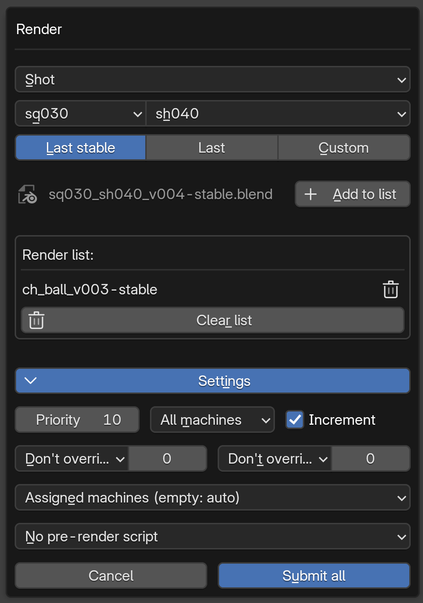

# Rendering (farm)

*[← Documentation index](README.md) · [Version française](farm_fr.md)*

---

Two roles, independent of whether a file is open or not:

- **Monitor**: one per project at a time (`config/.farm/monitor.lock`). Runs the queue — receives render requests, advances each job through its stages, dispatches to available workers.
- **Worker**: any machine with Blender + the addon open. Registers itself, sends a heartbeat, executes the renders assigned to it as a headless Blender subprocess.

A job goes through: `queued → setup → render → checks_images (ffmpeg check) → compilation (ffmpeg video assembly) → finished/failed → archived`. Every stage has its own dedicated failure (`*_failed`), never blocking for the other jobs in the queue. Launching the monitor checks for `ffmpeg` upfront (this machine's PATH, or the explicit path set in Preferences → FFmpeg path, for a Blender launch that doesn't see PATH properly — a sandboxed runtime such as Steam's, for instance) and warns (Cancel / Continue anyway) if it's missing — otherwise that failure would only surface later, silently, per job.

Submission (the "Render" panel, or a per-file button): priority (higher goes first, back to 10 on every submit; equal priority: oldest first), render mode, increment (systematic new output folder, or reuse), frame range with relative override (`s+10`, `e-5`...), targeted machines (empty = auto), pre-render script preset -- the dialog opens on the project's own (Edit project → *Pre-render*, "No pre-render script" by default), never on the one picked last time.



**Pre-render presets**: any `.py` or `.json` file dropped in `config/presets/` (except `asset_file_preset.py`) shows up in the submission's preset list, and is applied by each worker right before rendering -- on top of the file's own settings, never saved back into it. A `.py` defines `override(scene, job_data)` (`job_data` is the job's JSON, read-only use); a `.json` is a flat map of dot-notation paths from the scene:

```python
def override(scene, job_data):
    scene.render.engine = "CYCLES"
    scene.cycles.samples = 64
    scene.render.resolution_percentage = 50
```

```json
{"render.engine": "CYCLES", "cycles.samples": 64, "render.resolution_x": 1280, "render.resolution_y": 720}
```

A preset that can't be applied **fails that machine's render** instead of rendering with the file's own settings (burn-in, full resolution...): a `.py` that raises, a preset name that no longer exists, an unreadable `.json` -- logged as a farm error, the job carries on with its other machines or fails. Only an invalid `.json` key is just skipped (the others still apply). Each worker reads the job without taking its lock: all of a job's machines start at once, and the lock they fought over used to make some of them render without the preset.

The preset is also applied once at setup, in that throwaway session (never saved either), to read what the render will actually produce: the output format (what the frame check and compilation look for) and the fps (what the compilation encodes at) come from the file *plus* its preset. Mind version-specific identifiers when workers run different Blender versions: EEVEE is `BLENDER_EEVEE_NEXT` on 4.2–4.5 but `BLENDER_EEVEE` from 5.0 -- a `.py` preset can pick whichever exists.

**Render modes**:
- `All machines` (default): the frame range is cut into **chunks** (Edit project → *Chunk size*, 5 frames by default, fixed for a render once it's sent out). Every free machine opens the file once and takes the next free chunk, again and again until none is left; a machine added mid-render gets the chunks still free. A chunk is taken by creating its claim file in `config/.farm/queue/claims/<job>/` -- only one machine can create it -- and each frame is written under a temporary name then renamed: a frame under its final name is always whole, two machines never write the same frame.
- `Single`: one machine at a time over the whole range.

**Which job a free machine gets**: the jobs in priority order (equal priority: oldest first), renders already started included: a free machine goes to the first one with a chunk free that it's allowed on (no machine assigned, or in its list) and never failed. As many machines are sent as there are chunks free -- not ten machines for two chunks. A machine stays on its render while it has chunks to take, so a higher-priority job set up meanwhile would only get the machines free at that moment: when no free machine is left for it, machines on lower-priority renders give way once their chunk in progress is done (nothing lost, the chunk is finished first), the lowest priority first -- never for an equal priority, and never from a render with less than 3 min left (its missing frames at its pace over its machines; Edit project → *Priority switch*, 0 = it always switches). While jobs wait for their setup, the farm host's own worker (when it's also the monitor) takes no new render: the setup waits for that machine's render to end, which held the whole queue back for hours. Unless machines sit idle with nothing else to take: then the setup runs alongside the host's render (the file loaded twice for the setup's length).

**When a chunk fails**: a machine whose render fails on a chunk (Blender error, crash, a frame stuck far longer than usual) gets no more of that job; its chunk goes back to the others, the frames it finished are kept. The same chunk failing on **3 different machines** is the frames themselves, not the machines (a frame too heavy for the RAM, a cache or texture missing there...): the render stops and the job fails with "frames X-Y failed on 3 machines (...)". The job's detail shows the chunks in progress (which machine, which frame), the failed ones and why it stopped. Each failure says what the render died of, read from the end of its log: *out of memory* (RAM or VRAM), *Blender crashed*, *Python error*, *file not found*, Blender's last *Error:* line, or else its exit code -- with the frame it was on and the line itself ("Why: frames 401-405 on PC-03: out of memory (frame 402): Error: run out of memory!"); "frames X-Y failed on 3 machines" ends with the last one. The machine's own detail (Workers tab) shows it too, next to its last render.

**Stuck frame**: a frame taking far longer than usual on a machine (Edit project → *Stuck frame*: 5 times its usual time by default, 5 min at least, 0 = never) is taken for a hang -- the worker stops that render, its chunk goes to another machine, and the job detail names the frame. Measured by each machine on its own clock: never one machine's time against another's.

**Mixed versions**: a worker on an addon older than 1.1.0 gets no render at all (it doesn't know chunks and would write frames twice): it shows in Worker details as "too old", and in the log once. Update every machine of the farm.

A multishot block (see [Shot blocks (multishot)](multishot.md)) submits and behaves exactly like any file from this side — the split into one job per shot happens automatically once the file is picked up, not something you do differently at submission.

**Time left and time per frame**: each worker notes when it writes each frame. The time left is the frames still to render over the pace of the machines rendering the job *right now* -- each one at the speed of its last 10 frames, a machine that just joined at the job's average -- so it follows a machine joining or leaving at once. Until a first frame is timed (or with workers not updated yet), it falls back on elapsed time over progress. The job's detail shows the average time per frame and each machine's; the Workers tab, each machine's pace on its render; the render history keeps the average.

**Before it starts**: a job set up and waiting for a worker shows its number of frames, and an estimate when the file has a past render with the same pre-render script -- its frames at that render's time per frame: `≃ 2h00m on one machine, 30m00s on 4` (the live workers), with the render it's based on in the job's detail. A file never rendered has none; one rendered only before 1.1.7 (when the script wasn't recorded yet) gets the latest one, marked *preset unknown*. A rough figure: scenes change between versions.

**Output folders**: a shot renders into `renders/<seq>/<shot>/<version>_<n>/`, an asset or library file into `renders/assets/<prefix>/<asset>/<version>_<n>/` (or `renders/library/...`).

**Thumbnail**: once a render is compiled, the farm writes a thumbnail next to its folders — `renders/<seq>/<shot>/<seq>_<shot>_thumbnail.jpg`, `renders/assets/ch/ch_bob/ch_bob_thumbnail.jpg` (middle frame, 240 px on its longest side by default — "Thumbnails" in Edit project), used by the production snapshot. Made by Blender itself; only a multilayer EXR needs ffmpeg.

**After the render**: once a job is finished (frames checked, video compiled), its render shows up in Project monitoring's "Farm" column (which also shows each file's job while it's queued or rendering) until someone marks it checked (video button to play it, check mark button to mark it), which also archives the job (it leaves the Farm monitoring list) -- see [Tracking & reviews](tracking-and-reviews.md). A finished job (render, block split, preview) leaves the Farm monitoring list on its own 24 h after ending (`"auto_archive_hours"`, 0 = never); a failed one stays until someone archives it.

**Rushes for the edit**: the edit links to `editing/rushes/`, where each video keeps one name whatever its version -- `sq100/sq100_sh030.mp4`, `assets/ch/ch_bob.mp4` (one folder per sequence / asset prefix, as the snapshot's videos zip) -- so a new render replaces the old one under the editor's feet, no relink. Two ways in: *Push rushes to editing* (Project panel and Pipeline menu, under *Render*: the sequences ticked -- all by default -- and *Assets & libraries*, each one's latest video; only what changed since the last push is copied) and, in the *Render checked* dialog, *Push to editing* (that render's video; off by default: checked means watched, not approved). A video is copied beside its rush then swapped in at once, never half written; one open in the editing software (Windows refuses the swap) keeps its old video and is listed in a popup and the log -- push again once it's closed. `editing/rushes/rushes.json` says, per rush, which render it is (`source`, `render` folder, the `.blend` `version` it was rendered from), who pushed it and when.

**Frame check, compilation and preview progress**: these ffmpeg passes show a % in Farm monitoring (the job's line, with a time left at its pace so far, the farm host's or the compiling worker's row, and the job's detail). ffmpeg writes its progress (`-progress`) to `request_<job_id>.progress` next to the job's log: frames done over the job's range for the frame check and the compilation; for a preview -- whose sources are videos, their frame count unknown -- the time already encoded over the total duration of its videos, which ffmpeg writes at the top of its pass. A preview compiled by a worker on an older addon shows none.

**Logs**: every farm process writes its output to a file in `config/.farm/queue/requests/` -- `request_<job_id>.log` for a job's setup, frame check, compilation and preview, plus one `request_<job_id>_<machine>.log` per worker render. Deleted when the job ends well, kept (and archived with the job) when something failed: that's the first place to look. A kept log is trimmed once its job is over -- Blender's per-frame progress lines dropped but for the last ones, then only its start and end kept past 256 KB (a failed render's log reached 36 MB) -- and archived logs are deleted after 14 days (`"farm": {"archive_log_days": ...}` in `project_config.json`, 0 = never).

**Re-submitting a shot already in the farm**: a job is identified by file + preset + shot, so a new request for a shot whose previous job is still in flight (queued, waiting for a worker, rendering...) waits until that job ends, then goes out by itself. Farm monitoring shows it as "waiting for this shot's job in progress (stage)"; clicking it opens the job holding it back.

**Retry**: a failed job has a retry button (in the Farm monitoring list and its detail). It restarts from the stage that failed -- same output folder, frames and preset, no new version. A render only renders the missing frames -- and if every frame is already on disk (the other machines finished them), the render is skipped altogether: straight to the frame check and compilation, no worker needed. A render retry keeps clear of the machines that failed it ("Failed on" in the job detail), unless they're the only workers left. A job whose `.blend` no longer exists (replaced by a newer version, moved) can't be retried -- submit the current version -- and fails at once instead of being sent to every worker.

**Recompile**: a finished job has a recompile button (list and detail) that compiles its video again from the frames already on disk -- ffmpeg only, on the monitor's machine, no render and no worker. The render goes back to "to check" once done. Useful after replacing a few frames by hand, or after changing the ffmpeg preset.

**Network drop-outs**: a worker or the farm monitor keeps its role through a short loss of the share (NAS asleep, network reconnecting, a PC waking up): it's only given up once its own file has been gone for about 30 s with the share reachable, or another Blender took it over -- each logged in the pipeline log. Meanwhile it just waits; it carries on once the share is back.

**After a crash**: if the Blender running the farm monitor or a worker crashes, its jobs are picked up again on relaunch -- a step still running is waited for, a step cut short is redone. A machine that drops out of a render (its Blender crashed, it stopped responding for 3 minutes, it was switched off) lets go of its chunk: the frames it finished stay, the others go to any machine, the job carries on. Only a real render failure counts against a machine -- not a crash of its Blender, a machine switched off, a stop or a cancel.

**Stopping a worker**: "Kill this worker" on a machine that's rendering asks what to do with its render: *After this frame* (the frame it's on is written, then the render and the worker stop) or *Stop now* (interrupted at once; the frame it was on is lost -- never left half written). Either way its chunk goes to the other machines, never a failure, and the machine can come back to the render once started again. Quitting Blender, or switching to another project, while its worker renders stops the render too (*Stop now*). Any machine can be stopped from any other one too: the pause button on its row in Farm monitoring's Workers tab asks the same question (when it's rendering) and takes effect on that worker's next tick, about 10 s; the row then reads "stops after this frame", then "stopped".

**Cancel**: a job's Cancel stops it on every machine (requests not picked up yet withdrawn, renders killed) and ends it as cancelled -- even with no machine on it at that moment. One machine's Cancel (its row in the Workers tab) takes that machine **off the job** to free it for another one: its render stops, its chunk goes to the others, and it isn't sent back to that job while another job wants it -- only if it would otherwise stay idle. Never a failure.

The whole farm coordinates over the shared project drive, no SSH or direct machine-to-machine connection — see [Design choices](design.md#no-ssh-push-pull-coordination-over-the-shared-drive) for the push-pull mechanism and its trade-offs.

---

**See also**: [Interface](interface.md#overview-windows) for the Jobs/Workers dashboard · [Sessions and locking](sessions-and-locking.md) for the heartbeat/expiration pattern workers and the monitor also follow.
