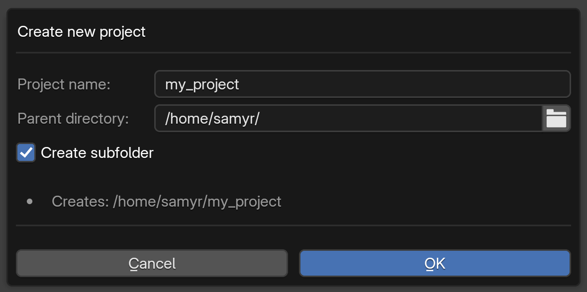
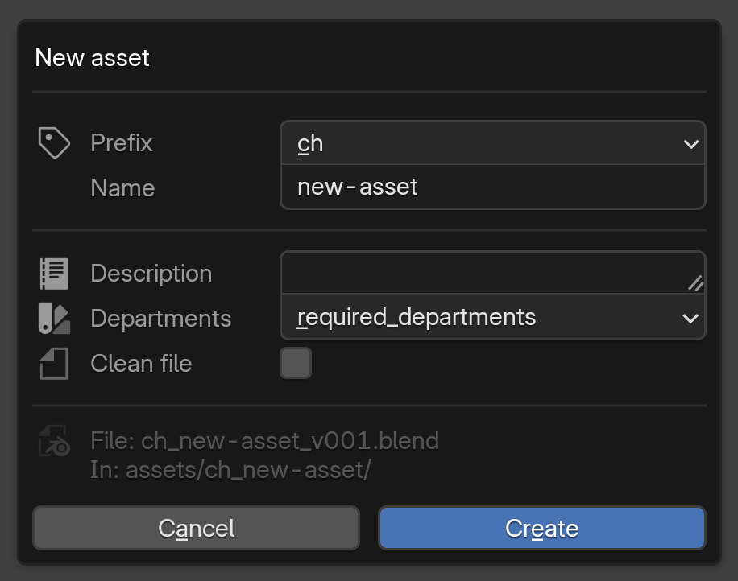
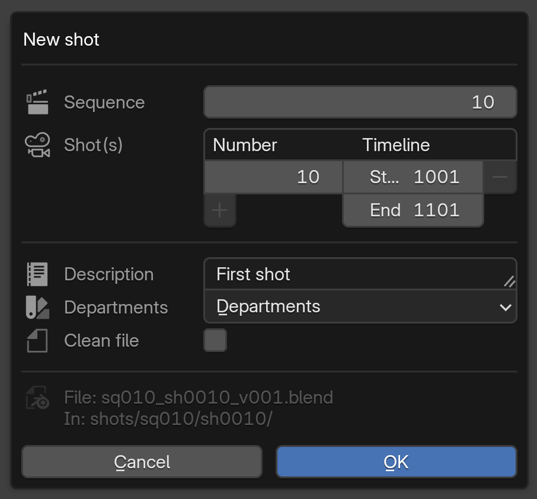
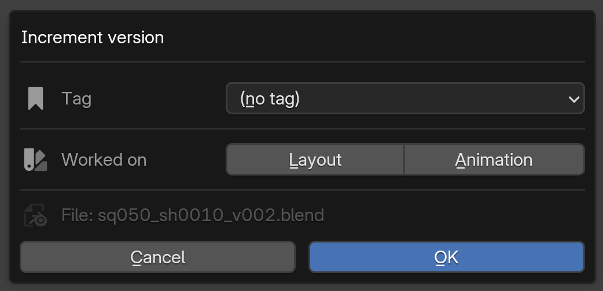

# Getting started

*[← Documentation index](README.md) · [Version française](getting-started_fr.md)*

---

This page is deliberately not a concepts reference — it's what you actually click, in order, the first time. Each step links to the concept page that covers the reasoning and the edge cases.

## 1. Create a project

Top bar menu (or the Project panel) → **New project**. Pick a folder, give it a name, and the wizard builds the folder structure for you (`assets/`, `shots/`, `library/`, `renders/`...) — nothing to set up by hand. Full structure: [Project structure, naming, batch creation](project-and-naming.md).

 

## 2. Create your first asset or shot

**New asset** / **New shot**, type a name — that's it. The addon builds the correct filename (`ch_bob_v001.blend`, `sq010_sh010_v001.blend`...) and creates its tracking folder next to it. You never type a version number or a padded digit by hand. Several to create at once? **Batch create from CSV** does the same thing from a spreadsheet.

 

## 3. Work, save, let the addon handle versions

Use Ctrl+S like you always would. Most of the time nothing visible happens — the addon is quietly tracking what you touched. The first time you open a file on a given day, it moves you to a new version behind the scenes, automatically, so you're never editing yesterday's file by accident.

The only time you'll see a popup is when a real decision needs a human — for example, saving over a version already marked `-stable`. Read it, pick an option, keep working. [Versions: wip and stable](versions.md) covers exactly when and why these show up.

## 4. Mark something as done: `-stable`

Once an asset or shot is in a state others can safely build on, use **Mark as stable** instead of just incrementing. This is what a link elsewhere in the project actually pulls — plain work-in-progress versions are never referenced across files.

## 5. Leave notes, todos, and fix requests

The **Tracking** panel on any file lets you jot a note, add a todo, or flag something to fix — no spreadsheet, no separate review tool. See [Tracking & reviews](tracking-and-reviews.md).

## 6. Render

Hit **Render** on any file, pick a frame range (or leave the defaults), and submit. Any machine that has the project open with Blender running can pick it up — check progress from the farm dashboard. Nothing to install beyond Blender itself. See [Rendering (farm)](farm.md).

## Working with someone else

Nothing to configure. If a teammate already has a file open, you get a clear notice and the file opens read-only instead of silently conflicting — same shared folder, no server, no setup. Details: [Sessions and locking](sessions-and-locking.md).

---

Once this feels natural, the [documentation index](README.md) covers the reasoning, the edge cases, and the exact JSON behind each of these steps.
