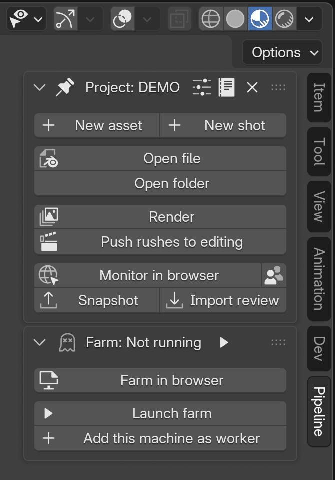
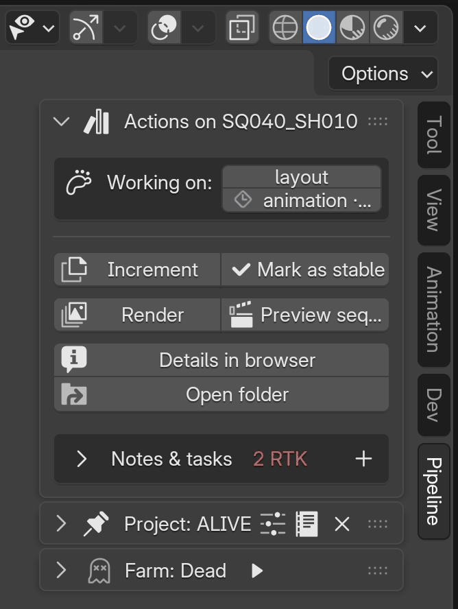
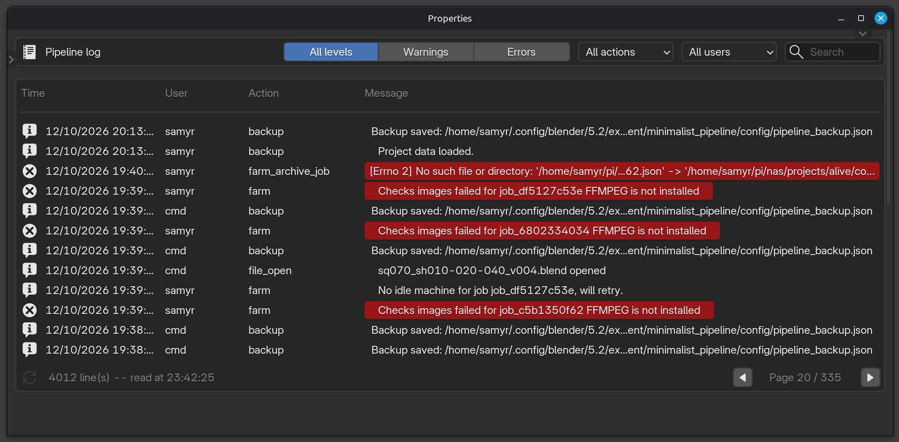
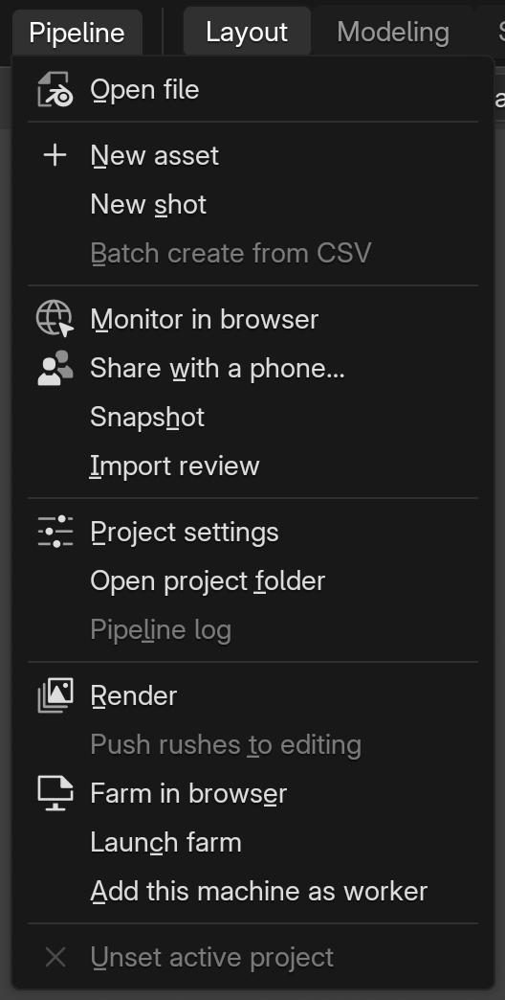

# Interface

*[← Documentation index](README.md) · [Version française](interface_fr.md)*

---

All the panels live in the 3D viewport sidebar (`N` > **Pipeline** tab). Each has its own collapsible header — click to fold it away without losing it, same as any native Blender panel; Farm starts folded, Project and File start open.

| Panel | Always visible? | Content |
|---|---|---|
| **Project** | Yes | Active project (name, folder), New asset / New shot (side by side when the sidebar is wide enough) / Open file / Open folder / Render buttons, Push rushes to editing under Render ([Rendering (farm)](farm.md)), Monitor in browser (the live page, see [Tracking & reviews](tracking-and-reviews.md)), Snapshot / Import review (side by side too). Collapsible list of other known projects (activate / edit / remove each), New project / Find existing project. |
| **File** | If the open file belongs to the active project | One panel for both assets and shots — worked-this-session department toggles (if the file has required departments), Increment and Mark as stable (hidden once the open file already is the stable version) side by side when the sidebar is wide enough, then Render -- for a shot, next to Preview block / Preview sequence --, Details (the live page opened on this file: its departments, renders, links), Open folder. Edit block structure is in the Pipeline menu (see [Shot blocks (multishot)](multishot.md)). Further down, inline (not a separate panel): its notes/todos/rtk, with direct editing/validation. See [Tracking & reviews](tracking-and-reviews.md). |
| **Farm** | If a project is active | Header: monitor status (not running / running / stale / dead) -- click it to open the live page's Farm tab -- and a Launch button. Body: the "Farm in browser" button first (the live page's Farm tab), the same Launch/Kill, a status detail line, and "Add this machine as worker" / "Stop this worker". See [Rendering (farm)](farm.md). |

 

 

## Overview windows

Reached from the buttons above, not permanent panels: the Pipeline log opens in a window of its own. Project and Farm monitoring are the live page's (*Monitor in browser*, Shift+Alt+P; its Farm tab, Shift+Alt+F): see [Tracking & reviews](tracking-and-reviews.md), "Live page".

- **Pipeline log** (icon in the Project panel's header, next to the project settings; also in the Pipeline menu): a window of its own -- paged to its height, the arrow keys and the wheel turn its pages, F5 reads it again --, the project's log, newest first, filterable by level (all, warnings, errors), action, user and text; times read day/month/year. Click a line to copy it whole (time, level, user, action, message and any extra field). The archive button at the bottom, next to refresh, moves the current log into `config/logs/archives/` right away (after a confirmation), as it is on its own once it reaches 5 MB: the log starts again empty, nothing is deleted.

 

## Top bar menu

A "Pipeline" menu appears in the top bar (next to File/Edit/Render...), so you don't have to open the sidebar for common actions — same content as the panels above (create, open, render, save/increment/mark-stable on the current file, prod snapshot export and review import, farm roles), condensed into a single menu. It also holds what the sidebar no longer shows: Batch create from CSV, and Edit block structure for an open shot file; the rarely used items (Batch create, Edit block structure, Pipeline log, Unset active project) are greyed out, still clickable.

Under "Open file", a "Recent files" submenu: up to 5 recently opened files — your own, not a teammate's, and never the file already open. Not a separate list: derived from `sessions_log.jsonl` each time, so it's automatically scoped to the active project and can't drift from it. One click reopens, no dialog.

Same row, leftmost — before the Blender icon, before File/Edit/Render, before "Pipeline" too: a red "READ-ONLY" label appears whenever the current file is read-only for this session (`-stable`, locked by someone else, `always_read_only`, or already read-only earlier this same session) — always visible regardless of which sidebar tab is open, right where the File menu's Save button and the top bar's save icon sit, the two ways of saving that don't go through the Ctrl+S guard (see [Known current limitations](limitations.md)). The small arrow right after it opens why (which of the reasons above) and, except when it's someone else's lock, an Increment button to get a writable copy on the spot.

---

**See also**: [Project structure, naming, batch creation](project-and-naming.md) · [Versions: wip and stable](versions.md) for what Increment/Mark as stable actually do.
