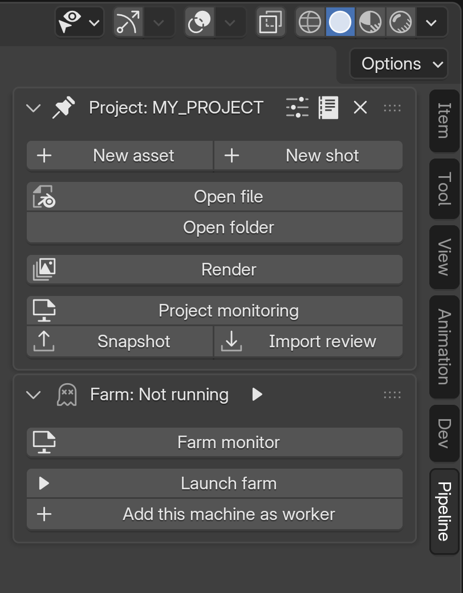
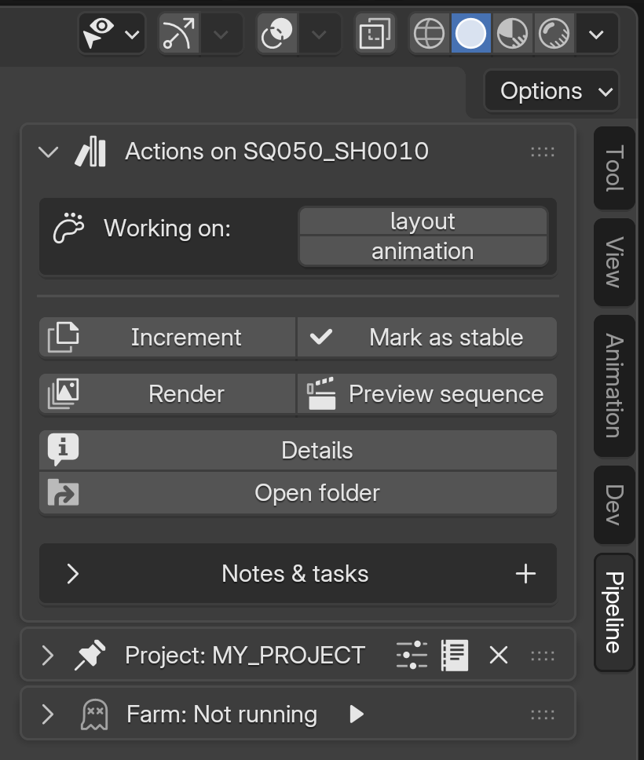
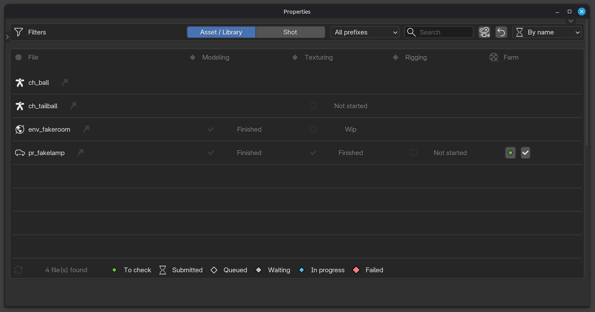
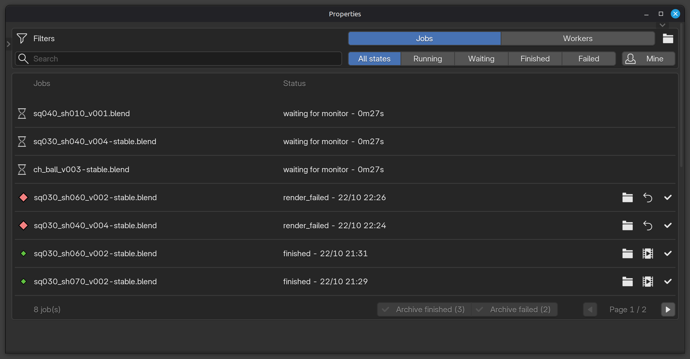
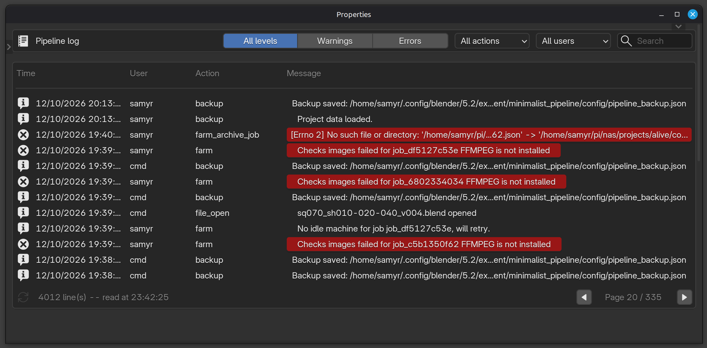
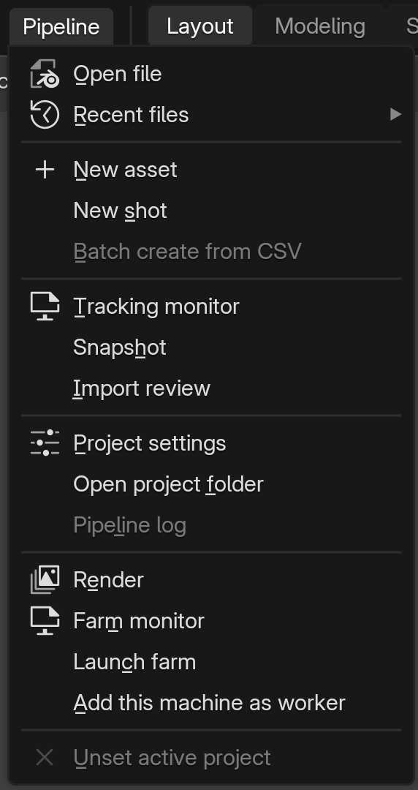

# Interface

*[← Documentation index](README.md) · [Version française](interface_fr.md)*

---

All the panels live in the 3D viewport sidebar (`N` > **Pipeline** tab). Each has its own collapsible header — click to fold it away without losing it, same as any native Blender panel; Farm starts folded, Project and File start open.

| Panel | Always visible? | Content |
|---|---|---|
| **Project** | Yes | Active project (name, folder), New asset / New shot (side by side when the sidebar is wide enough) / Open file / Open folder / Render buttons, Push rushes to editing under Render ([Rendering (farm)](farm.md)), Monitoring button (see below), Snapshot / Import review (side by side too). Collapsible list of other known projects (activate / edit / remove each), New project / Find existing project. |
| **File** | If the open file belongs to the active project | One panel for both assets and shots — worked-this-session department toggles (if the file has required departments), Increment and Mark as stable (hidden once the open file already is the stable version) side by side when the sidebar is wide enough, then Render -- for a shot, next to Preview block / Preview sequence --, Details (Project monitoring opened on this file's detail: its departments, renders, links), Open folder. Edit block structure is in the Pipeline menu (see [Shot blocks (multishot)](multishot.md)). Further down, inline (not a separate panel): its notes/todos/rtk, with direct editing/validation. See [Tracking & reviews](tracking-and-reviews.md). |
| **Farm** | If a project is active | Header: monitor status (not running / running / stale / dead) -- click it to open Farm monitoring -- and a Launch button. Body: the "Farm monitor" dashboard button first, the same Launch/Kill, a status detail line, and "Add this machine as worker" / "Stop this worker". See [Rendering (farm)](farm.md). |

 

 

## Overview windows

Reached from the buttons above, not permanent panels (Project monitoring, the Farm dashboard and the Pipeline log each open in a window of their own):

- **Pipeline log** (icon in the Project panel's header, next to the project settings; also in the Pipeline menu): a window of its own like the two below -- paged to its height, the same keys --, the project's log, newest first, filterable by level (all, warnings, errors), action, user and text; times read day/month/year. Click a line to copy it whole (time, level, user, action, message and any extra field). The Farm job detail has a button that opens it filtered on that job. The archive button at the bottom, next to refresh, moves the current log into `config/logs/archives/` right away (after a confirmation), as it is on its own once it reaches 5 MB: the log starts again empty, nothing is deleted.
- **Project monitoring** (the "Monitoring" button on the Project panel): a window of its own, not a popup -- it stays open while you work, resize it or put it on a second screen; its list is paged by as many rows as the window holds -- resize it and the pages follow, so the footer (refresh, file count, legend) always stays in view. Turn pages with the arrows by "Page 2 / 5" or the Left / Right keys (Ctrl: first / last page); Tab switches assets / shots (jobs / workers in the Farm dashboard); Esc goes back from a detail to the list; F5 reads everything again. These shortcuts can be changed in the addon's preferences (Shortcuts). The sort icon next to the filters orders the list by name, oldest open RTK first, or oldest work first (the file saved longest ago). Ctrl+click on the button opens it on the open file's detail (or says the file isn't one of the project's, with a Back button). Clicking the button again while it's open brings it to the front (Windows: where it is; Linux/macOS: opened again over the old one, same place and size). Opening a file through the pipeline (Open file, its recent files, a file's open button in this window) keeps it open: while it is, those files open without loading their own interface layout -- Blender would otherwise close every window the file doesn't have. Blender's own File > Open still closes it. Underneath it's a Properties editor on its Tool tab: the content comes first -- Blender's active tool isn't shown there, its own Tool sections (Options, Workspace) are pushed out of sight below. The list always shows at least 6 rows (blank ones below), whatever the filters. Content: every file in the project with its status per department, filterable by prefix (assets) or sequence (shots), plus a "Farm" column (the farm renders nobody has checked yet: a video button plays each one, the check mark button marks them checked, archives their farm job and lists all the file's departments as validated now ("render" ticked too) -- untick one to unvalidate it after watching the render; one icon per render: to check, or the Farm popup's icon for its job's stage, details on hover) and a filter to list only those files, a filter for the files with an open RTK (its department's icon is red; an RTK for no department reds every department already started, not the ones not started yet), and a search field (file name or description). It opens at once on what's already known and refreshes in the background ("Scanning project…" in its footer, then a refresh button to re-scan on demand). Clicking a file opens its detail — its thumbnail (from its latest render, see [Tracking & reviews](tracking-and-reviews.md)), description, total logged work time (all versions, everyone summed — see [Design choices](design.md#work-duration-is-logged-never-surfaced-per-person)), the departments required for that specific file with a toggle to validate/unvalidate each one, the last render of each shot (video and folder buttons), the renders waiting to be checked (video, folder and "Checked" buttons) and its jobs still in the farm, full notes/todos, entry creation, and the files it links to / is linked by (see [Link vs Append](linking.md)) — each one clickable to jump straight to its own detail.
- **Farm dashboard** (the Farm panel's button): a window of its own too, same behavior as Project monitoring (the Jobs list paged to the window's height, refreshed every 2 s while open), a folder button next to the view tabs opening `config/.farm/` (queue, workers, logs); two views, *Jobs* (each active job with its current stage and progress -- frames for a render, a % for the frame check, the compilation and a preview -- newest first, filterable by name/shot, state -- running, finished, failed -- and "Mine" for your own submits, a retry button on a failed job, and "Archive finished" / "Archive failed" to clear them all at once; a folder button to open its render folder, an "X" button to cancel an in-progress render, a "✓" button to archive a finished/failed job once it's no longer useful in the list; click a job's name for its detail: stage history with timestamps, frame range, output, format, fps, preset, machines, time per frame (average and per machine), how many frames each machine rendered, and a *Frame* field (held to the render's range) telling which machine rendered a given frame, and the frames around it that machine rendered in a row (also in File details, under the last render: there once the job is archived), split shots -- read once on click, refresh button to re-read, a button to open the job's JSON file, one per log, and Retry on a failed job) and *Workers* (every known machine, idle or what it's currently rendering -- the job's name as in *Jobs*, click it for its detail, same for the farm host's step in progress, also shown under the worker line of the farm host's own machine -- with the same cancel button targeted at that machine: it takes that machine off the job, for another one; a machine that stopped answering stays listed, greyed -- "late", then "silent since" with a button to forget it; click a machine's name for its detail: status, the job and chunk it's on, its pace, its Blender and addon versions -- in red when they differ from the project's or this machine's, "too old" when it gets no render --, renders done and failed since it started, its last render, Stop / Forget and its logs), plus the button to add/remove this machine as a worker. The job detail also shows the chunks in progress (which machine, which frame), the failed ones and why a job stopped.

 

## Top bar menu

A "Pipeline" menu appears in the top bar (next to File/Edit/Render...), so you don't have to open the sidebar for common actions — same content as the panels above (create, open, render, save/increment/mark-stable on the current file, prod snapshot export and review import, farm roles), condensed into a single menu. It also holds what the sidebar no longer shows: Batch create from CSV, and Edit block structure for an open shot file; the rarely used items (Batch create, Edit block structure, Pipeline log, Unset active project) are greyed out, still clickable.

Under "Open file", a "Recent files" submenu: up to 5 recently opened files — your own, not a teammate's, and never the file already open. Not a separate list: derived from `sessions_log.jsonl` each time, so it's automatically scoped to the active project and can't drift from it. One click reopens, no dialog.

Same row, leftmost — before the Blender icon, before File/Edit/Render, before "Pipeline" too: a red "READ-ONLY" label appears whenever the current file is read-only for this session (`-stable`, locked by someone else, `always_read_only`, or already read-only earlier this same session) — always visible regardless of which sidebar tab is open, right where the File menu's Save button and the top bar's save icon sit, the two ways of saving that don't go through the Ctrl+S guard (see [Known current limitations](limitations.md)). The small arrow right after it opens why (which of the reasons above) and, except when it's someone else's lock, an Increment button to get a writable copy on the spot.

---

**See also**: [Project structure, naming, batch creation](project-and-naming.md) · [Versions: wip and stable](versions.md) for what Increment/Mark as stable actually do.
