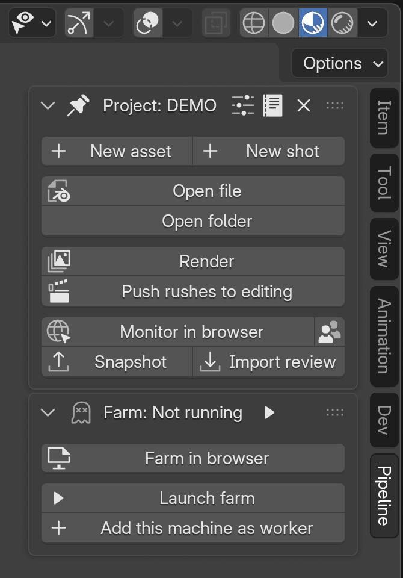
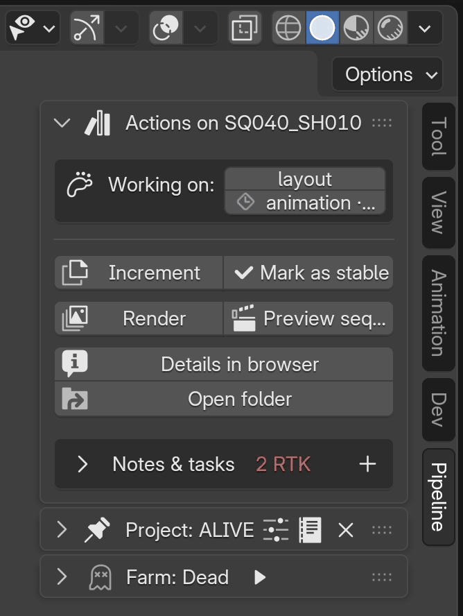
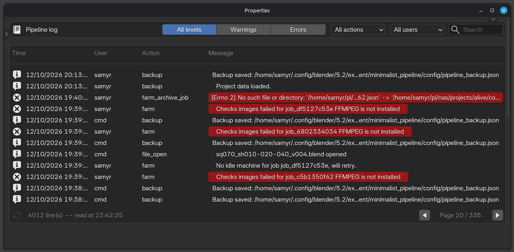
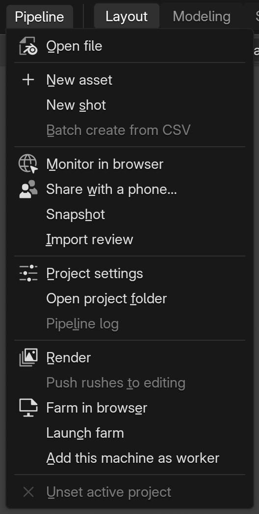

# Interface

*[← Index de la documentation](README.md) · [English version](interface.md)*

---

Tous les panneaux vivent dans la sidebar de la vue 3D (`N` > onglet **Pipeline**). Chacun a son propre en-tête repliable — un clic le replie sans le perdre, comme n'importe quel panneau natif de Blender ; Farm démarre replié, Project et File démarrent ouverts.

| Panneau | Toujours visible ? | Contenu |
|---|---|---|
| **Project** | Oui | Projet actif (nom, dossier), boutons New asset / New shot (côte à côte quand la sidebar est assez large) / Open file / Open folder / Render, Push rushes to editing sous Render ([Rendu (farm)](farm_fr.md)), Open in browser (la page en live, voir [Suivi & reviews](tracking-and-reviews_fr.md)), Snapshot / Import review (côte à côte aussi). Liste dépliable des autres projets connus (activer / éditer / retirer chacun), New project / Find existing project. |
| **File** | Si le fichier ouvert appartient au projet actif | Un seul panneau pour les assets et les shots — boutons bascule "départements travaillés cette session" (si le fichier a des départements requis), Increment et Mark as stable (masqué une fois que le fichier ouvert est déjà la version stable) côte à côte quand la sidebar est assez large, puis Render -- pour un shot, à côté de Preview block / Preview sequence --, Details (la page en live ouverte sur ce fichier : ses départements, rendus, liens), Open folder. Edit block structure est dans le menu Pipeline (voir [Blocs de shots (multishot)](multishot_fr.md)). Plus bas, à même le panneau (pas un panneau séparé) : ses notes/todos/rtk, avec édition/validation directe. Voir [Suivi & revues](tracking-and-reviews_fr.md). |
| **Farm** | Si un projet est actif | En-tête : statut du monitor (arrêté / tournant / périmé / mort) -- un clic dessus ouvre l'onglet Farm de la page en live -- et un bouton Lancer. Corps : le bouton "Farm in browser" en premier (l'onglet Farm de la page en live), les mêmes Lancer/Tuer, une ligne de détail du statut, et "Add this machine as worker" / "Stop this worker". Voir [Rendu (farm)](farm_fr.md). |

 

 

## Fenêtres de vue d'ensemble

Accessibles depuis les boutons ci-dessus, pas des panneaux permanents : le journal du pipeline s'ouvre dans une fenêtre à lui. Le Project et le Farm monitoring sont ceux de la page en live (*Open in browser*, Maj+Alt+P ; son onglet Farm, Maj+Alt+F) : voir [Suivi & reviews](tracking-and-reviews_fr.md), « Page en live ».

- **Pipeline log** (icône dans l'en-tête du panneau Project, à côté des réglages du projet ; aussi dans le menu Pipeline) : une fenêtre à part -- en pages à sa hauteur, les flèches et la molette tournent ses pages, F5 la relit --, le log du projet, du plus récent au plus ancien, filtrable par niveau (tout, warnings, erreurs), action, user et texte ; dates en jour/mois/année. Un clic sur une ligne la copie en entier (date, niveau, user, action, message et tout champ en plus). Le bouton d'archive en bas, à côté du rafraîchissement, déplace tout de suite le log actuel dans `config/logs/archives/` (après confirmation), comme il l'est tout seul une fois à 5 Mo : le log repart vide, rien n'est supprimé.

 

## Menu top bar

Un menu "Pipeline" apparaît dans la barre du haut (à côté de File/Edit/Render...), pour ne pas avoir à ouvrir la sidebar pour les actions courantes — même contenu que les panneaux ci-dessus (création, ouverture, rendu, save/increment/mark-stable sur le fichier courant, export du snapshot de prod et import de review, rôles farm), condensé en un seul menu. Il contient aussi ce que la sidebar n'affiche plus : Batch create from CSV, et Edit block structure quand un fichier de shot est ouvert ; les entrées peu utilisées (Batch create, Edit block structure, Pipeline log, Unset active project) sont grisées, toujours cliquables.

Sous "Open file", un sous-menu "Recent files" : jusqu'à 5 fichiers récemment ouverts — les tiens, pas ceux d'un collègue, et jamais le fichier déjà ouvert. Pas une liste séparée : dérivée de `sessions_log.jsonl` à chaque fois, donc automatiquement cantonnée au projet actif et ne peut pas en dériver. Un clic rouvre, pas de popup.

Même ligne, tout à gauche — avant l'icône Blender, avant File/Edit/Render, avant "Pipeline" aussi : un label rouge "READ-ONLY" apparaît dès que le fichier courant est en lecture seule pour cette session (`-stable`, verrouillé par quelqu'un d'autre, `always_read_only`, ou déjà en lecture seule plus tôt dans cette même session) — toujours visible quel que soit l'onglet de la sidebar ouvert, là où sont le bouton Save du menu File et l'icône save de la barre du haut, les deux façons de sauvegarder qui ne passent pas par la garde Ctrl+S (voir [Limites connues actuelles](limitations_fr.md)). La petite flèche juste après ouvre la raison (laquelle des raisons ci-dessus) et, sauf si c'est un verrou posé par quelqu'un d'autre, un bouton Incrémenter pour obtenir une copie modifiable sur-le-champ.

---

**Voir aussi** : [Structure de projet, nommage, création en masse](project-and-naming_fr.md) · [Versions : wip et stable](versions_fr.md) pour ce que font vraiment Increment/Mark as stable.
