# The live page (2.0)

*[← Documentation index](README.md) · [Version française](live-page_fr.md)*

---

Since 2.0 the live page replaces the Project monitoring and Farm monitoring windows of 1.x. Blender serves it to your browser (Project panel or Pipeline menu › *Monitor in browser*, Shift+Alt+P; the Farm panel's *Farm in browser*, Shift+Alt+F; a file's *Details in browser* opens it on that file). It is the same page as the [production snapshot](tracking-and-reviews.md), kept up to date while Blender runs. What it shows and how a review works are described in [Tracking & reviews](tracking-and-reviews.md). This page is a tour of its tabs.

The screenshots come from the demo project in `tests/fixtures/` (the farm and the history are made up).

 

## Shots and Assets

- **Left**: the tree of sequences and files, each with its progress.
- **Middle**: the list, a row per file, with a diamond per department.
- **Right**: the selected file's detail. Its side tabs are:
  - **Review**: the player and the departments.
  - **Notes**: the file's threads.
  - **Links**: what it links and what links it.
  - **Versions**: the chain of its versions, with branches and conflicts shown.
  - **Render history**: grouped by version.
  - **Files**: who saved last, and the work time to the half hour.

The page opens at once: while Blender reads the project, a line along the top says *Reading the project: 142 / 480 folders* and the figures are partial. Opening a file that is open in another Blender (another machine) asks first, naming who has it, on which machine and which version.

From the page you can:
- Write retakes, remarks and **to-dos**.
- **Reopen** a closed retake or to-do.
- Edit or delete your own notes.
- Push any render to the edit (*rushes*).

What others do shows up as **notifications** (the bell): toasts as they arrive, and the system notification when the page is in the background.

## Search (Ctrl+K)

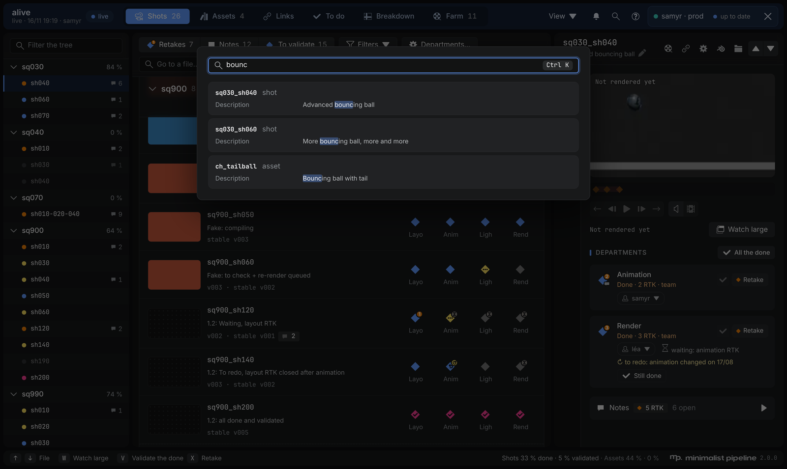

Every word you type is looked for in each file's:
- name and description
- notes, retakes, to-dos and replies (their text and author)
- assignees and departments
- reasons it is waiting
- the render presets its renders used

Accents are ignored. Results are listed under their file, and opening one goes to the tab that shows it.

## To do

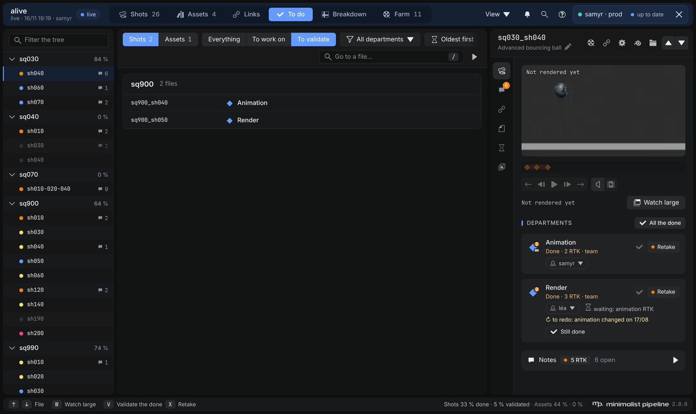

Each file's required departments that are not validated yet, with why one waits (Waiting, To redo, RTK).
- **Show**: *Everything*, *To work on* or *To validate*. The default depends on your role: the team gets *To work on*, the top role *To validate*.
- **Narrow it down** to shots or assets, one department, and one person's files (yours by default when something is assigned to you).
- **Oldest first**: the files that have waited longest come first.
- **Copy**: puts the list in the clipboard as text.

## Breakdown

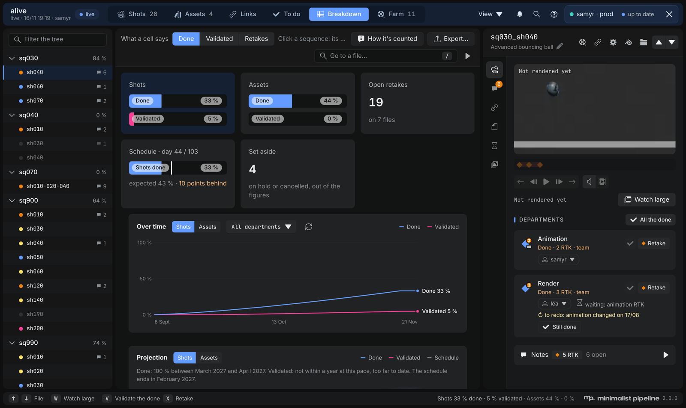

The figures per section, the schedule's pace, then:

- **Over time**: Done and Validated day after day, for all departments or one. The points are in `config/logs/progress.json`:
  - Today's point is written by a snapshot export and while the live page runs.
  - The previous day's point is corrected by the first Blender of the next day.
  - *Migrate old data* rebuilds the days before the log existed.
- **Activity**: what was worked on, not only what was finished. Each day is a column of diamonds, and each diamond is a number of files (sessions saved, by the departments ticked) or of hours. Hours are everyone's, together, never per person (see [Design choices](design.md)).
- **Projection**: where the current pace leads. It is drawn as a cone between the pace of the last 30 days and that of the last 90, next to the schedule (Edit project › Schedule). It gives months, never a day, and nothing past a year.
- **Export…**: the whole project as a spreadsheet (`.xlsx`, written by the page, offline too). It has these sheets: Sequences, Shots, Assets, Retakes, To validate and Over time.

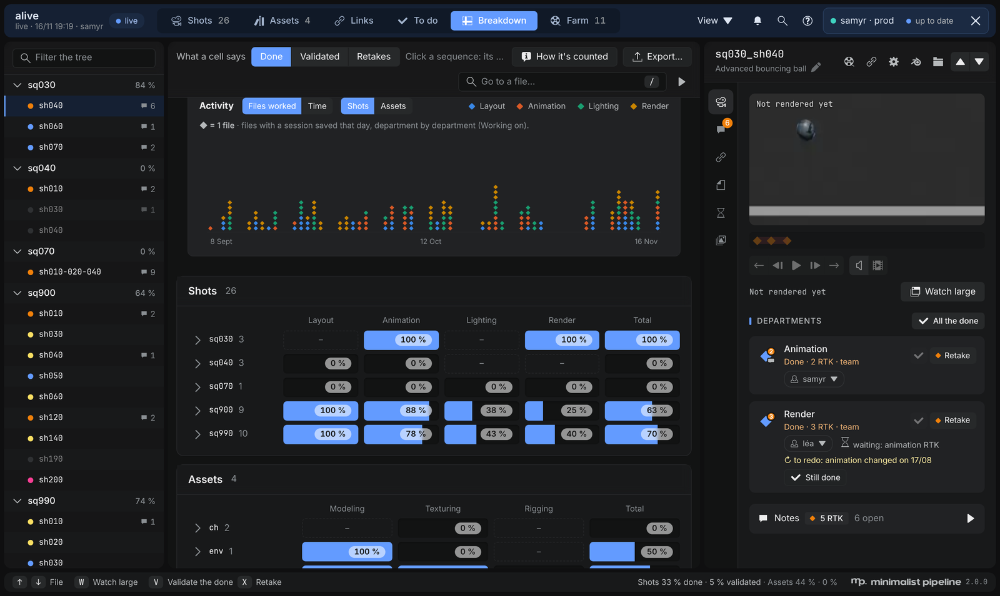

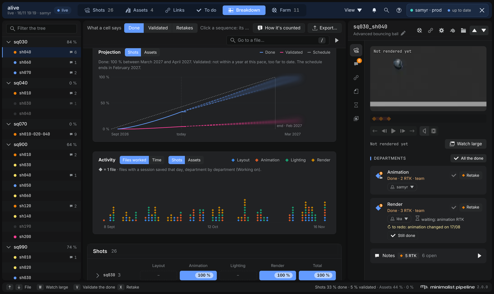

## Farm

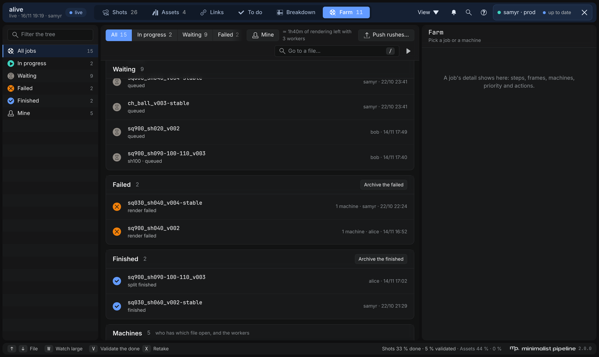

The farm's jobs by state: in progress, waiting, failed and finished. The rendering time left is shown above the list. A click on a job opens its detail:
- its steps, frames, machines and who sent it
- its priority (− / +)
- *Cancel*, *Retry*, *Archive*, *Recompile*, and *Remove from the queue* while nothing has rendered yet
- its file, folder and logs

On top:
- **This machine**: *Make it a worker* / *Stop being a worker*.
- **The farm host**: *Launch the farm*, *Take the farm over* (when it's stuck, asked twice) and *Stop the farm* (asked twice; the renders running finish, the queue is kept).

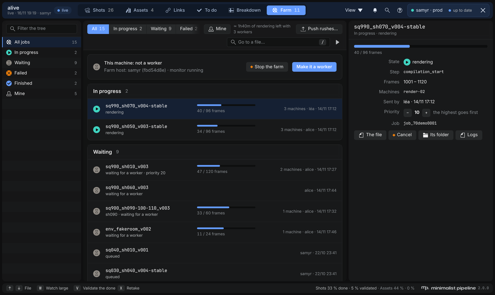

**Machines**, under the jobs: a node per machine. Each shows who uses it and the project files open in its Blenders (a click opens one), then its worker's state. It shows who works on what, never since when.

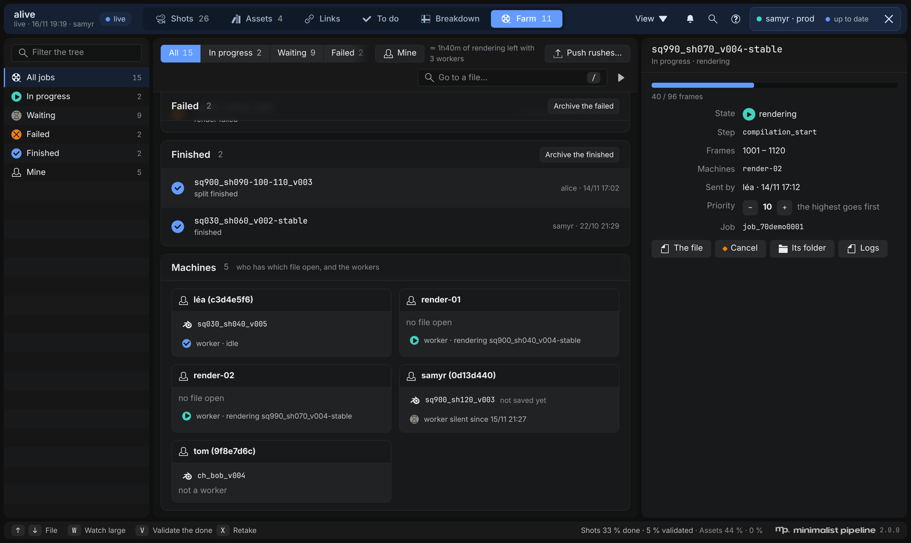

**Render**: a file's detail and the page's *Render* form send a file to the farm the way Blender's Render dialog does: a department, then its preset. In Blender, the File panel's Render also offers **Where**:
- *Farm*
- *Local · playblast*: renders here, now, outside the queue.
- *Local · viewport*: draws each frame from the file's 3D view.

See [Farm](farm.md).

## On a phone

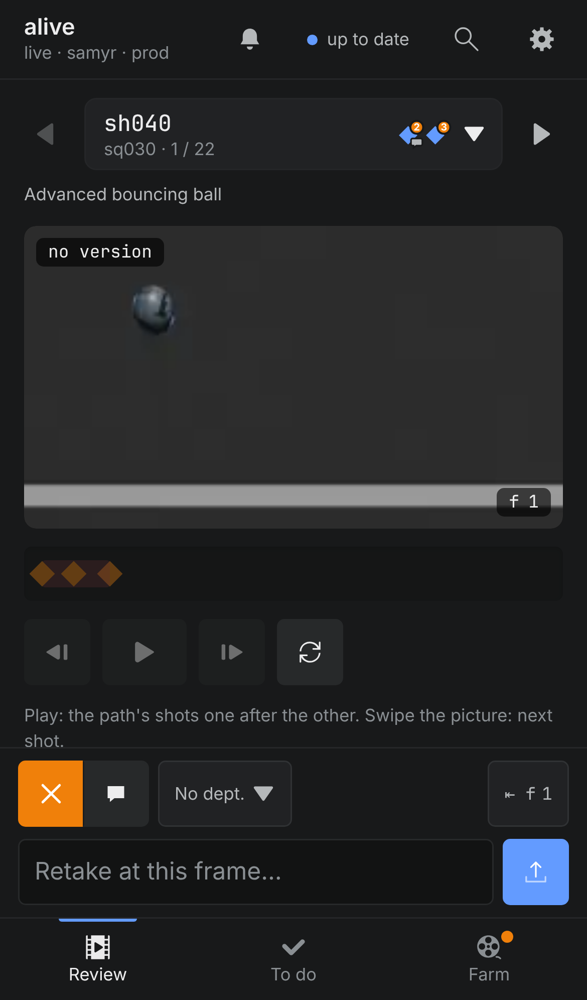 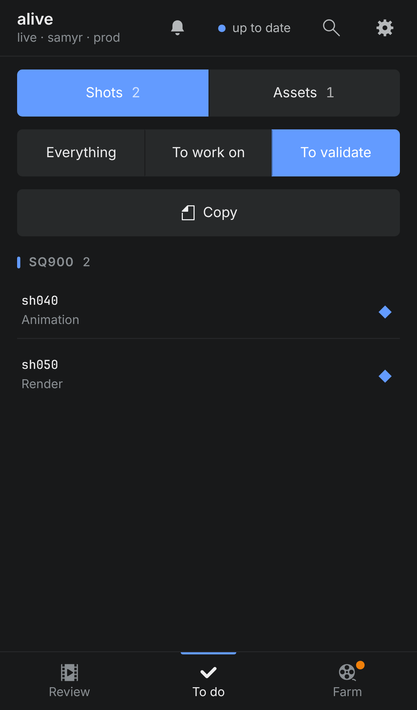 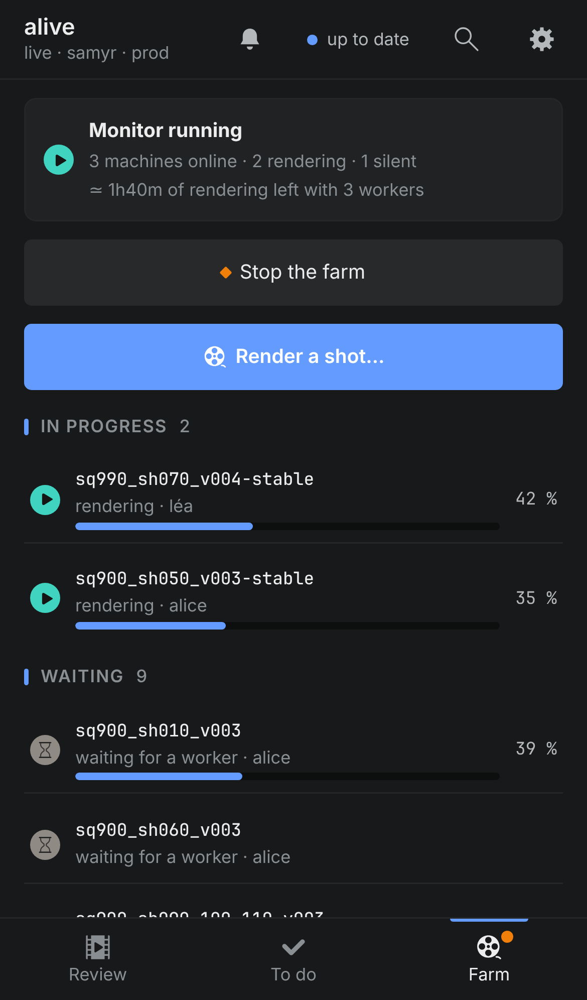

*Share with a phone…* (Pipeline menu, or the icon beside *Monitor in browser*) gives someone a time-limited access with a QR code.

On the phone they get **Review**, **To do** and **Farm** tabs. Reviewing, they write retakes, remarks and to-dos, mark a retake fixed or a to-do done, and reopen a closed one. The farm is read-only unless the access allows driving it (launch, stop, renders, priorities). Nothing is ever opened on the machine serving the page.

## View menu

From the page's View menu:
- **Interface scale**: 0.5 to 1.5.
- **Theme**: Dark, Light or System.
- **Language**: Automatic (Blender's, else the browser's), English or Français.
- *Share with a phone…* and *Export a snapshot…* (live only).
- **Guided tour**: shown once by itself to beginners (Preferences › Experience).
