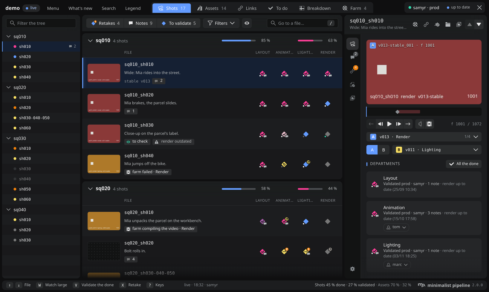

# The live page (2.0)

*[← Documentation index](README.md) · [Version française](live-page_fr.md)*

---

Since 2.0 the live page replaces the Project monitoring and Farm monitoring windows of 1.x. Blender serves it to your browser (Project panel or Pipeline menu › *Monitor in browser*, Shift+Alt+P; the Farm panel's *Farm in browser*, Shift+Alt+F; a file's *Details in browser* opens it on that file). With *Open the live page* ticked in the addon's preferences, it opens by itself when Blender starts with a project, or when another project becomes active -- once: not when this Blender or another one on the machine serves it already. It is the same page as the [production snapshot](tracking-and-reviews.md), kept up to date while Blender runs. What it shows and how a review works are described in [Tracking & reviews](tracking-and-reviews.md). This page is a tour of its tabs.

The screenshots come from the demo project in `tests/fixtures/` (the farm and the history are made up).

 

## Shots and Assets

- **Left**: the tree of sequences and files, each with its progress.
- **Middle**: the list, a row per file, with a diamond per department. To keep it light:
  - a state's words (*Validated · 1 note*) show on the row hovered or selected, the diamond says the rest; so do Progress's figures and the Renders column's words (its icons stay), a sequence's *Play the sequence* / *+ shot* (its header hovered), the outliner's figures, Breakdown's figures (the bar hovered), the buttons of the detail's departments (the card hovered) and of its notes (Reply, Fixed, the pen: the note hovered) -- faded or folded in, with a mouse only;
  - a file's versions (`v013 · stable v012 · 3 shots`) show on the selected row only;
  - *Progress* is two bars, Done in blue and Validated in pink (their words in the tooltip);
  - a file set aside (*On hold*, *Cancelled*) is hatched;
  - the eye by *Filters* chooses the columns shown: the thumbnails, each department, *Progress*, and *Renders* (the job in the farm with its frames while it renders, a render to check, one outdated; also shown by *Filters › In the farm*, *To check* or *Render outdated*) -- remembered by the browser.
  - *Filters › To check*: the files with a render not checked yet. In the detail, *Render to check* names them, a *Watch* (that version in the player) and a *Checked…* each (an animation playblast and a lighting render aren't watched by the same people); *Checked…* asks, as Blender's Render checked did, which departments the render shows done (one done: validated; one not done: done on the stable) and, live, whether to push its video to editing.
- **Right**: the selected file's detail. Its side tabs are:
  - **Review**: the player and the departments. *Watch large* appears over the video's top right corner when the mouse is on it. Under the video, ◂ ▸ go to the previous and next shot (or file), the frame buttons step a frame. *Watch large*'s *Notes* (the open ones: retakes, remarks, to-dos; those at a frame first) are filtered by type, by version and to those at a frame (*At a frame*), the timeline's marks with them; reviewing, a retake or a to-do is ticked off from its row (✓ on hover), and a render to check has its *Checked…* at the panel's top. In its full screen, the departments and notes sit over the video, blurred behind: the tab on their left folds them, the tab at the video's top left hides the header. A note's or a retake's frame (its mark on the timeline, its chip) goes there; live, the Blender that has this file open goes to it too. Reviewing, each department has ✓ (validate) and *Comment* (a retake, a remark or a to-do under it).
  - **Notes**: the file's threads. A retake or to-do closed turns blue with a ✓. A validation's own line (*Validated (prod): lighting, …*) is a record: shown pink, not counted as a note, no reply. Notes sent together (a review imported, or a sitting on the live page) are grouped under one header -- who, when, how many -- as in Blender; live, a sitting is renewed after 15 minutes, at the next file selected. With notes written on two versions or more, a menu keeps one version's (the timeline's marks too).
  - **Links**: what it links and what links it.
  - **Versions**: on top, its files (wip, stable, who saved last, who has it open, the work time to the half hour); then the chain of its versions, with branches and conflicts shown; a small diamond in its state's colour before what was worked (yellow), done (blue) and validated (pink).
  - **Render history**: on top, its last renders (▶ watch one, open it in this machine's player, push it to the edit), its farm state and *Render…*; then every render, grouped by version. Each render says its time on one machine (a frame's seconds there, times its frames), its *local* / *viewport* tags for a *Render here*. *Which machine…* (in the head) asks for a render and a frame number and says which machine rendered it, each machine's frames counted under it.
  - At the bar's foot, ⚙ the file's settings: its required departments, set aside.

*Previous* / *Next* (▲ ▼, ↑ ↓; in *Watch large* ← →) go through the list as filtered, and from any other tab (Links, To do, Breakdown) through every file of the same kind. They are greyed at the first and last file. Another file's video starts at its first frame; *Play the sequence* goes on playing from one shot to the next.

A note on a block (a multishot file) can name some of its shots or none: *All shots*, one note on every shot of the block (no copies made).

The page opens at once: while Blender reads the project, a line along the top says *Reading the project: 142 / 480 folders* and the figures are partial. Opening a file that is open in another Blender (another machine) asks first, naming who has it, on which machine and which version.

From the page you can:
- Write retakes, remarks and **to-dos**.
- **Reopen** a closed retake or to-do.
- Edit or delete your own notes.
- Push any render to the edit (*rushes*).

What others do shows up as **notifications** (the bell): toasts as they arrive, and the system notification when the page is in the background.

## Search (Ctrl+K)

Every word you type is looked for in each file's:
- name and description
- notes, retakes, to-dos and replies (their text and author)
- assignees and departments
- reasons it is waiting
- the render presets its renders used

Accents are ignored. Results are listed under their file, and opening one goes to the tab that shows it.

## To do

Each file's required departments that are not validated yet, with why one waits (Waiting, To redo, RTK).
- **Show**: *Everything*, *To work on* or *To validate*. The default depends on your role: the team gets *To work on*, the top role *To validate*.
- **Narrow it down** to shots or assets, one department, and one person's files (yours by default when something is assigned to you).
- **Oldest first**: the files that have waited longest come first.
- **Copy**: puts the list in the clipboard as text.

## Breakdown

The figures per section, the schedule's pace, the table by sequence (shots, then assets), then:

- **Over time**: Done and Validated day after day, for all departments or one. The points are in `config/logs/progress.json`:
  - Today's point is written by a snapshot export and while the live page runs.
  - The previous day's point is corrected by the first Blender of the next day.
  - *Migrate old data* rebuilds the days before the log existed.
- **Activity**: what was worked on, not only what was finished. Each day is a column of diamonds, and each diamond is a number of files (sessions saved, by the departments ticked) or of hours. Hours are everyone's, together, never per person (see [Design choices](design.md)).
- **Projection**: where the current pace leads. It is drawn as a cone between the pace of the last 30 days and that of the last 90, next to the schedule (Edit project › Schedule). It gives months, never a day, and looks no further ahead than a quarter of the time the production has run (three months in: three weeks ahead); past that, it says only that it won't be by then.
- **Export…**: the whole project as a spreadsheet (`.xlsx`, written by the page, offline too). It has these sheets: Sequences, Shots, Assets, Retakes, To validate and Over time.

## Farm

The farm's jobs by state: in progress, waiting, failed and finished. The rendering time left is shown above the list, and each render's under its bar. A click on a job opens its detail:
- its steps, frames, machines and who sent it
- while it renders: the time left and when it should be done, its time per frame, how long it's been on this step, and each machine's time per frame and the frame it's on
- what went wrong, as in Blender's job details: a chunk that failed and why (out of memory, crash...), a frame stuck, the machines taken off it
- its steps, each with the time since the one before
- its priority (− / +)
- *Cancel*, *Retry*, *Archive*, *Recompile*, and *Remove from the queue* while nothing has rendered yet
- its file, folder and logs

On top:
- **This machine**: *Make it a worker* / *Stop being a worker* -- while it renders, a popup asks: *Stop after this frame* / *Stop now* (see [Farm](farm.md), Stopping a worker).
- **The farm host**: *Launch the farm*, *Take the farm over* (when it's stuck, asked twice) and *Stop the farm* (asked twice; the renders running finish, the queue is kept).

**Machines**, under the jobs: a node per machine. Each shows who uses it and the project files open in its Blenders (a click opens one), then its worker's state. It shows who works on what, never since when.

**Render**: a file's detail and the page's *Render* form send a file to the farm the way Blender's Render dialog does: a department, then its preset. Only the presets that fit are offered: a department picked, its own; none, those of no department and those of the file's kind (never a shot department's preset on an asset). When the latest version is the stable, the version is one choice (*Latest, stable*). In Blender, the File panel's Render also offers **Where**:
- *Farm*
- *Local · playblast*: renders here, now, outside the queue.
- *Local · viewport*: draws each frame from the file's 3D view.

See [Farm](farm.md).

## On a phone

  

*Share with a phone…* (Pipeline menu, or the icon beside *Monitor in browser*) gives someone a time-limited access with a QR code.

On the phone they get **Review**, **To do** and **Farm** tabs. A swipe sideways on the video goes to the next or previous shot; a panel (Render, a version…) closes pulled down by its header. The page goes full screen at the first touch; the ⚙ menu leaves it (remembered) or goes back to it -- not on an iPhone, whose browser doesn't allow it. Reviewing, they write retakes, remarks and to-dos, mark a retake fixed or a to-do done, and reopen a closed one. The farm is read-only unless the access allows driving it (launch, stop, renders, priorities). Nothing is ever opened on the machine serving the page.

## Menu

From the page's Menu (top right):
- *Load a review…* and *Choose the videos folder…*.
- *Share with a phone…* and *Export a snapshot…* (live only).
- *Required departments on several files…* (while reviewing).
- **Interface scale**: 0.5 to 1.5, applied when the slider is let go.
- *Fold* / *Unfold the sequences*.
- **Theme**: Dark, Light or System.
- **Language**: Automatic (Blender's, else the browser's), English or Français.
- **Guided tour**: shown once by itself to beginners (Preferences › Experience).
