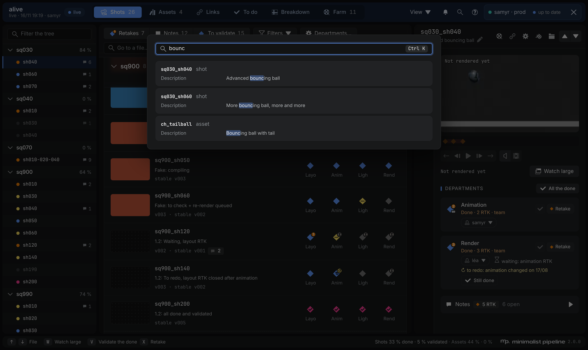
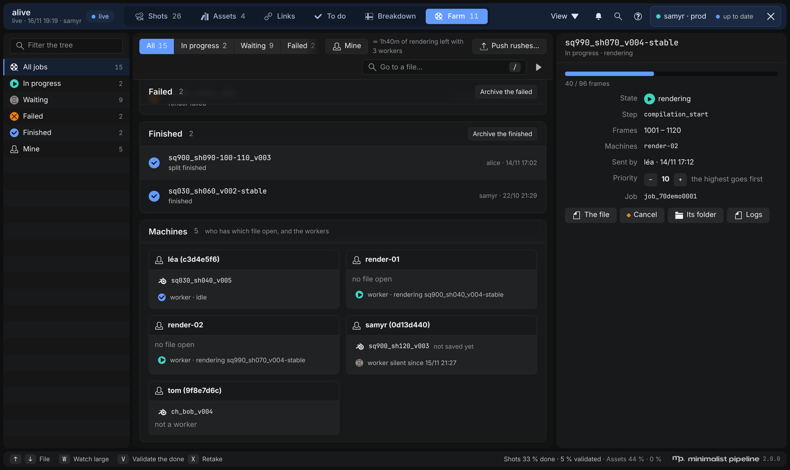

# La page live (2.0)

*[← Index de la documentation](README.md) · [English version](live-page.md)*

---

Depuis la 2.0, la page live remplace les fenêtres Project monitoring et Farm monitoring de la 1.x. Blender la sert à ton navigateur :
- Panneau Project ou menu Pipeline › *Monitor in browser* (Shift+Alt+P).
- *Farm in browser* du panneau Farm (Shift+Alt+F).
- *Details in browser* d'un fichier l'ouvre sur ce fichier.
- Toute seule, avec *Open the live page* coché dans les préférences de l'addon : au démarrage de Blender avec un projet, ou quand un autre projet devient actif -- une fois : pas si ce Blender, ou un autre sur la machine, la sert déjà.

C'est la même page que le [snapshot de production](tracking-and-reviews_fr.md), tenue à jour tant que Blender tourne. Ce qu'elle montre et le fonctionnement d'une review sont décrits dans [Suivi & reviews](tracking-and-reviews_fr.md). Cette page fait le tour de ses onglets.

Les captures viennent du projet de démo de `tests/fixtures/` (la farm et l'historique sont inventés).

 

## Shots et Assets

- **À gauche** : l'arbre des séquences et des fichiers, chacun avec son avancement.
- **Au milieu** : la liste, une ligne par fichier, un losange par département. Pour qu'elle reste légère :
  - les mots d'un état (*Validé · 1 note*) s'affichent sur la ligne survolée ou sélectionnée, le losange dit le reste ; de même les chiffres d'Avancement et les mots de la colonne Rendus (ses icônes restent), *Lire la séquence* / *+ plan* d'une séquence (son en-tête survolé), les chiffres de l'arbre, ceux de Synthèse (la barre survolée), les boutons des départements du détail (la carte survolée) et de ses notes (Répondre, Corrigé, le crayon : la note survolée) -- en fondu ou dépliés, à la souris seulement ;
  - les versions d'un fichier (`v013 · stable v012 · 3 plans`) ne s'affichent que sur la ligne sélectionnée ;
  - *Avancement*, c'est deux barres, Fait en bleu et Validé en rose (leurs mots dans l'infobulle) ;
  - un fichier mis de côté (*En pause*, *Annulé*) est hachuré ;
  - l'œil à côté de *Filtres* choisit les colonnes affichées : les vignettes, chaque département, *Avancement*, et *Rendus* (le job dans la farm avec ses frames pendant le rendu, un rendu à vérifier, un rendu périmé ; aussi affichée par *Filtres › Dans la farm*, *À vérifier* ou *Rendu périmé*) -- retenu par le navigateur.
  - *Filtres › À vérifier* : les fichiers avec un rendu pas encore vu. Dans le détail, *Rendu à vérifier* les nomme, un *Regarder* (cette version dans le lecteur) et un *Vu…* chacun (un playblast d'anim et un rendu lighting ne sont pas regardés par les mêmes personnes) ; *Vu…* demande, comme le Render checked de Blender, quels départements le rendu montre finis (fini : validé ; pas fini : fini sur la stable) et, en live, s'il faut envoyer sa vidéo au montage.
- **À droite** : le détail du fichier choisi. Ses onglets latéraux :
  - **Review** : le lecteur et les départements. *Regarder en grand* apparaît en haut à droite de la vidéo quand la souris est dessus. Sous la vidéo, ◂ ▸ passent au plan (ou au fichier) précédent et suivant, les boutons de frame avancent d'une frame. Les *Notes* de *Regarder en grand* (celles ouvertes : retakes, remarques, à-faire ; celles à une frame d'abord) se filtrent par type, par version et aux seules notes à une frame (*Par frame*), les repères de la timeline avec ; en review, un retake ou un à-faire se coche depuis sa ligne (✓ au survol), et un rendu à vérifier a son *Vu…* en haut du panneau. Dans son plein écran, les départements et les notes passent par-dessus la vidéo, floutés derrière : la languette à leur gauche les replie, celle en haut à gauche de la vidéo masque l'en-tête. La frame d'une note ou d'un retake (son repère sur la timeline, son étiquette) y mène ; en live, le Blender qui a ce fichier ouvert y va aussi. En review, chaque département a ✓ (valider) et *Commenter* (un retake, une remarque ou une tâche sous ce département).
  - **Notes** : les fils de discussion du fichier. Un retake ou une tâche fermés passent en bleu avec un ✓. La ligne propre à une validation (*Validated (prod): lighting, …*) est une trace : en rose, pas comptée comme une note, sans réponse. Les notes envoyées ensemble (une review importée, ou une séance sur la page en live) sont regroupées sous un même en-tête -- qui, quand, combien -- comme dans Blender ; en live, une séance est renouvelée au bout de 15 minutes, au fichier sélectionné suivant. Quand les notes ont été écrites sur au moins deux versions, un menu ne garde que celles d'une version (les repères de la timeline aussi).
  - **Liens** : ce qu'il lie et ce qui le lie.
  - **Versions** : en haut, ses fichiers (wip, stable, qui a sauvé en dernier, qui l'a ouvert, le temps de travail à la demi-heure) ; puis la chaîne de ses versions, branches et conflits visibles ; un petit losange de la couleur de l'état devant ce qui a été travaillé (jaune), fait (bleu) et validé (rose).
  - **Historique de rendu** : en haut, ses derniers rendus (▶ en regarder un, l'ouvrir dans le lecteur de cette machine, l'envoyer au montage), son état dans la farm et *Rendu…* ; puis tous ses rendus, regroupés par version. Chaque rendu donne son temps sur une machine (les secondes d'une frame sur une machine, fois ses frames), ses tags *local* / *viewport* pour un *Render here*. *Quelle machine…* (dans l'en-tête) demande un rendu et un numéro de frame et dit quelle machine l'a rendue, le nombre de frames de chaque machine dessous.
  - En bas de la barre, ⚙ les réglages du fichier : ses départements requis, mis de côté.

*Précédent* / *Suivant* (▲ ▼, ↑ ↓ ; dans *Regarder en grand* ← →) parcourent la liste telle que filtrée, et depuis un autre onglet (Liens, À faire, Breakdown) tous les fichiers du même type. Ils sont grisés au premier et au dernier fichier. La vidéo d'un autre fichier part de sa première frame ; *Lire la séquence* continue de lire d'un plan au suivant.

Une note sur un bloc (un fichier multishot) peut nommer certains de ses plans ou aucun : *Tous les plans*, une seule note sur tous les plans du bloc (sans copie).

La page s'ouvre tout de suite. Pendant que Blender lit le projet, une ligne en haut indique *Reading the project: 142 / 480 folders* et les chiffres sont partiels. Ouvrir un fichier déjà ouvert dans un autre Blender (une autre machine) demande d'abord, en disant qui, sur quelle machine et quelle version.

Depuis la page, tu peux :
- écrire des retakes, des remarques et des **à-faire** ;
- **rouvrir** un retake ou un à-faire fermé ;
- modifier ou supprimer tes propres notes ;
- pousser n'importe quel rendu au montage (*rushes*).

Ce que font les autres arrive en **notifications** (la cloche) : des toasts à leur arrivée, et la notification du système quand la page est en arrière-plan.

## Recherche (Ctrl+K)

Chaque mot tapé est cherché, pour chaque fichier, dans :
- son nom et sa description ;
- ses notes, retakes, à-faire et réponses (texte et auteur) ;
- ses assignés et ses départements ;
- les raisons pour lesquelles il attend ;
- les presets de rendu utilisés par ses rendus.

Les accents sont ignorés. Les résultats sont listés sous leur fichier, et en ouvrir un mène à l'onglet qui le montre.

## À faire

Les départements requis de chaque fichier qui ne sont pas encore validés, avec la raison de l'attente (En attente, À refaire, RTK).
- **Affichage** : *Tout*, *À travailler* ou *À valider*. Le choix par défaut dépend de ton rôle : l'équipe voit *À travailler*, le rôle le plus haut *À valider*.
- **Restreindre** aux shots ou aux assets, à un département, et aux fichiers d'une personne (les tiens par défaut quand on t'a assigné quelque chose).
- **Plus ancien d'abord** : les fichiers qui attendent depuis le plus longtemps passent en premier.
- **Copier** : met la liste dans le presse-papiers en texte.

## Breakdown

Les chiffres par section, l'allure du planning, le tableau par séquence (les shots, puis les assets), puis :

- **Dans le temps** : Fait et Validé jour après jour, pour tous les départements ou un seul. Les points sont dans `config/logs/progress.json` :
  - Le point du jour est écrit par un export de snapshot et pendant que la page live tourne.
  - Le point de la veille est corrigé par le premier Blender du lendemain.
  - *Migrate old data* reconstruit les jours d'avant le journal.
- **Activité** : ce qui a été travaillé, pas seulement ce qui a été fini. Chaque jour est une colonne de losanges, et chaque losange vaut un nombre de fichiers (sessions sauvées, par départements cochés) ou d'heures. Les heures sont celles de tout le monde, ensemble, jamais par personne (voir [Choix de conception](design_fr.md)).
- **Projection** : où mène l'allure actuelle. Elle est dessinée comme un cône entre l'allure des 30 derniers jours et celle des 90 derniers, à côté du planning (Edit project › Schedule). Elle donne des mois, jamais un jour, et ne regarde pas plus loin qu'un quart du temps déjà écoulé de la production (trois mois de prod : trois semaines devant) ; au-delà, elle dit seulement que ce ne sera pas d'ici là.
- **Exporter…** : tout le projet en tableur (`.xlsx`, écrit par la page, hors ligne aussi). Il contient ces feuilles : Séquences, Shots, Assets, Retakes, À valider et Dans le temps.

## Farm

Les jobs de la farm par état : en cours, en attente, en échec et terminés. Le temps de rendu restant est affiché au-dessus de la liste, et celui de chaque rendu sous sa barre. Un clic sur un job ouvre son détail :
- ses étapes, ses frames, ses machines et qui l'a envoyé ;
- pendant le rendu : le temps restant et l'heure de fin prévue, le temps par frame, depuis combien de temps il est sur cette étape, et pour chaque machine son temps par frame et la frame sur laquelle elle est ;
- ce qui s'est mal passé, comme dans le détail du job dans Blender : un morceau en échec et pourquoi (manque de mémoire, crash...), une frame bloquée, les machines retirées ;
- ses étapes, chacune avec le temps depuis la précédente ;
- sa priorité (− / +) ;
- *Annuler*, *Relancer*, *Archiver*, *Recompiler*, et *Retirer de la file* tant que rien n'est rendu ;
- son fichier, son dossier et ses logs.

En haut :
- **Cette machine** : *En faire un worker* / *Ne plus être un worker* -- pendant qu'elle rend, une popup demande : *Arrêter après cette frame* / *Arrêter maintenant* (voir [Farm](farm_fr.md), Arrêter un worker).
- **L'hôte de la farm** : *Lancer la farm*, *Reprendre la farm* (si elle est bloquée, demandé deux fois) et *Arrêter la farm* (demandé deux fois ; les rendus en cours finissent, la file est gardée).

**Machines**, sous les jobs : un nœud par machine. Chacun montre qui l'utilise et les fichiers du projet ouverts dans ses Blender (un clic en ouvre un), puis l'état de son worker. On voit qui travaille sur quoi, jamais depuis quand.

**Rendu** : le détail d'un fichier et le formulaire *Rendu* de la page envoient un fichier à la farm comme le dialogue Render de Blender : un département, puis son preset. Seuls les presets qui conviennent sont proposés : un département choisi, les siens ; aucun, ceux sans département et ceux du type du fichier (jamais le preset d'un département de shot sur un asset). Quand la dernière version est la stable, la version n'a qu'un choix (*Dernière, stable*). Dans Blender, le Render du panneau File propose aussi **Where** :
- *Farm* ;
- *Local · playblast* : rend ici, tout de suite, hors de la file ;
- *Local · viewport* : dessine chaque frame depuis la vue 3D du fichier.

Voir [Farm](farm_fr.md).

## Sur un téléphone

  

*Share with a phone…* (menu Pipeline, ou l'icône à côté de *Monitor in browser*) donne à quelqu'un un accès limité dans le temps, avec un QR code.

Sur le téléphone, on a les onglets **Review**, **À faire** et **Farm**. Un glissement de côté sur la vidéo passe au plan suivant ou précédent ; un panneau (Rendu, une version…) se ferme tiré vers le bas par son en-tête. La page passe en plein écran au premier toucher ; le menu ⚙ en sort (retenu) ou y revient -- pas sur iPhone, dont le navigateur ne le permet pas. En review, on y écrit des retakes, des remarques et des à-faire, on marque un retake corrigé ou un à-faire fait, et on rouvre une note fermée. La farm est en lecture seule, sauf si l'accès permet de la piloter (lancer, arrêter, rendus, priorités). Rien n'est jamais ouvert sur la machine qui sert la page.

## Menu

Depuis le Menu de la page (en haut à droite) :
- *Load a review…* et *Choose the videos folder…*.
- *Share with a phone…* et *Export a snapshot…* (live seulement).
- *Départements requis sur plusieurs fichiers…* (en review).
- **Échelle de l'interface** : de 0,5 à 1,5, appliquée quand on lâche le curseur.
- *Replier* / *Déplier les séquences*.
- **Thème** : Sombre, Clair ou Système.
- **Langue** : Automatique (celle de Blender, sinon du navigateur), English ou Français.
- **Visite guidée** : montrée une fois d'elle-même aux débutants (Preferences › Experience).
