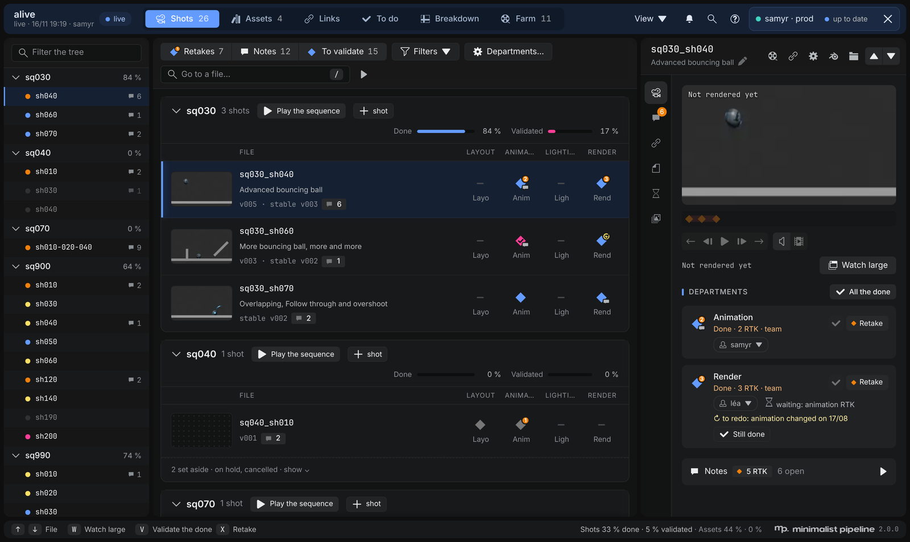
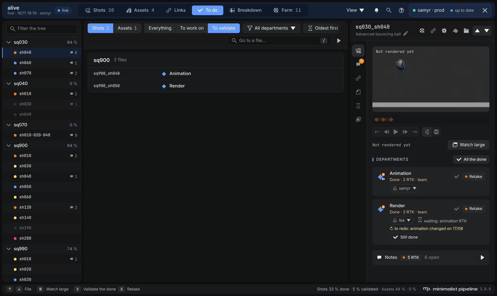
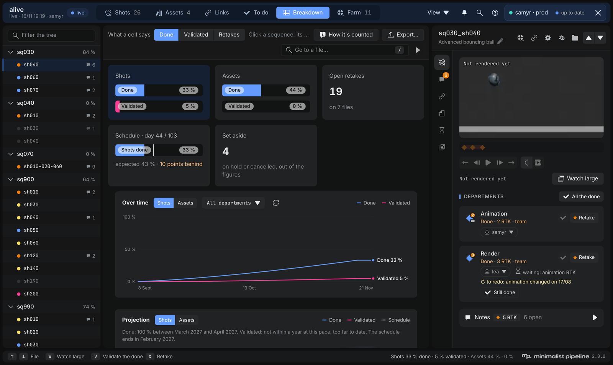
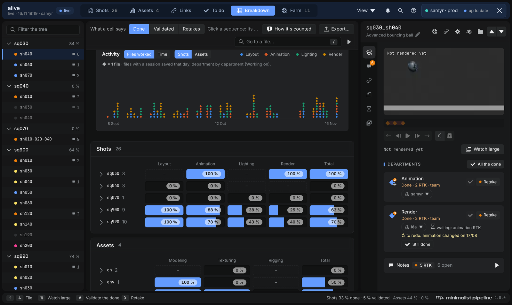
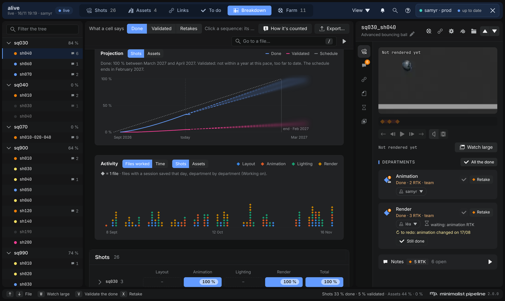
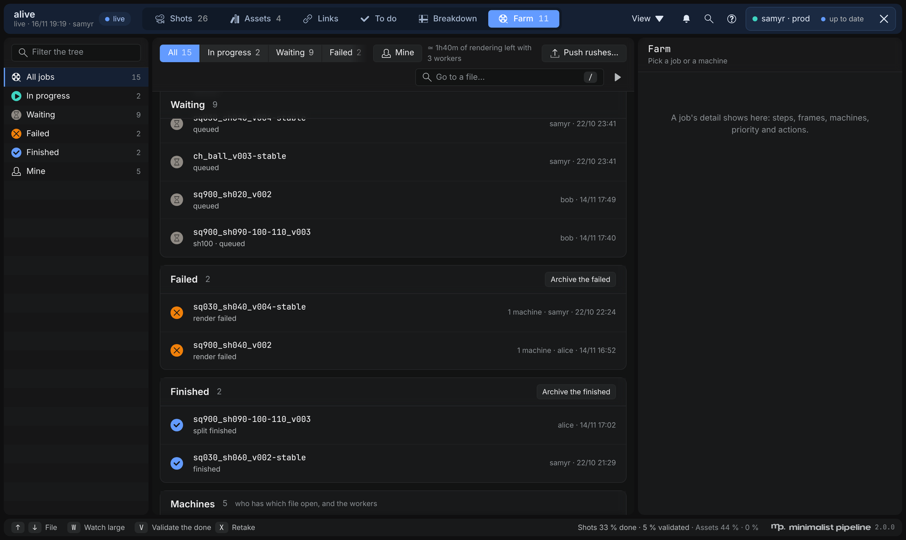
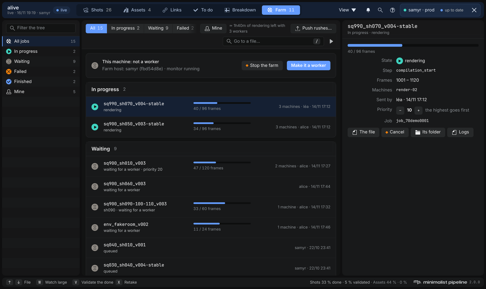
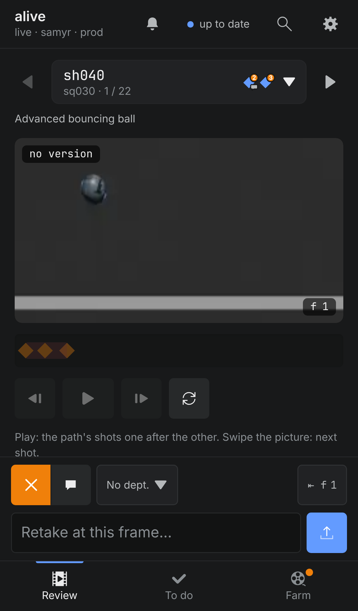
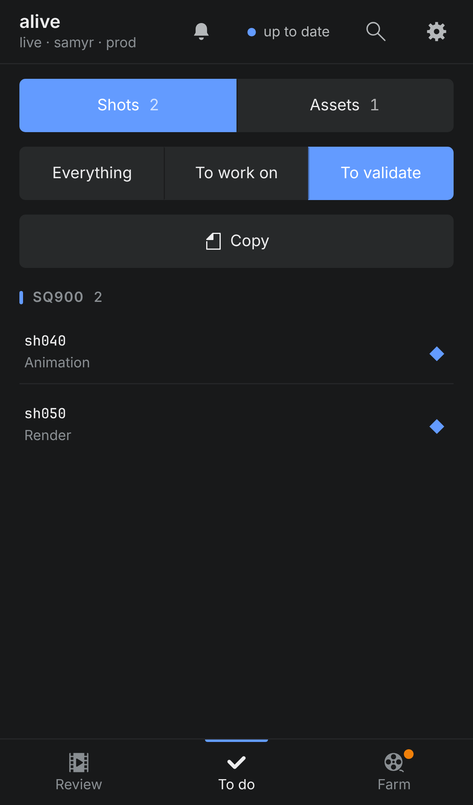
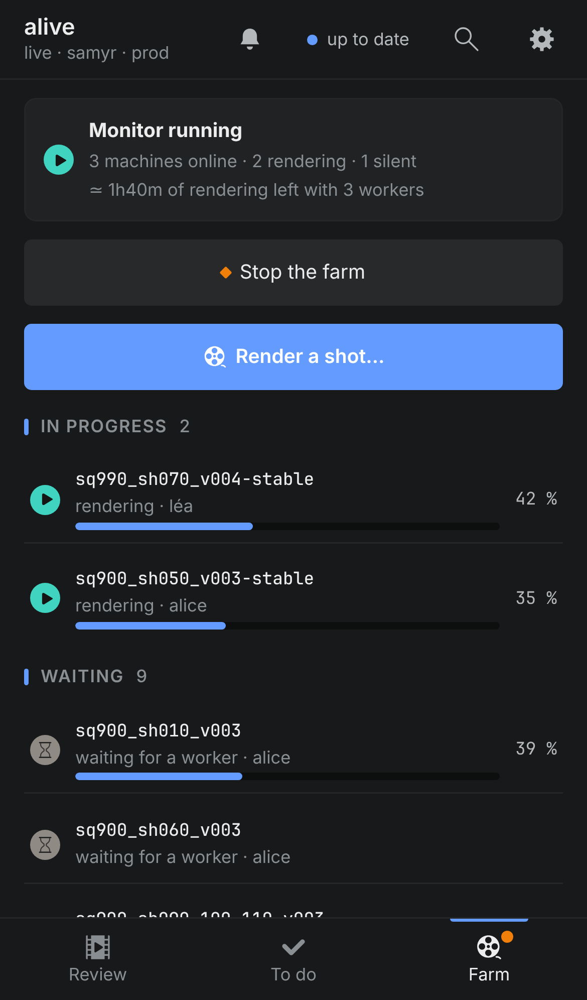

# La page live (2.0)

*[← Index de la documentation](README.md) · [English version](live-page.md)*

---

Depuis la 2.0, la page live remplace les fenêtres Project monitoring et Farm monitoring de la 1.x. Blender la sert à ton navigateur :
- Panneau Project ou menu Pipeline › *Monitor in browser* (Shift+Alt+P).
- *Farm in browser* du panneau Farm (Shift+Alt+F).
- *Details in browser* d'un fichier l'ouvre sur ce fichier.

C'est la même page que le [snapshot de production](tracking-and-reviews_fr.md), tenue à jour tant que Blender tourne. Ce qu'elle montre et le fonctionnement d'une review sont décrits dans [Suivi & reviews](tracking-and-reviews_fr.md). Cette page fait le tour de ses onglets.

Les captures viennent du projet de démo de `tests/fixtures/` (la farm et l'historique sont inventés).

 

## Shots et Assets

- **À gauche** : l'arbre des séquences et des fichiers, chacun avec son avancement.
- **Au milieu** : la liste, une ligne par fichier, un losange par département.
- **À droite** : le détail du fichier choisi. Ses onglets latéraux :
  - **Review** : le lecteur et les départements.
  - **Notes** : les fils de discussion du fichier.
  - **Liens** : ce qu'il lie et ce qui le lie.
  - **Versions** : la chaîne de ses versions, branches et conflits visibles.
  - **Historique de rendu** : regroupé par version.
  - **Fichiers** : qui a sauvé en dernier, et le temps de travail à la demi-heure.

La page s'ouvre tout de suite. Pendant que Blender lit le projet, une ligne en haut indique *Reading the project: 142 / 480 folders* et les chiffres sont partiels. Ouvrir un fichier déjà ouvert dans un autre Blender (une autre machine) demande d'abord, en disant qui, sur quelle machine et quelle version.

Depuis la page, tu peux :
- écrire des retakes, des remarques et des **à-faire** ;
- **rouvrir** un retake ou un à-faire fermé ;
- modifier ou supprimer tes propres notes ;
- pousser n'importe quel rendu au montage (*rushes*).

Ce que font les autres arrive en **notifications** (la cloche) : des toasts à leur arrivée, et la notification du système quand la page est en arrière-plan.

## Recherche (Ctrl+K)

Chaque mot tapé est cherché, pour chaque fichier, dans :
- son nom et sa description ;
- ses notes, retakes, à-faire et réponses (texte et auteur) ;
- ses assignés et ses départements ;
- les raisons pour lesquelles il attend ;
- les presets de rendu utilisés par ses rendus.

Les accents sont ignorés. Les résultats sont listés sous leur fichier, et en ouvrir un mène à l'onglet qui le montre.

## À faire

Les départements requis de chaque fichier qui ne sont pas encore validés, avec la raison de l'attente (En attente, À refaire, RTK).
- **Affichage** : *Tout*, *À travailler* ou *À valider*. Le choix par défaut dépend de ton rôle : l'équipe voit *À travailler*, le rôle le plus haut *À valider*.
- **Restreindre** aux shots ou aux assets, à un département, et aux fichiers d'une personne (les tiens par défaut quand on t'a assigné quelque chose).
- **Plus ancien d'abord** : les fichiers qui attendent depuis le plus longtemps passent en premier.
- **Copier** : met la liste dans le presse-papiers en texte.

## Breakdown

Les chiffres par section, l'allure du planning, puis :

- **Dans le temps** : Fait et Validé jour après jour, pour tous les départements ou un seul. Les points sont dans `config/logs/progress.json` :
  - Le point du jour est écrit par un export de snapshot et pendant que la page live tourne.
  - Le point de la veille est corrigé par le premier Blender du lendemain.
  - *Migrate old data* reconstruit les jours d'avant le journal.
- **Activité** : ce qui a été travaillé, pas seulement ce qui a été fini. Chaque jour est une colonne de losanges, et chaque losange vaut un nombre de fichiers (sessions sauvées, par départements cochés) ou d'heures. Les heures sont celles de tout le monde, ensemble, jamais par personne (voir [Choix de conception](design_fr.md)).
- **Projection** : où mène l'allure actuelle. Elle est dessinée comme un cône entre l'allure des 30 derniers jours et celle des 90 derniers, à côté du planning (Edit project › Schedule). Elle donne des mois, jamais un jour, et rien au-delà d'un an.
- **Exporter…** : tout le projet en tableur (`.xlsx`, écrit par la page, hors ligne aussi). Il contient ces feuilles : Séquences, Shots, Assets, Retakes, À valider et Dans le temps.

## Farm

Les jobs de la farm par état : en cours, en attente, en échec et terminés. Le temps de rendu restant est affiché au-dessus de la liste. Un clic sur un job ouvre son détail :
- ses étapes, ses frames, ses machines et qui l'a envoyé ;
- sa priorité (− / +) ;
- *Annuler*, *Relancer*, *Archiver*, *Recompiler*, et *Retirer de la file* tant que rien n'est rendu ;
- son fichier, son dossier et ses logs.

En haut :
- **Cette machine** : *En faire un worker* / *Ne plus être worker*.
- **L'hôte de la farm** : *Lancer la farm*, *Reprendre la farm* (si elle est bloquée, demandé deux fois) et *Arrêter la farm* (demandé deux fois ; les rendus en cours finissent, la file est gardée).

**Machines**, sous les jobs : un nœud par machine. Chacun montre qui l'utilise et les fichiers du projet ouverts dans ses Blender (un clic en ouvre un), puis l'état de son worker. On voit qui travaille sur quoi, jamais depuis quand.

**Rendu** : le détail d'un fichier et le formulaire *Rendu* de la page envoient un fichier à la farm comme le dialogue Render de Blender : un département, puis son preset. Dans Blender, le Render du panneau File propose aussi **Where** :
- *Farm* ;
- *Local · playblast* : rend ici, tout de suite, hors de la file ;
- *Local · viewport* : dessine chaque frame depuis la vue 3D du fichier.

Voir [Farm](farm_fr.md).

## Sur un téléphone

  

*Share with a phone…* (menu Pipeline, ou l'icône à côté de *Monitor in browser*) donne à quelqu'un un accès limité dans le temps, avec un QR code.

Sur le téléphone, on a les onglets **Review**, **À faire** et **Farm**. En review, on y écrit des retakes, des remarques et des à-faire, on marque un retake corrigé ou un à-faire fait, et on rouvre une note fermée. La farm est en lecture seule, sauf si l'accès permet de la piloter (lancer, arrêter, rendus, priorités). Rien n'est jamais ouvert sur la machine qui sert la page.

## Menu Affichage

Depuis le menu Affichage de la page :
- **Échelle de l'interface** : de 0,5 à 1,5.
- **Thème** : Sombre, Clair ou Système.
- **Langue** : Automatique (celle de Blender, sinon du navigateur), English ou Français.
- *Share with a phone…* et *Export a snapshot…* (live seulement).
- **Visite guidée** : montrée une fois d'elle-même aux débutants (Preferences › Experience).
