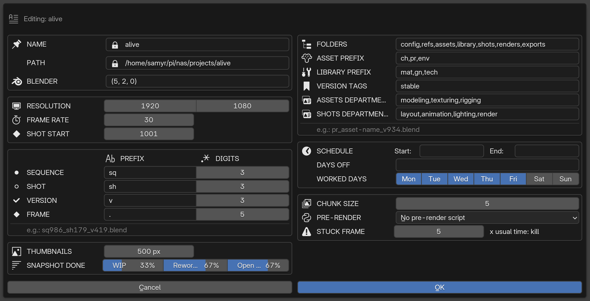

# Structure de projet, nommage, création en masse

*[← Index de la documentation](README.md) · [English version](project-and-naming.md)*

---

## Le projet

Un projet = un dossier avec `config/project_config.json` à sa racine. Structure imposée à la création, configurable dans le wizard :

```
my_project/
├── config/
│   ├── project_config.json
│   ├── logs/pipeline_log.jsonl, sessions_log.jsonl
│   ├── presets/            ← preset Python de collections d'asset, presets ffmpeg
│   ├── .sessions/          ← qui a quoi d'ouvert, en ce moment
│   └── .farm/               ← queue de rendu, workers, monitor.lock
├── refs/
├── assets/
│   └── ch/
│       └── ch_bob/
│           └── .pipeline/   ← tracking.json, .wipmeta, .stablemeta
├── library/
│   └── mat/
│       └── mat_wood-dark/
├── shots/
│   └── sq010/sh010/
├── renders/
├── snapshots/
└── exports/
```

**Routing par préfixe** : le préfixe du fichier détermine son dossier parent, l'artiste ne choisit rien. `ch`/`pr`/`env` → `assets/`, `mat`/`gn`/`tech` → `library/`. Les deux listes de préfixes sont configurables par projet.

<br>

## Convention de nommage

```
{prefix}_{name}_v{number}[-{tag}].blend      # asset / library
{prefix}sq{n}_{prefix}sh{n}_v{number}[-{tag}].blend   # shot
```

- Tout en minuscules. Underscore = séparateur structurel (toujours 3 segments). Tiret = mots à l'intérieur d'un segment, et tag de version.
- Pas de tag = wip, implicitement.
- La regex de parsing n'est pas figée dans le code : elle est **reconstruite dynamiquement depuis `project_config.json`** (préfixes, digits, tags autorisés) à chaque changement de config.

La variante multishot d'un shot (plusieurs cuts dans un seul fichier) étend ce pattern — voir [Blocs de shots (multishot)](multishot_fr.md).

<br>

## Création en masse

De nouveaux assets/shots peuvent aussi être créés en masse depuis un fichier CSV (menu top bar > "Batch create from CSV"). Chaque ligne est construite dans son propre process Blender headless jetable — jamais la session courante — donc rien ne s'accumule entre les lignes (pas de collections résiduelles d'une ligne précédente) et le travail en cours de l'artiste n'est jamais réinitialisé ni touché. Les lignes sont traitées strictement une par une, jamais en parallèle.

- **Assets** : `prefix`, `name` obligatoires ; `departments`, `description` optionnels.
- **Shots** : `sequence`, `shot` obligatoires ; `frame_start`/`frame_end`/`frame_duration`/`timeline`, `departments`, `description` optionnels. `shot` peut aussi être un bloc joint par des tirets (ex. `"030-035-040"`, dans n'importe quel ordre, n'importe quel padding — `"3-10-020"` est tout aussi valide) pour créer un multi-shot en une seule ligne — ses shots sont alors répartis uniformément dans le bloc au lieu de tomber sur une seule et même frame.
  - **Priorité si plusieurs colonnes de frame sont remplies** (seule la première qui s'applique est utilisée, les autres sont ignorées pour cette ligne) : `timeline` (exacte, ex. `"1001-1021-1051-1076"` — un départ par shot plus la fin du bloc) > `frame_end` > `frame_duration` > `frame_start` seul (`default_frame_start` du projet si même celui-ci est vide). `frame_end`/`frame_duration` fixent la fin du bloc pour la répartition automatique ; sans les deux, elle vaut par défaut 20 frames par shot après `frame_start` — sans jamais dépasser un `frame_end` explicite.
- `departments` : noms de départements séparés par des virgules. Retombe sur l'ensemble par défaut du projet si la colonne est vide/absente ; tout nom absent des départements réellement configurés dans le projet est ignoré et loggé en warning — ne bloque jamais la ligne.
- Une ligne correspondant à un asset/shot déjà existant (même prefix+name, ou même sequence+shot) est silencieusement ignorée — la création en masse n'écrase jamais rien.

**Exemple — CSV de batch pour des assets :**

```csv
prefix,name,departments,description
ch,bob,"modeling,rigging",Hero character
pr,chair_oak,,Background prop (departments default to the project's asset set)
```

**Exemple — CSV de batch pour des shots :**

```csv
sequence,shot,frame_start,frame_end,frame_duration,timeline,departments,description
sq010,010,1001,1100,,,,Single shot, explicit range
sq010,020,,,,,,Single shot, falls back to project defaults
sq020,"030-035-040",,,,"1001-1021-1051-1076","layout,animation",Multi-shot block, exact per-shot starts
```

Une cellule vide signifie juste "utiliser le repli pour cette colonne" (départements par défaut du projet, frame de départ par défaut, fin auto-répartie...) — seuls `prefix`+`name` (assets) ou `sequence`+`shot` (shots) doivent réellement être remplis sur chaque ligne.

---

## Structure de données : `project_config.json`

Écrit sous verrou et de façon atomique (fichier temporaire puis renommage), comme tout autre fichier JSON du pipeline (voir [Choix de conception](design_fr.md)). Un par projet, entièrement éditable via "Edit project" :

```json
{
  "project_name": "my_project",
  "pipeline_addon_version": "1.1.0",
  "blender_version": "(4, 2, 0)",
  "resolution": {"x": 1920, "y": 1080},
  "default_fps": 30,
  "default_frame_start": 1001,
  "naming": {
    "sequence": {"prefix": "sq", "digits": 3},
    "shot": {"prefix": "sh", "digits": 3},
    "version": {"prefix": "v", "digits": 3},
    "frame": {"prefix": ".", "digits": 5}
  },
  "structure": {
    "project_folders": ["config", "refs", "assets", "library", "shots", "renders", "exports"],
    "asset_prefixes": ["ch", "pr", "env"],
    "library_prefixes": ["mat", "gn", "tech"]
  },
  "tags": ["stable"],
  "assets_departments": ["modeling", "texturing", "rigging", "tech"],
  "shots_departments": ["layout", "animation", "lighting", "render"],
  "thumbnails": {"size": 240},
  "snapshot": {
    "progress": {"wip": 33, "rework": 67, "rtk": 67},
    "schedule": {"start": "2026-09-01", "end": "2027-03-31", "days_off": ["2026-12-25"], "worked_days": [1, 2, 3, 4, 5]}
  },
  "farm": {
    "chunk_size": 5, "stuck_frame_factor": 5, "default_prerender_script": "",
    "max_concurrent_local": 1, "stale_monitor_seconds": 90, "dead_monitor_seconds": 360,
    "auto_archive_hours": 24, "archive_log_days": 14
  }
}
```

**Edit project** (panneau Project), les réglages sur deux colonnes -- ce que fait chacun :

| Réglage | Rôle |
|---|---|
| Blender | La version de Blender du projet : une autre affiche un avertissement (ci-dessous). |
| Resolution, Frame rate, Shot start | Résolution, fps et première frame des nouveaux shots. |
| Naming | Préfixe et nombre de chiffres des séquences, shots, versions et frames : les noms de fichiers, et leur relecture. |
| Folders, Asset / Library prefixes, Version tags | L'arborescence du projet, les types d'assets et de libraries, les tags de version. |
| Assets / Shots departments | Les départements requis par chaque nouvel asset ou shot -- et l'ordre que suit toute liste de départements. |
| Thumbnails | Taille des vignettes de rendu (snapshot, détail des fichiers). |
| Snapshot done | La part d'un département comptée comme faite dans le snapshot : en cours, à reprendre, RTK ouverte. |
| Schedule, Days off, Worked days | Les dates de la production, pour l'avancement attendu du snapshot. |
| Chunk size | Nombre de frames par morceau qu'une machine de la farm prend à la fois (voir [Rendu](farm_fr.md)). |
| Pre-render | Le script pré-rendu sur lequel s'ouvre le dialogue Render. |
| Stuck frame | Combien de fois son temps habituel une frame peut prendre avant que son rendu soit arrêté (0 = jamais). |
| Priority switch | Minutes : un rendu à qui il reste moins que ça garde ses machines quand un job plus prioritaire les veut (3 par défaut ; 0 = elles partent toujours une fois leur morceau fini). |

Les autres clés `farm` ne sont pas dans le dialogue : combien de processus farm locaux à la fois, quand un farm host est considéré en retard / parti, quand les jobs finis et leurs logs sont archivés / supprimés (voir [Rendu](farm_fr.md)).



**Version de Blender** : `blender_version` (fixée à la création, modifiable dans Edit project) est le Blender avec lequel le projet est fait. Ouvrir le projet avec un autre majeur.mineur (5.2 pour un projet 4.5 -- 4.5.2 contre 4.5.7 ne compte pas) affiche un popup d'avertissement rouge au démarrage et à l'activation, plus une ligne rouge dans le panneau Project : un fichier sauvé dans un Blender plus récent peut ne pas s'ouvrir, ou pas pareil, dans celui du projet. Laisser vide pour ne jamais avertir.

Tous les préfixes, tags, départements et digits sont libres — c'est ce fichier qui reconstruit la regex de nommage et le routing par dossier à chaque changement. `pipeline_addon_version` est écrit/rafraîchi à chaque création ou édition du projet — pas de logique de migration automatique pour l'instant, juste de quoi savoir plus tard quelle version de l'addon a touché en dernier un config donné.

---

**Voir aussi** : [Versions : wip et stable](versions_fr.md) · [Interface](interface_fr.md) pour le panneau où vivent ces actions.
