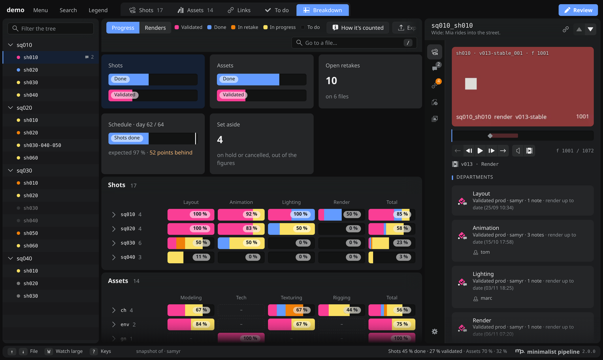
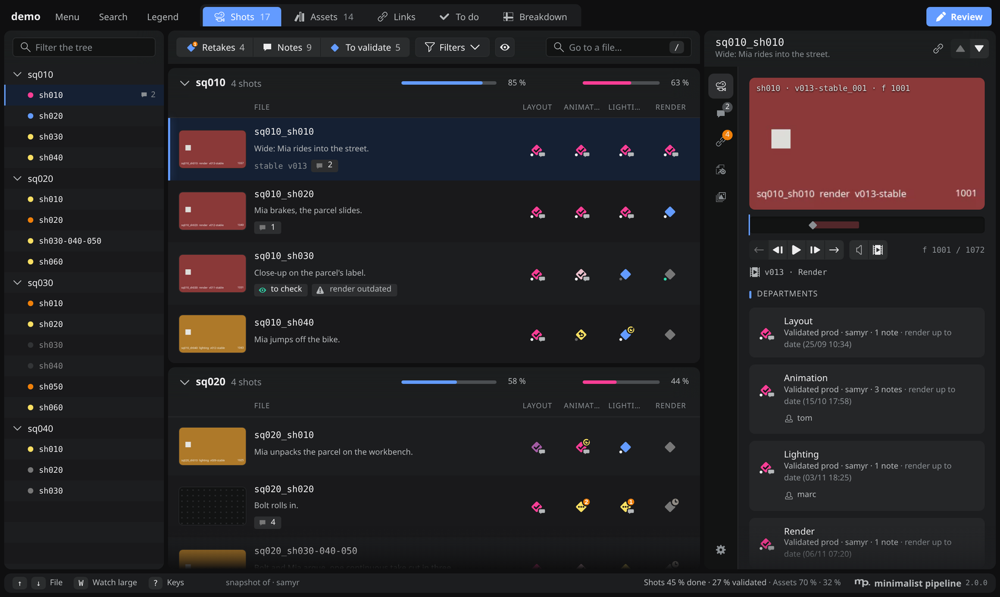
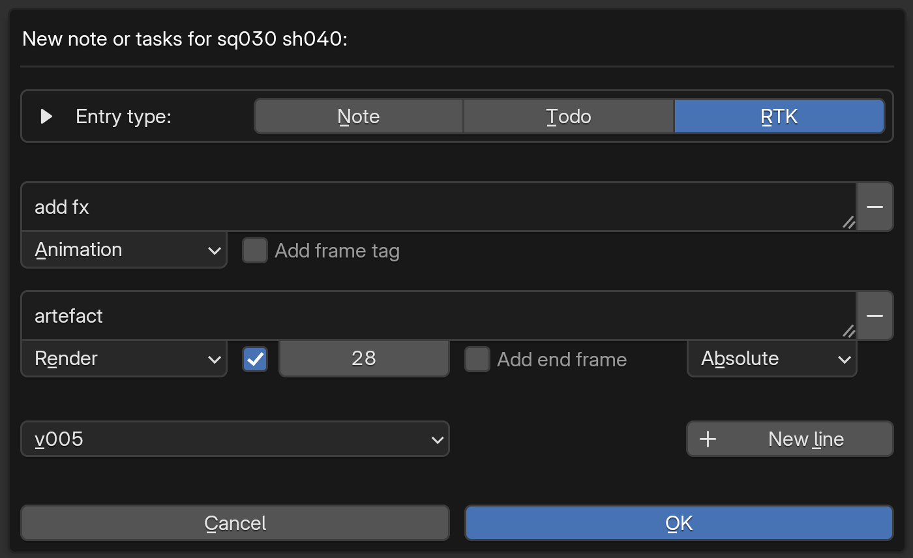

# Tracking & reviews

*[← Documentation index](README.md) · [Version française](tracking-and-reviews_fr.md)*

---

Every asset/shot has a `.pipeline/` folder next to its `.blend` files:

- **`tracking.json`**: required departments + a free-text description of what the asset/shot is (set at creation — interactively or via batch CSV, see [Project structure, naming, batch creation](project-and-naming.md)) + a list of entries (`note` / `todo` / `rtk`), each with author, date, its department(s), done/not-done state. Its *Notes & tasks* title (the File panel, a file's detail) shows what's left, folded or not: open RTKs in red, open todos in grey -- notes aren't counted. *Hide done*, first of its filters, brings back the done ones: the retakes to check a render against. A right-click on an entry's icons (its check box or circle, the grip on its right) offers Reply, Edit, Mark done / Reopen and Delete.
- **`{version}.wipmeta`**: one per work version — creation mode, departments worked on this session, linked libraries. Full details in [Versions: wip and stable](versions.md).
- **`{version}.stablemeta`**: one per `-stable` version — departments validated at that point. This is the reference point for computing "what's been touched since the last stable", shown throughout the UI. Individual departments can also be validated directly, without cutting a new `-stable` version — buttons next to each department in the Tracking panel/dashboard, for departments (like "render") that aren't tied to editing the file itself. This mutates the *latest* stablemeta's `departments_validated` in place; requires at least one `-stable` version to already exist.

**Prod review import** (Project panel or Pipeline menu > *Import review*): reads back the review made on a snapshot's page (the `.json` it downloads, see *Review on the page* below). Each line of a department's box becomes its own retake — several retakes on the same shot go on several lines, each one with its own checkbox. Author and date are the ones given at its download (`prod` and the import day when left empty); each note is anchored on the render the reviewer watched -- the *Last render* the snapshot showed, per shot for a block (`[sh120]` takes sh120's) -- and on the `.blend` version that render was made from (`v007-stable_001` → `..._v007-stable.blend`), not on the latest file: a tag *▶ v007-stable_001* on the note (snapshot) and *Based on: ... (render v007-stable_001)* in its tooltip say which. The review carries that render (a `render_watched` field in its `.json`); a shot never rendered keeps the file's version. Only a review of this add-on version's snapshot is read: one from an older snapshot is refused -- export the snapshot again and review it there. Importing the same file again, or a re-sent one with notes added, never duplicates: lines already imported are skipped. Descriptions edited on the page (*✎ Edit the description*) are applied too, after a dialog listing every change (was / now): all of them, or none — to leave one out, change it on the page and download the review again. Only a description the production changed counts: one changed in the project since the export is never reverted, and an empty one changes nothing. A popup lists what came in and what couldn't (e.g. a file renamed or branched since). Imported entries say so in their tooltip. Each review imported is kept as it was sent, in `snapshots/reviews/<role>/<YYYY-MM>/` (`team`, or `no-role`; the month of its review date): the same file is never copied twice, another one under the same name gets a number.

**Production snapshot** (Project panel or Pipeline menu > *Snapshot*): writes one HTML file -- `<project>_snapshot_<YYYY-MM-DD_HH-MM>.html`, in the project's `snapshots/<YYYY-MM>/` folder by default (one per month; the snapshots of before 1.2 stay at its root) -- with the state of every asset/shot per department and every note, for people outside the studio (no Blender, no access to the share needed: it opens offline in any browser, on a computer or a phone, and can be sent by mail). The scan runs in the background; Blender stays usable meanwhile. Once written, it opens in your browser (*Open when done*, next to *Thumbnails* in the file browser; untick to just save it).

**Live page** (Project panel or Pipeline menu > *Open in browser*): the same page, served by this Blender to this machine's browser and kept up to date -- a note written, a save, a render finished show within a few seconds, without exporting again. A pill by the time says *connected*, *Blender busy* (a long task: it waits) or *disconnected* (Blender closed, or *Stop the live page*: it reconnects by itself once Blender serves it again, no reload). Videos play from the project's `renders/` through Blender. **It reviews as you, at once**: always in review, under Blender's user name and role (Preferences; none: the team's), and what you do -- ✓, a retake or a note added, a reply, *Mark fixed*, who it's assigned to, the file settings, a description once its box is left, *+ shot* -- is sent to Blender a moment later and applied as an imported review would be (the same checks; sent twice, it changes nothing). The header says *sending…*, then *live*; your YOU tags go once the page shows it done. Not applied (Blender busy for long, closed): sent again by itself. A file's panel has more there: the Blender button by its name opens it in Blender (asking first when Blender's file has unsaved changes: save it, don't, or cancel); *To check*, its renders not watched yet -- ▶ in the player, *Checked* takes one off (*Push to editing when checked*, ticked, sends its video to the rushes); *Linked files*, what it links (a newer stable said) and what links it, a click opens one; and under the player, every version of its renders with a video, to watch instead of the main one. A **Farm** tab, beside Breakdown: the farm's jobs by state (in progress with their frames and time left, waiting, failed, the last finished) and its machines -- a click on a job opens its detail (stage, preset, frames, machines, who sent it) and what can be done to it: its priority (− / +, higher goes first), *Cancel*, *Retry* a failed one, *Archive*, *Open its file details*; its bar grows to its new progress, a sheen running across while it renders. Opened, it reads the rest from the job's file: its estimate and pace, the chunks in progress, what failed and why, frames per machine, missing or absorbed shots, its stages; *Which machine rendered frame* [n] (that machine, the frames it wrote in a row, its pace); *Recompile* (its video again), *Remove from queue* (nothing rendered yet), its folder, its job file and its logs opened on this machine. Above the jobs, filters (a state, *Mine*, a name) and the rendering time left; *Archive all* on the finished and failed. A machine opens on its detail too (its chunk, its versions -- in red when they differ --, its last render), *Stop* (rendering: after this frame or now) or *Forget* a silent one. On top, this machine: a worker or not (rendering, idle), the farm host, and *Make it a worker* / *Stop being a worker* (rendering: asked first, its render stopped); under the jobs, every machine -- this one and the farm host tagged, a silent one (crashed, closed, asleep) since when. A file's panel has a *Render* section too: its version (last stable or last), a preset, the priority, All machines or Single, its frames (folded: the file's own; open, Blender's frame numbers), a block's shots to render -- *Send to the farm*, as the Render dialog sends it; for a shot, *Preview* its sequence. Another project made active in Blender: the page follows it, saying it's being read first (as on opening, while Blender reads the project). On this machine only (`127.0.0.1`, a token in its address); the snapshot stays for anyone away from the studio.

**A phone or a tablet** (the icon beside *Open in browser*, the Pipeline menu's *Share with a phone…*, or the live page's ⋯ menu): someone on the same network as this machine (the studio's Wi-Fi) gets the page too -- give their name, their role and how long (an hour, until tonight, a day, a week at most), then they scan the QR code, or you send them the link (*Copy link*). They review as that name and role -- notes, validations, assignees, a render checked --, see the farm without acting on it, and open nothing on this machine; the page says *guest until 18:00*. The accesses running are listed there, each with *Revoke*; past its end one stops by itself, and with none left the page is served on this machine only again. Blender stays open here for it to work (the page is served by it); the link holds this machine's address on the network and a code of its own -- from outside the studio, a VPN would be needed. While watching a render on the live page, the film button beside the frame number opens its full video in this machine's player (the page may play its light copy, `ld/`).

- **At the top**, one line staying in view as the page scrolls: the project and the snapshot's day -- opened later, a "n days old" pill says the project may have moved since --, each section's Done and Validated (a double bar, `84 % · 3 %`; with a schedule, its pace in a pill coloured by band, as in a progress spreadsheet: 105 % and more ahead, 100 to 105 % on track, 90 to 100 % slightly behind, under 90 % behind -- the working days ahead or behind in its tip), *Go to a file…* (/), *?* and *Review* (violet). The page is dark, Blender's mood, or light (⋯ menu: System, Light, Dark); one colour for one meaning: green done, orange in progress or reworked, violet validated, red a retake, blue play and frame ranges, your review neutral.
- **The list**: a tab per section (Shots, Assets, and Libraries when there are any) then *Breakdown*, the files by sequence / prefix, each group a card with its Done and Validated -- folded when none of its files has a department to track. A file shows its thumbnail (its own size on hover with a mouse, full screen on a click or a tap), its name, then its versions (`wip v004 · stable v003`, the wip only when newer than the stable), a block's number of shots and its open notes; under them, tags: a retake on no department (*RTK · WHOLE FILE*), *render to check*, *render outdated*, and the farm (queued dashed, rendering, failed in red); a file set aside (*On hold*, *Cancelled*) is faded. Then a keyframe diamond per department: not started (outlined), in progress (half filled), reworked since (open, an arrow), done (green), validated (violet with a ✓: light by a role, deep by the top one); waiting on an earlier stage (a clock in it) or to redo since one changed (an eye in it), in its state's colour; not required, nothing. Hovering or focusing a diamond stretches it into a capsule with its words (`WIP · v005`, `DONE · stable v003`, `✓ PROD · Valerie`, and *Waiting* or *To redo* with their reason). An open retake puts a post-it under it -- red from a validation role, outlined from the team, their number in it (`2 RTK`) --, your review a *YOU* one above it. On the right, the file's Done and Validated.
- **Filters**: a department (the toggles then look at it alone), then each toggle with its icon, name and count -- *Your review* (✎, while there's one: the files it touched), *Retakes* (an open RTK -- on that department or on none), *Open notes*, *Render outdated*, *To validate* (a done department its stable isn't validated at), *In the farm* (while a file is: rendering, queued or failed), *Not finished*. *Go to a file…* in the header (/ from anywhere) narrows the list and lists the matching files of every section -- Enter or a click opens one. A filter finding nothing in this section but some in another says so. *?* gives the legend, the keys and how Done counts.
- **A file's panel** (a click on its row): beside the list on a computer -- the list moves aside and stays live, a click on another row shows that one; drag the panel's left edge to make it wider or narrower -- past its widest, it fills the page (an iPad upright), dragged back from its left edge it's beside the list again (kept by the browser, a double click for the default); a narrow list turns compact: 58 px rows, a small picture, the name and one line, each department's diamond in a 30 px column named by its initials (L, A, Li, R) --, the whole screen on a phone (swiped down to close, *Previous* / *Next* at the bottom) and on a tablet. With a finger, a first tap on a diamond shows its words, a second opens the file. At its top **the player**: the file's video (its shots one after the other), its timeline carrying the notes at their frames -- a retake's red diamond, a range's blue bar (`f12-30`), yours outlined; a click goes there --, ◂ ▶ ▸ (`,` `.` a frame back / on, Space to play), the frame as numbered in the .blend (`f12 / f96 · 30 fps`) and **⤢ Watch large**: the video the whole window, the departments with ✓ / ✕ and the notes at their frames in a column beside it, the timeline and ⏮ ◂ ▶ ▸ ⏭ under it, the sequence's files along the bottom (a click plays one; past a file's last video, the next file's) -- Esc back to the panel. A sequence's ▶ in the list opens Watch large on it. No video to play: why, and *Choose the videos folder…*, in its place. Then its description and its departments, each with its diamond, its state and what's open on it (`done · 1 retake · 1 thread`), its validation, ✓ / ✕ while reviewing, and **its threads under it** -- each note in one place, under its first department (none: under *Whole file*): its author's initial, who, as what, when, its kind (RTK red, TODO orange, NOTE neutral), its frames (a click goes there), its replies indented; the closed ones folded (*1 closed todo · show*). At the bottom, its last render per shot (the version rendered, ⚠ when older than the stable, *to check*, the farm's state, ▶ plays it above) and its Blender file. *Previous* / *Next* or ← / → go through the list as filtered (on a phone ‹ › in its header, or a swipe sideways), Esc or the tab on its left edge closes it (at the window's edge then, the tab brings it back); the link button copies a link that opens this file (`…_snapshot_….html#sq060_sh070`).
- **Done**: each required department counts for an equal share: not started 0 %, work in progress 33 %, done but reworked since 67 %, done with an open RTK -- on it or on none -- 67 %, done 100 % (the three middle values are set per project: Project settings > *Snapshot done*). A file averages its departments, a group its files. The *Breakdown* tab shows, in place of the list, per section: five figures -- *Done* (the expected progress a mark on its bar, how many points ahead of or behind the schedule), *Validated* (by the top role; while reviewing, *with you* under it), the open *RTK* (in how many files, how many general), the files *Waiting* on an earlier stage, and for shots the *Renders* to check (and how many on the farm) -- the files set aside said in the title, not counted; then one table, sequence (or prefix) × department, its totals on the right and in the *All* row, a switch above it for what a cell says: *%* (done, validated in violet), *Status* (the split of validated, done, in progress -- reworked and done with an open RTK too --, not started), *Count* (done / required, ✓ validated), *RTK & notes* (open retakes, files waiting, open notes), kept in the browser. A department not required: –. A cell's tip says everything; a click opens the list filtered on its sequence and department (*Total*: the sequence alone, *All*: the department alone). While reviewing, a cell your review changes shows the new value in violet, after ✎. With a schedule, it sits on the tabs' line (the day, the progress expected). At the bottom, *How it's counted*: the weights, *More* for the whole text. On a phone, two figures a row, the departments by their first three letters, the sequence's % under its name.
- **Videos**: the page plays each render's video. *Videos*, in the export's file browser, picks where from -- remembered from one export to the next, with the sequences ticked: *Don't copy* (the default) copies nothing: on a machine that reaches the project, the page plays them from `renders/` itself, relative to it (the browser loads one video on ▶, it never reads a folder through); *Folder* copies them into `snapshots/videos/`, shared by every month's snapshots (the page finds it at `../videos`; a snapshot saved elsewhere, in a `videos/` beside it) -- only the videos new or changed since the last export: take the whole `snapshots/` folder --, *Zip* into a zip next to the snapshot, with its name (`..._snapshot_<date>.zip`): both to take the snapshot elsewhere, a folder to send as is, a zip to send in one piece. A copy missing (a *Folder* snapshot opened at the studio without its folder), the page falls back on `renders/`. The sequences are listed, none ticked the first time: the video of each last render the page shows, for every shot of the ticked ones, is copied (*Folder*, *Zip*) under its path in `renders/` (`sq100/sh030/v002-stable_001/sq100_sh030_v002-stable_001.mp4`) -- the same tree, so one name works from the copy or from `renders/`. *Assets & libraries*, under the sequences, adds every asset/library's the same way (`assets/ch/ch_bob/v003_002/...`). Only each shot's main render goes (the highest department's, see [farm](farm.md)); *Every department* takes each department's last render as well, played on the page under the main one -- without it, those play from `renders/` where the project is reachable. **Too wide or unplayable**: a video wider than 8192 px (a panoramic render -- past that, browsers on a PC or an iPad refuse it) or in a codec browsers don't play (ProRes, DNxHR...) has a light copy beside it, in its render folder's `ld/` (H.265, at most 8192 px wide), made by the farm's compilation: that's what the page plays and the snapshot carries, the full one kept for the edit. A render compiled before gets its light copy from Export snapshot, once, for the ticked sequences (needs ffmpeg; the log says which). Copied after the HTML, in the background too; a sequence with nothing rendered is skipped (a warning says which), and so are the assets/libraries with no video. The blue ▶ in a file's panel header plays its render -- for a block whose shots were rendered apart, each shot's video after the other in the block's order (⏮ ⏭ or ← → skip) --, a small ▶ after each sequence's name for all its files' in a row, and *▶ Play* on each line of *Last render*: one line per video, a shot rendered apart its own line. While reviewing, *Last render* folds away: a ▶ per shot stays under the picture. Thin controls under the picture (▶/❚❚, position, time, full screen; Space plays/pauses), and the frame shown -- `f1042`, numbered as in the .blend (the render's first frame, from its farm history or its images' names, plus its rank in the video at the project's fps): a block rendered whole counts on its own timeline, as Blender and the `[f12-40]` retakes do; ◂ ▸ (or , and .) go one frame back / on, paused. A render whose first frame isn't known counts from its video's start (`#1`). Moved, renamed, or on another machine: *Choose the videos folder…* (the folder button next to *?* until one is chosen, the page's ⋯ menu, or under a render with nothing to play) picks the folder holding them, whatever its name -- the project's `renders/` folder works too: in Chrome or Edge the page opens only the videos it needs, by their paths, never reading the folder through (Firefox and Safari read every file of the folder chosen first: pick `videos/` there, not `renders/`, full of frames); on a phone, the videos themselves.
- Its ⋯ menu also picks the page's theme: *System* (the device's), *Light* or *Dark*, kept by the browser.
- The review is made right on the page and sent back as a `.json` (*Review on the page*, below).





Every file's status per department, a file's notes, renders and links: the live page above (*Open in browser*) -- File details' *Details* opens it on the open file.

Multishot blocks can tag a note/todo with which shot in the block it's about — see [Shot blocks (multishot)](multishot.md).

**Renders to check**: when a farm job finishes (frames checked, video compiled), its render waits for a check. On the live page, a file's panel lists them under *To check* -- ▶ plays one, *Checked* takes it off and archives its farm job (*Push to editing when checked*, ticked, sends its video to the rushes) --, the list's *render to check* tag and the farm's state show which files have some. The departments the render shows as right are validated with ✓ as any other. One per shot and per department (the department of the render's preset, see [Farm](farm.md)): a newer render of a shot replaces the older one of the same department, not another department's.


---

## Stages: Waiting and To redo

**Stages** (Edit project, in the departments field itself): `layout > animation > fx, lighting > render` -- `>` the next stage, a comma for departments in parallel. Commas only (`layout, animation, lighting, render`, as before): no stages, nothing changes. Nothing is ever blocked: it's information.

- **Waiting**: an earlier stage has an open RTK, or isn't started -- *Waiting: layout RTK*, *Waiting: layout not started*. Shown with the department's state on the page (a clock in its diamond).
- **To redo**: a department already started whose earlier stage changed after its last update -- an RTK on that stage closed, or a stable made with it reworked -- *To redo: layout changed on 12/11*. Its last update: a save in a session where it was ticked as worked, or **Still done**.
- **Where**: File details' departments, the sidebar's *Working on* toggles. On the snapshot page, a clock (Waiting) or an orange arrow (To redo) in the diamond's place, the state a small diamond on its corner; the reason under the department's name in the file's panel.
- **Still done** (File details, or the ✓ beside a toggle in the sidebar, on a department to redo, open to everyone): the work done holds after the change -- recorded with who and when, and an optional why; not a validation.

## On hold and Cancelled

**Set a file aside** without archiving it (File details, the pause button): *On hold* (paused, waiting for a decision) or *Cancelled* (cut at the edit, dropped), with a why. It stays in Blender's lists, greyed with its mark (on the snapshot page: hidden, a line at the end of its sequence shows it), and leaves the shares done (the snapshot's figures, the schedule's pace), the Retakes and To validate filters, and the stages (no Waiting, no To redo). The same button makes it *Active* again. A block's mark covers all its shots.

## Team and assignees

**The team** (Edit project → *Team*, names with a comma between them): each one's user name picks from it (Preferences or the welcome window, the team's button by the name field; a name not in the team is flagged), and a file's departments are assigned to its people.

- **Assign** (File details, the team's button by a department, open to all): tick who it's for -- sh010's layout to Léa, its animation to Tom. Optional, a filter's matter: nothing is counted from it (no load per person, see [Design choices](design.md)). Stored in `tracking.json`: `"assignees": {"animation": ["tom"]}`.
- **Me** (the page's filters): only the files with a department assigned to you.
- **On the snapshot page**: who each department is assigned to, under its name; *Me* among the filters (your name in the review). Reviewing, each department's names are a button: its menu, the team to tick -- sent as an `assign` action, applied at the import as File details would.

## Done, then validated: validation roles

A department is **done** when its work is finished (the tick next to it --
called "validated" before 1.1.2, same data). **Validation** comes on top:
a role's sign-off -- the supervisor's, the production's -- on the version
it saw.

- **Roles** are set per project (Edit project > *Validation roles*, e.g.
  `sup:1,prod:2,real:2`): a higher level covers the lower ones (validated
  by prod: good for sup too), the same level is equivalent (prod or real).
  Without any set, `sup:1,prod:2`.
- **Your role**: Preferences > *Validation role*. Empty: a team member.
- **Validating**: in a file's detail, a star next to each done department
  gives or withdraws your role's validation (its tooltip lists every
  role: validated, covered by a higher one, or not). It's kept on the
  latest stable, and a new stable keeps it while that department wasn't
  worked since (1.1.9: "validated on v012, not worked since"); worked
  since, the new stable starts without -- the role hasn't seen it -- and
  shows the last one given ("prod: v012, to review again").
  Withdrawing or giving it writes a note under your role, for the record
  -- in *Notes & tasks*, those in a row make one box, a line per role and
  stable ("★ prod: fixanim, render-ld · v003-stable", each note in its
  tooltip).
- **Notes under a role**: a note, todo or RTK written by someone with a
  role carries it (its tick box or dot violet in Blender), and so do the notes imported from a
  review. An RTK from a role is red in the snapshot, the team's light red; in Blender, a role's box is violet, the team's Blender's own.
  The *New entry* dialog shows your role in an *As sup* box, on by
  default: untick it to write as the team (a technical note, say).
- **A review as the team**: *team* in a review's Role (the snapshot
  page's -- unless a validation role has that name): its retakes and notes are the team's own -- no role, orange, no
  "prod review" tag (imported from a team review) -- and it validates
  nothing: the page's ✓ are off, a ✓ or `ok` written before is left out.
- **Snapshot**: "✓ prod" under a department's mark (each role in its
  tooltip), struck through for one given to an earlier stable and worked
  since (the
  file's panel says which: "✓ sup on v012, to review again").
  A *Validated* figure sits apart from Done -- per section, group and
  file, in violet: the share of the required
  departments validated by the top role (or one of its level) at the
  stable shown. Done stays the fabrication: 100 % done with nothing
  validated reads 100 % / 0 %.
- **Review on the page**: *✎ Review* (violet, in the header) opens a
  window first: *Continue your review* when this browser keeps one; your
  name, the review date and your role (buttons, a line saying what each
  does: the team writes retakes and notes, no validation); what to *go
  through* -- *To validate*, *Open retakes and notes*, *Everything, in
  order*, *What the filters show* (the filters set for it, its first
  file opened); *Load a review file…*. While reviewing, the header shows
  who, as what and how many files (a click: the same window, to change
  them) and *Send…*; the ⋯ menu *Clear this review…* and *Leave the
  review*. In a file's panel, a department *To redo* has *Still done* (its
  work holds), and *File settings*, folded at the bottom, change its departments
  required and sets it aside (*Active*, *On hold*, *Cancelled*, with a
  why) -- sent with the review, open to any role; each sequence (or prefix) has
  *+ shot* (or *+ asset*): its number or name, frames, description and
  departments required, checked against the project's naming, shown
  planned in its group until the import creates it; and the figures follow
  as you write -- by each section, group and file, after a pencil: what
  the review would make of them; a ✓ by each department (validate it as your
  role -- a done one only) and a ✕. Each department is one line: its mark,
  its name, what your review says of it (✓ you, ✕ you), its state and
  what's open on it ("not started · 2 RTK · 1 note · 1 closed"), who it's
  assigned to (a dashed ring when nobody: its menu has you first, the
  team, *Nobody*), ✓ and ✕. **✕ opens a box under the department's
  header**: *Retake* or *Note* (or `note:` typed at its start), one per
  line, `[f12-40]` for frames; on a block, *On All / sh010 / sh020…* --
  the same as the `[sh020]` at the line's start, either one changes the
  other --, *+ f12* puts the frame shown after it (again on another frame:
  the range between the two, `[f12-30]`). *Add retake* (Ctrl+Enter,
  ⌘↵ on a Mac) adds the lines and leaves the box open for the next one;
  nothing written, the department is sent back with no text (its
  validation withdrawn); *Cancel* or Esc closes it. What you added sits on
  top of the department's threads, one line each with ✕ YOU / NOTE · YOU
  and a × to take it back. A note keeps your ✓; a retake replaces it.
  *Whole file* comes first: its ✕ writes a retake on no department (X),
  its ✓ validates every done department (V). *✎ Edit the description*
  above. **The notes**: one line per thread -- kind (RTK, TODO, NOTE),
  frames (a click goes there), shot, text, who and when --, a click opens
  it (its replies, *Reply*, *Mark fixed*); on hover the two as icons.
  One open by default has a reply of the last 7 days or one of yours;
  then as you left it. An author's notes of a day share one header. The
  bar above them: *Open* (the closed ones folded under "N closed", at the
  end of their department), *All*, *Mine* (yours, those you answered or
  fixed); *Newest* or *By frame* -- kept by the browser. *Reply* opens a
  box under the thread's last message: *Retake* ("still to redo": its
  department sent back as ✕ would, imported as an RTK on it) or *Note*
  (a remark); sent, it shows as ↩ YOU, × to take it back. *Mark fixed*
  (an open todo: *Mark done*) strikes it through with ✓ FIXED · YOU: done
  at import, as its author (one done since, or gone, is left as it is;
  importing again changes nothing); again, it's undone. The RTK answered
  stays open. *File settings*, folded at the end: the departments
  required and set aside. The figures your review moves show by the
  pencil (with you 33 % · 5 %), their tip -- hover or a tap -- says what
  they are now. The list shows what you did under each department (✓
  you, ✕ you), and under the file's name who you reassigned; the panel's *Last render* and *Blender file* step aside
  while reviewing.
  To go over it: *Your review*, among the filters (or *Show the changes* in *Send your review*),
  shows only the files the review touched.
  Keys: ← → (files), Esc (close), V (all done), X (whole file's box), R
  (reply to the thread focused); in a box Ctrl+Enter adds, Esc cancels. *Send…* opens *Send your review*: your
  name, your role (required as soon as it holds a retake or a
  validation) and the review date; then file by file what it holds, with
  the list's symbols (✓ a department validated, ✕ a retake and its
  text, a description, fixed, replies); the `.json`'s name -- the page
  sends nothing itself: download it and send it to the studio (mail,
  SwissTransfer). *Clear this review…*, *Keep reviewing*, *Download*:
  **Import review** takes the file -- several at once too (one per
  reviewer: the file is named after its time, role and author). On a
  tablet or a phone, the button is *Save or send…*, the system's share
  sheet: *Save to Files* picks
  the folder (a download lands wherever the browser -- or the app showing
  the page -- keeps its own), or AirDrop, Mail.... The page keeps what you write in
  your browser as you go (a reload brings it back, in the same browser
  -- not in a private window or on another machine); the bar's ⋯ menu
  has *Load a review…* (reopens a downloaded one), *Clear this review*
  and *Leave the review*. The import asks first, naming the role and
  listing the validation changes, then refuses any validation of a
  department worked since the stable the review saw (a newer stable
  without it worked keeps it).

Nothing to migrate: `departments_validated` keeps its name, validations
are a new `approvals` key in the stablemeta, a note's role a new `role`
key -- absent, the team's own.

## Data structure: `tracking.json`

**`assets/ch/ch_bob/.pipeline/tracking.json`** — one per asset/shot, created with the file:

```json
{
  "file_name": "ch_bob",
  "created_at": "2026-03-25T16:00:00",
  "departments_required": ["modeling", "rigging", "texturing"],
  "description": "Main character, the fox.",
  "entries": [
    {
      "id": "a3f1c",
      "type": "todo",
      "text": "Add face shape keys",
      "author": "samy",
      "date": "2026-03-21T09:00:00",
      "departments": ["rigging"],
      "done": false
    }
  ]
}
```

`type` is `note` (`done: null`, never checkable), `todo`, or `rtk` (fix requested — `done: true/false`, with `done_by`/`done_at` once validated).

**New entry**: one entry per line, whatever its type (RTK by default) -- each line its own departments, frames and, in a block, shot. Departments always show in the project's order (Edit project), wherever they're listed.



**Several departments**: an entry can be for several departments at once -- tick them in the department menu of the New entry / Edit dialogs. It's one entry with one done state, shown under each of its departments' filter; an open RTK turns each of its departments red on the page; one on no department (a general retake) red-outlines the "n RTK" by the file's name and counts in the file's Done as an RTK on one done department (each department's own Done untouched). Stored as `"departments": ["animation", "lighting"]` (one department: a list of one).

A finished farm render adds a `to_check` key, until it's marked checked: `{"<shot>#<department>": {"render", "video", "at", "job_id", "shot", "department"}}` — the shot is `""` for an asset or a single shot, one key per shot and department; a render with no department (and one flagged before 1.2) is keyed by its shot alone.

---

**See also**: [Versions: wip and stable](versions.md) for `.wipmeta`/`.stablemeta` · [Interface](interface.md) for the Tracking panel.
