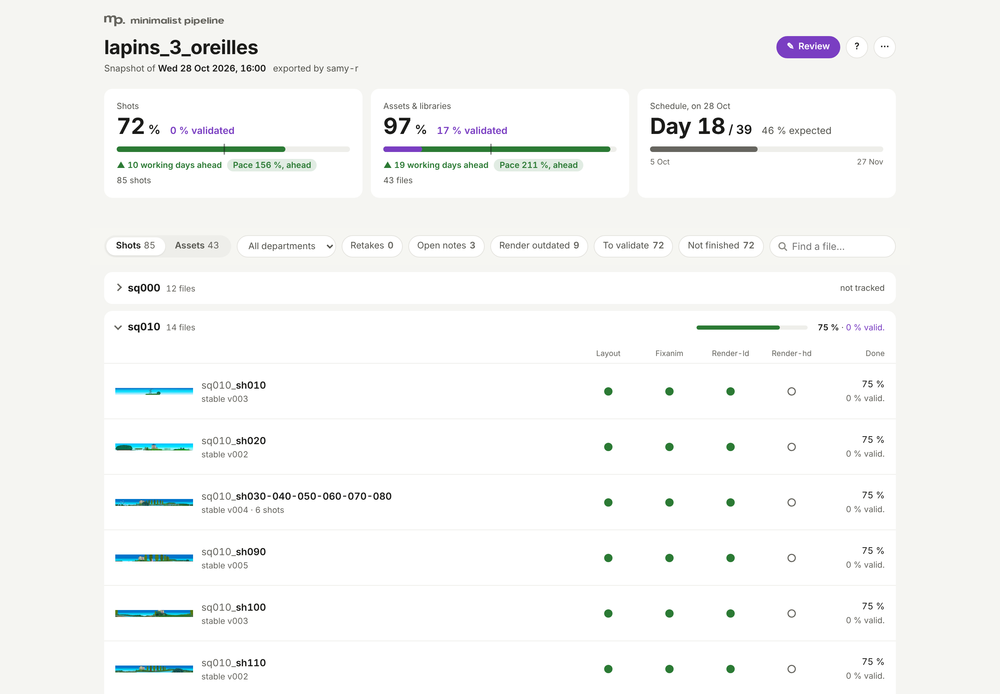
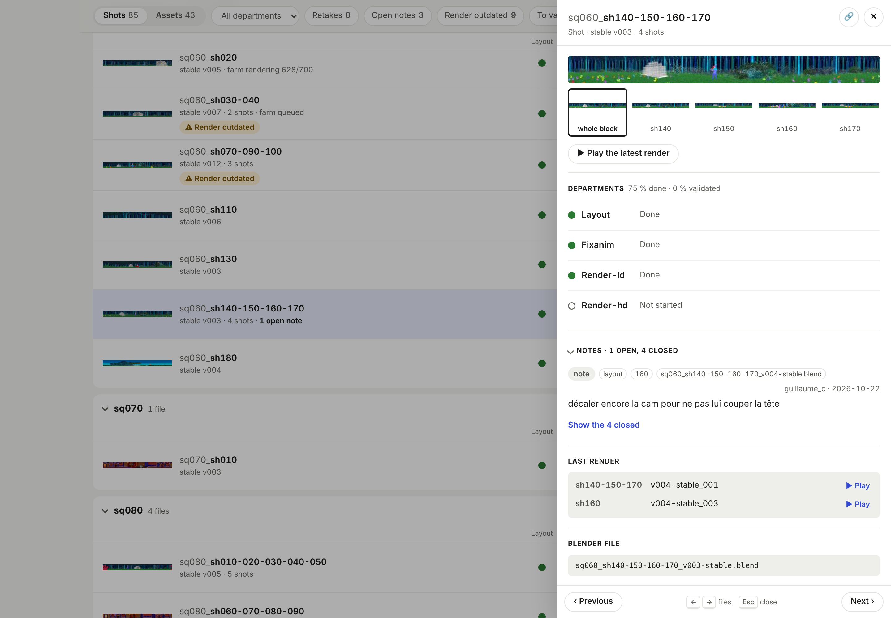
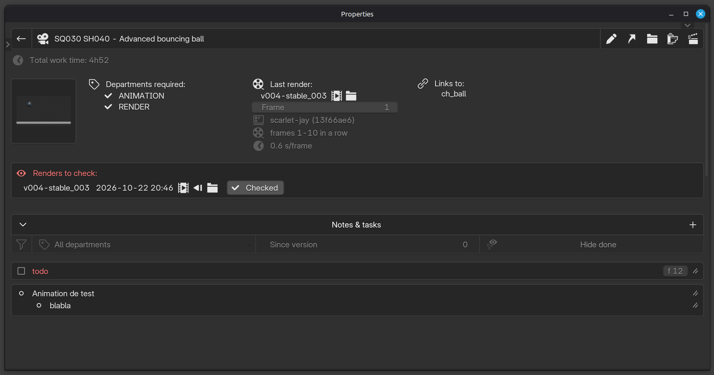
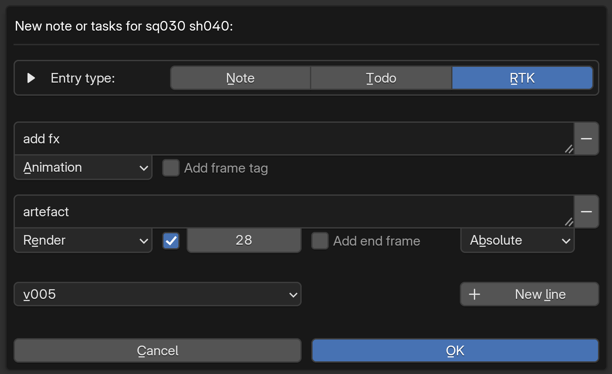

# Tracking & reviews

*[← Documentation index](README.md) · [Version française](tracking-and-reviews_fr.md)*

---

Every asset/shot has a `.pipeline/` folder next to its `.blend` files:

- **`tracking.json`**: required departments + a free-text description of what the asset/shot is (set at creation — interactively or via batch CSV, see [Project structure, naming, batch creation](project-and-naming.md)) + a list of entries (`note` / `todo` / `rtk`), each with author, date, its department(s), done/not-done state.
- **`{version}.wipmeta`**: one per work version — creation mode, departments worked on this session, linked libraries. Full details in [Versions: wip and stable](versions.md).
- **`{version}.stablemeta`**: one per `-stable` version — departments validated at that point. This is the reference point for computing "what's been touched since the last stable", shown throughout the UI. Individual departments can also be validated directly, without cutting a new `-stable` version — buttons next to each department in the Tracking panel/dashboard, for departments (like "render") that aren't tied to editing the file itself. This mutates the *latest* stablemeta's `departments_validated` in place; requires at least one `-stable` version to already exist.

**Prod review import** (Project panel or Pipeline menu > *Import review*): reads back the review spreadsheet from a snapshot, as is. Each line of a department cell's text becomes its own retake (see *Review template* below; a *text* cell in a template from before 1.1.2) — several retakes on the same shot go on several lines (Alt+Enter), each one with its own checkbox. Author and date come from the top of the sheet (`prod` and the import day when left empty); each note is anchored on the version the snapshot showed. Importing the same file again, or a re-sent one with notes added, never duplicates: lines already imported are skipped. Descriptions edited in the *description* column (editable for that) are applied too, after a dialog listing every change (was / now): all of them, or none — to leave one out, fix the spreadsheet and import it again. Only a cell the production changed counts: a description changed in the project since the export is never reverted, and an empty cell changes nothing. A spreadsheet exported before 1.0.12 has its descriptions ignored. A popup lists what came in and what couldn't (e.g. a file renamed or branched since). Imported entries say so in their tooltip.

**Production snapshot** (Project panel or Pipeline menu > *Snapshot*): writes one HTML file — `<project>_snapshot_<YYYY-MM-DD>.html` — showing every asset/shot's status per department and every note (closed todos/RTKs included, hidden until "Show closed" is ticked), for people outside the studio (no Blender, no access to the share needed: it opens offline in any browser, and can be sent by mail). Each department reads *Not started* (never worked on nor done), *WIP* (work in progress: worked on since the last stable, or done at an earlier stable or worked on before the last one but not done at it -- reopened, or not finished yet), *Done*, or *Reworked* (done at the last stable, but worked on again after it), with its validation by a role next to it (see below). Project monitoring reads the same. A "Done" column shows how far along each asset/shot is — each required department counts for an equal share: not started 0 %, work in progress 33 %, validated but reworked since 67 %, validated with an open RTK 67 %, validated 100 % (the three middle values are set per project: Project settings > *Snapshot done*); a department with an open RTK is outlined in red, whatever its state — with the % of each sequence / asset prefix on its group row and an "All" row per table (section total and % per department). A *Progress* block at the top sums up the whole project (filters aside): Done of the shots and of the assets & libraries, the open RTKs, then per section a bar of its department tasks by state, in the pills' colours (validated, reworked, open RTK -- whatever the state --, WIP, not started) and its Done by sequence / prefix and by department, then a sequence (or prefix) × department grid, each cell shaded by its %. With a schedule (Project settings > *Schedule*: start and end dates, days off, and the days of the week worked -- Monday to Friday by default), it also gives where the project should be at an even pace on the export day -- working days so far over the schedule's -- how far ahead or behind each section is, and its pace (done / expected) in a pill coloured by band, as in a progress spreadsheet: 105 % and more ahead (green), 100 to 105 % on track (light green), 90 to 100 % slightly behind (amber), under 90 % behind (red); the expected progress is a line across every bar, and a *Schedule* band per section puts both on one scale of planned progress (0 % at the start date, 100 % at the end): the expected progress today as a line, the section's Done as the fill, the stretch between them light green when ahead, red when behind ("▲ 18 pts, 7 working days ahead"). Each section of the page (Progress, Assets, Shots) folds on a click on its title; all open at load, and a link into a folded one opens it. The Assets and Shots column headers stay at the top of the screen, under the filters, while their table scrolls by. Exports go to the project's `snapshots/` folder by default, named with the date and time. A "Last render" column gives the output folder of each asset/shot's last render (vXXX_YYY: the .blend version rendered, then the render increment), in red when it was rendered from a version older than the last stable, each line starting with its status pill, aligned down the table: *to check* while the team hasn't checked it, then the jobs still in the farm at export time — *queued*, their step in blue (*rendering 45/120*, *compiling*...), *failed* in red. A multishot also has, under its thumbnail, a small button per shot (010, 020...) in the block's order: hover one to see that shot's thumbnail, to find your way in an edit -- greyed for a shot not rendered yet. Each asset/shot shows a thumbnail from its latest render (the farm makes it when a render ends; the export makes any that are missing or out of date, from the frames already on disk). It can be filtered by name, group (prefix/sequence), department and state, open RTKs or open notes, or "Farm" (in the farm or to check), and a *Columns* menu hides the columns you don't need (remembered by the browser); each row with notes has an "n notes" button that unfolds them right under it, and *Notes* in the bar at the top unfolds (or folds) all of them -- printing prints every open note. The page carries a review spreadsheet (.xlsx) to download, one row per asset/shot, for production to fill in and send back. The scan runs in the background; Blender stays usable meanwhile. Once written, it opens in your browser (*Open when done*, next to *Thumbnails* in the file browser; untick to just save it).





Project monitoring (Project panel or Pipeline menu), a window of its own: the list of every file with its status per department, and a file's detail (notes/todos, with a click to validate an `rtk`, and its total logged work time — see [Design choices](design.md#work-duration-is-logged-never-surfaced-per-person) for what that total is and isn't). Described in [Interface](interface.md#overview-windows).

Multishot blocks can tag a note/todo with which shot in the block it's about — see [Shot blocks (multishot)](multishot.md).

**Renders to check**: when a farm job finishes (frames checked, video compiled), its render waits for a check. Project monitoring shows it in its "Farm" column as a button (click to play it), next to the Farm popup's icon for each job of the file still in the farm (submitted, queued, waiting between steps, in progress, failed) — one per shot, side by side for a block; hover an icon for its shot, version and step (rendering 45/120, compiling...). The check mark button after them marks the renders to check checked; a filter icon (camera) lists only the files with an icon there. A legend of these icons sits at the bottom of the table, next to the file count. The file's detail lists them in their own box (date, video, the render before it -- to play the previous version of the shot and compare --, folder, "Checked"), with an "In the farm" box below for its jobs still in the farm (shot, version, step), next to the last render of each shot, checked or not. Marking a render checked also archives its farm job, and shows all the file's departments, ticked as they're validated now ("render" ticked too): untick one the render shows isn't right, and it's unvalidated (needs a stable version, like any department validated by hand). A block keeps one per shot; a newer render of a shot replaces the older one.



---

## Done, then validated: validation roles

A department is **done** when its work is finished (the tick next to it --
called "validated" before 1.1.2, same data). **Validation** comes on top:
a role's sign-off -- the supervisor's, the production's -- on the version
it saw.

- **Roles** are set per project (Edit project > *Validation roles*, e.g.
  `sup:1,prod:2,real:2`): a higher level covers the lower ones (validated
  by prod: good for sup too), the same level is equivalent (prod or real).
  Without any set, `sup:1,prod:2`.
- **Your role**: Preferences > *Validation role*. Empty: a team member.
- **Validating**: in a file's detail, a star next to each done department
  gives or withdraws your role's validation (its tooltip lists every
  role: validated, covered by a higher one, or not). It's kept on the
  latest stable: a new stable starts with none -- the role hasn't seen it
  -- and shows the last one given ("prod: v012, to review again").
  Withdrawing or giving it writes a note under your role, for the record.
- **Notes under a role**: a note, todo or RTK written by someone with a
  role carries it (violet mark), and so do the notes imported from a
  review template. An RTK from a role is red, the team's own orange.
  The *New entry* dialog shows your role in an *As sup* box, on by
  default: untick it to write as the team (a technical note, say).
- **Project monitoring**: a done department reads "Done · prod" once
  validated; a filter (the star) lists the files with a done department
  still to validate -- for your role, or by any role if you have none.
- **Snapshot**: "✓ prod" next to a department's pill (each role in its
  tooltip), "prod v012" greyed for one validated on an earlier stable.
  A *Validated* figure sits apart from Done -- a tile per section, a
  column, the groups and totals, in violet: the share of the required
  departments validated by the top role (or one of its level) at the
  stable shown. Done stays the fabrication: 100 % done with nothing
  validated reads 100 % / 0 %.
- **Review template**: a first sheet *Review* for your name, the review
  date and your *Role* (required as soon as the file holds a retake or a
  validation), how to fill it and the colour legend; then a *Shots* and
  an *Assets* sheet, a row per file and **a cell per department** (only
  that section's departments), coloured by its state at the snapshot:
  white not started, amber WIP, light green done but reworked since,
  green done -- to validate --, violet already validated by the top role;
  a red border for an open retake; grey "–" not required (locked).
  - `ok` (or `yes`, `oui`, `v`, `✓`...) validates the department for your
    role -- refused if it isn't done.
  - `no` withdraws that validation.
  - any other text withdraws it too, and **each line becomes a retake**
    (RTK) of that department -- Alt+Enter for the next line. Start a line
    with `[sh020]` for one shot of a block, `[f12-40]` (or `[f12]`) for its
    frames, in any order: `[sh020] [f12-40] camera higher`; with `note:`
    for a remark instead of a retake.
  - *global*: `ok` validates every department done so far (a
    department's own cell wins over it), a text is a retake for no
    department in particular.
  - empty: nothing changes.

  The import asks first, naming the role and listing the validation
  changes, then refuses any validation of a file with a newer stable
  since the snapshot. A template exported by an earlier version still
  imports, as it was read then.

Nothing to migrate: `departments_validated` keeps its name, validations
are a new `approvals` key in the stablemeta, a note's role a new `role`
key -- absent, the team's own.

## Data structure: `tracking.json`

**`assets/ch/ch_bob/.pipeline/tracking.json`** — one per asset/shot, created with the file:

```json
{
  "file_name": "ch_bob",
  "created_at": "2026-03-25T16:00:00",
  "departments_required": ["modeling", "rigging", "texturing"],
  "description": "Main character, the fox.",
  "entries": [
    {
      "id": "a3f1c",
      "type": "todo",
      "text": "Add face shape keys",
      "author": "samy",
      "date": "2026-03-21T09:00:00",
      "department": "rigging",
      "done": false
    }
  ]
}
```

`type` is `note` (`done: null`, never checkable), `todo`, or `rtk` (fix requested — `done: true/false`, with `done_by`/`done_at` once validated).

**New entry**: one entry per line, whatever its type (RTK by default) -- each line its own departments, frames and, in a block, shot. Departments always show in the project's order (Edit project), wherever they're listed.



**Several departments**: an entry can be for several departments at once -- tick them in the department menu of the New entry / Edit dialogs. It's one entry with one done state, shown under each of its departments' filter; an open RTK turns each of its departments red (Project monitoring, snapshot). Stored as `"departments": ["animation", "lighting"]` next to `"department"` (the first one, what an addon before 1.1.0 reads). A review spreadsheet's department cell takes several too: `layout, lighting` (`,` `;` `/` `+`).

A finished farm render adds a `to_check` key, until it's marked checked: `{"<shot>": {"render", "video", "at", "job_id"}}` — the shot is `""` for an asset or a single shot, one key per shot for a block.

---

**See also**: [Versions: wip and stable](versions.md) for `.wipmeta`/`.stablemeta` · [Interface](interface.md) for the Tracking panel and the monitoring windows.
