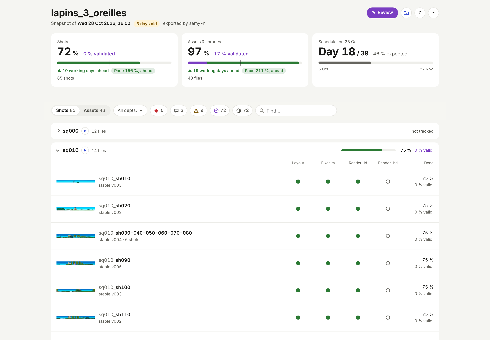
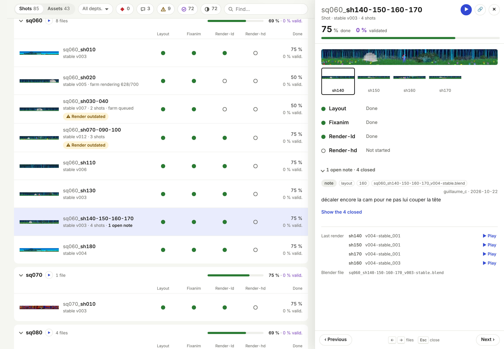
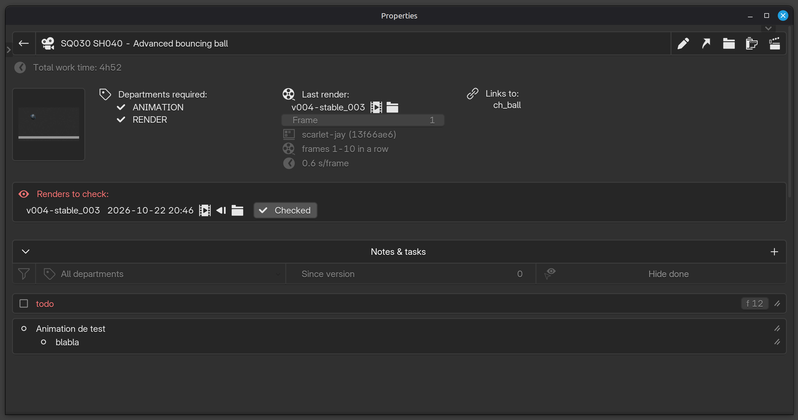
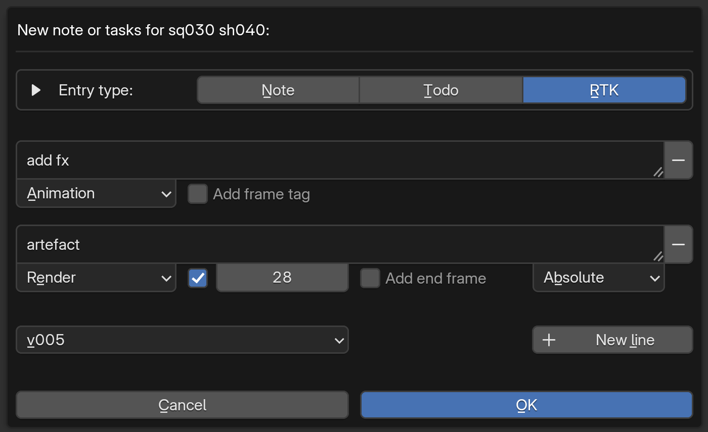

# Suivi & revues

*[← Index de la documentation](README.md) · [English version](tracking-and-reviews.md)*

---

Chaque asset/shot a un dossier `.pipeline/` à côté de ses fichiers `.blend` :

- **`tracking.json`** : départements requis + une description libre de ce qu'est l'asset/shot (définie à la création — interactivement ou via CSV en masse, voir [Structure de projet, nommage, création en masse](project-and-naming_fr.md)) + liste d'entrées (`note` / `todo` / `rtk`), chacune avec auteur, date, son ou ses départements, état fait/pas fait. Le titre *Notes & tasks* (panneau File, détail d'un fichier) affiche ce qui reste, replié ou non : les RTK ouverts en rouge, les todos ouverts en gris -- les notes ne sont pas comptées. *Hide done*, premier de ses filtres, fait réapparaître ceux qui sont faits : les retakes à vérifier sur un rendu. Le panneau latéral et le Project monitoring gardent chacun leurs filtres et leur repli.
- **`{version}.wipmeta`** : une par version de travail — mode de création, départements travaillés cette session, libs liées. Détails complets dans [Versions : wip et stable](versions_fr.md).
- **`{version}.stablemeta`** : une par version `-stable` — départements validés à ce moment-là. C'est le point de référence pour calculer "qu'est-ce qui a été retouché depuis le dernier stable" affiché partout dans l'UI. Un département peut aussi être validé directement, sans republier de version `-stable` — boutons à côté de chaque département dans le panneau Tracking/le dashboard, pour les départements (comme "render") qui ne sont pas liés à une modification du fichier. Ça mute le `departments_validated` du dernier stablemeta en place ; nécessite qu'au moins une version `-stable` existe déjà.

**Import de review prod** (panneau Projet ou menu Pipeline > *Import review*) : relit le tableur de review d'un snapshot, tel quel. Chaque ligne de texte d'une case de département devient un retake séparé (voir *Tableur de review* plus bas) — plusieurs retakes sur le même plan vont sur plusieurs lignes (Alt+Entrée), chacune avec sa case à cocher. Auteur et date viennent du haut de la feuille (`prod` et le jour de l'import s'ils sont vides) ; chaque note est ancrée sur le rendu que le reviewer a regardé -- le *Last render* que montrait le snapshot, par shot pour un bloc (`[sh120]` prend celui de sh120) -- et sur la version du `.blend` dont ce rendu est issu (`v007-stable_001` → `..._v007-stable.blend`), pas sur le dernier fichier : une étiquette *▶ v007-stable_001* sur la note (snapshot) et *Based on: ... (render v007-stable_001)* dans son infobulle disent lequel. La review porte ce rendu (une colonne cachée *render_watched*, un champ `render_watched` dans le `.json` de la page) ; un shot jamais rendu garde la version du fichier. Seule une review d'un snapshot de cette version de l'add-on est lue : celle d'un snapshot plus ancien est refusée -- exporter le snapshot à nouveau et faire la review dessus. Réimporter le même fichier, ou un fichier renvoyé avec des notes en plus, ne crée jamais de doublon : les lignes déjà importées sont ignorées. Les descriptions modifiées dans la colonne *description* (éditable pour ça) sont appliquées aussi, après un dialogue qui liste chaque changement (avant / après) : toutes, ou aucune — pour en écarter une, corriger le tableur et le réimporter. Seule une cellule modifiée par la prod compte : une description changée dans le projet depuis l'export n'est jamais remise à l'ancienne, et une cellule vide ne change rien. Une popup liste ce qui est entré et ce qui n'a pas pu (ex : un fichier renommé ou branché depuis). Les entrées importées l'indiquent dans leur infobulle.

**Snapshot de prod** (panneau Projet ou menu Pipeline > *Snapshot*) : écrit un seul fichier HTML -- `<projet>_snapshot_<AAAA-MM-JJ_HH-MM>.html`, dans le dossier `snapshots/` du projet par défaut -- avec l'état de chaque asset/shot par département et toutes les notes, pour les personnes hors studio (pas besoin de Blender ni d'accès au partage : il s'ouvre hors ligne dans n'importe quel navigateur, sur ordinateur ou téléphone, et s'envoie par mail). Le scan tourne en arrière-plan ; Blender reste utilisable pendant ce temps. Une fois écrit, il s'ouvre dans le navigateur (*Open when done*, à côté de *Thumbnails* dans le sélecteur de fichier ; décocher pour juste l'enregistrer).

- **En haut** : le projet et le moment du snapshot -- ouvert plus tard, une pastille « n days old » rappelle que le projet a pu avancer depuis --, puis une carte par section (shots, assets & libraries) avec son Done et son Validated. Avec un planning (Project settings > *Schedule* : dates de début et de fin, jours fériés, jours travaillés de la semaine -- du lundi au vendredi par défaut), chaque carte dit aussi de combien de jours ouvrés la section est en avance ou en retard à rythme régulier, et son rythme (fait / attendu) dans une pastille colorée par palier, comme dans un tableur de suivi : 105 % et plus en avance, 100 à 105 % dans les temps (vert), 90 à 100 % léger retard (ambre), moins de 90 % en retard (rouge) ; une carte *Schedule* donne le jour et l'avancement attendu.
- **La liste** : un onglet par section (Shots, Assets, et Libraries s'il y en a), les fichiers par séquence / préfixe, chaque groupe avec son Done et son Validated -- replié quand aucun de ses fichiers n'a de département suivi. Un fichier affiche sa vignette (à sa taille au survol à la souris, en plein écran d'un clic ou d'un tap), son nom, puis sur une ligne en dessous ses versions (`wip v004 · stable v003`, le wip seulement s'il est plus récent que le stable), le nombre de shots d'un bloc, ses notes ouvertes et son état dans la farm (▷ bleu en rendu, ◷ ambre en attente, ⚠ rouge en échec) ; puis une marque par département : fini ●, fini au dernier stable mais retravaillé depuis ◉ (reworked), en cours ◐, pas commencé ○, non requis –. Sous une marque, un ◆ par entrée ouverte, sa couleur disant de qui : rouge un RTK d'un rôle de validation, orange celui de l'équipe, gris un todo -- son infobulle précise ; un RTK sur aucun département met son ◆ sous chaque département fini, qu'il retient, et le fichier affiche *◆ General RTK* ; sa validation (✓ prod -- chaque rôle dans son infobulle --, barrée quand elle a été donnée sur un stable antérieur : à revoir) et, pendant une review, la vôtre (✓ you, ✕ you). Une pastille seulement pour ce qui ne se voit nulle part ailleurs : *⚠ Render outdated* (rendu depuis une version plus ancienne que la dernière stable), *Render to check*. Les départements qu'aucun fichier de la liste ne requiert n'ont pas de colonne ; les noms de colonnes restent sous la barre pendant le défilement.
- **Filtres** : un département (les boutons ne regardent alors que lui), puis chaque bouton en icône avec son nombre, son nom dans son infobulle, dans la légende *?* et en entier une fois actif -- *Your review* (✎, tant qu'il y en a une : les fichiers qu'elle a touchés), *Retakes* (◆, un RTK ouvert -- sur ce département ou sur aucun), *Open notes*, *Render outdated* (⚠), *To validate* (✓, un département fini pas validé à son stable), *In the farm* (▷, tant qu'un fichier y est : en rendu, en attente ou en échec), *Not finished* ; *Find…* (réduit à sa loupe quand la ligne est pleine) restreint la liste et propose les fichiers correspondants de toutes les sections -- Entrée ou un clic en ouvre un. Un filtre qui ne trouve rien dans cette section mais ailleurs le signale. *?* donne la légende, les touches et le calcul du Done.
- **Le panneau d'un fichier** (un clic sur sa ligne) : à côté de la liste sur ordinateur -- la liste se décale et reste active, un clic sur une autre ligne affiche celle-ci ; tirer le bord gauche du panneau l'élargit ou le rétrécit -- au-delà de sa largeur maximale, il remplit la page (un iPad en portrait), retiré depuis son bord gauche il revient à côté de la liste (retenu par le navigateur, double-clic pour la largeur par défaut) ; une liste étroite passe en présentation compacte --, en plein écran sur téléphone (glisser vers le bas pour le fermer) : son image en grand et, pour un bloc, celle de chaque shot ; sa description ; ses départements, chacun avec sa validation et ses RTK ouverts (qui, quand, son shot et ses frames) ; les RTK sur aucun département ; les autres notes, ouvertes d'abord (*Show the n closed*), chacune avec ses tags -- le rôle sous lequel elle a été écrite (violet), ses départements, son shot, ses frames, le rendu regardé en l'écrivant (▶ v007-stable_001) ; son dernier rendu par shot (la version rendue, ⚠ si plus ancienne que le stable, *to check*, l'état de la farm) et son fichier Blender. *Previous* / *Next* ou ← / → parcourent la liste filtrée (sur téléphone ‹ › dans son en-tête, ou un glissement sur le côté), Échap ferme ; 🔗 copie un lien qui ouvre ce fichier (`…_snapshot_….html#sq060_sh070`).
- **Done** : chaque département requis compte pour une part égale : pas commencé 0 %, en cours 33 %, fini mais retravaillé depuis 67 %, fini avec un RTK ouvert -- sur lui ou sur aucun -- 67 %, fini 100 % (les trois valeurs du milieu se règlent par projet : Project settings > *Snapshot done*). Un fichier fait la moyenne de ses départements, un groupe celle de ses fichiers. *Progress details*, en bas, donne le Done de chaque section par séquence / préfixe et par département -- l'avancement attendu en trait sur chaque barre -- et une grille séquence (ou préfixe) × département, chaque case teintée selon son %.
- **Vidéos** : la page lit la vidéo de chaque rendu. *Videos*, dans le sélecteur de fichier de l'export, choisit d'où -- retenu d'un export à l'autre, comme les séquences cochées : *Don't copy* (par défaut) ne copie rien : sur une machine qui atteint le projet, la page les lit dans `renders/` directement, en relatif (le navigateur charge une vidéo au ▶, il ne parcourt jamais un dossier) ; *Folder* les copie dans un dossier `videos/` à côté des snapshots, commun à tous -- seulement les vidéos nouvelles ou modifiées depuis le dernier export --, *Zip* dans un zip à côté du snapshot, à son nom (`..._snapshot_<date>.zip`) : les deux pour emporter le snapshot ailleurs, un dossier à envoyer tel quel, un zip à envoyer d'un bloc. Une copie absente (un snapshot *Folder* ouvert au studio sans son dossier), la page se rabat sur `renders/`. Les séquences sont listées, aucune cochée la première fois : la vidéo de chaque dernier rendu que montre la page, pour chaque shot des séquences cochées, est copiée (*Folder*, *Zip*) sous son chemin dans `renders/` (`sq100/sh030/v002-stable_001/sq100_sh030_v002-stable_001.mp4`) -- la même arborescence, donc un même nom marche depuis la copie ou depuis `renders/`. *Assets & libraries*, sous les séquences, ajoute de la même façon celle de chaque asset/library (`assets/ch/ch_bob/v003_002/...`). **Trop large ou illisible** : une vidéo de plus de 8192 px de large (un rendu panoramique -- au-delà, les navigateurs sur PC comme sur iPad la refusent) ou dans un codec que les navigateurs ne lisent pas (ProRes, DNxHR...) a une copie légère à côté, dans le dossier `ld/` de son rendu (H.265, 8192 px de large au plus), faite par la compilation de la farm : c'est elle que lit la page et qu'emporte le snapshot, la pleine gardée pour le montage. Un rendu compilé avant reçoit sa copie légère de l'export snapshot, une fois, pour les séquences cochées (il faut ffmpeg ; le log dit lesquelles). Copié après le HTML, en arrière-plan aussi ; une séquence sans rendu est ignorée (un avertissement dit laquelle), comme les assets/libraries sans vidéo. Le ▶ bleu de l'en-tête du panneau d'un fichier lit son rendu -- pour un bloc dont les shots ont été rendus séparément, la vidéo de chaque shot l'une après l'autre dans l'ordre du bloc (⏮ ⏭ ou ← → pour sauter) --, un petit ▶ après le nom de chaque séquence pour celles de tous ses fichiers à la suite, et *▶ Play* sur chaque ligne de *Last render* : une ligne par vidéo, un shot rendu séparément a la sienne. En review, *Last render* se replie : un ▶ par shot reste sous l'image. Des contrôles fins sous l'image (▶/❚❚, position, temps, plein écran ; Espace lit/met en pause), et la frame affichée -- `f1042`, numérotée comme dans le .blend (la première frame du rendu, d'après son historique de farm ou le nom de ses images, plus son rang dans la vidéo au fps du projet) : un bloc rendu d'un seul tenant compte sur sa propre timeline, comme Blender et les retakes `[f12-40]` ; ◂ ▸ (ou , et .) reculent / avancent d'une frame, en pause. Un rendu dont la première frame est inconnue compte depuis le début de sa vidéo (`#1`). Déplacées, renommées, ou sur une autre machine : *Choose the videos folder…* (le bouton dossier à côté de *?* tant qu'aucun n'est choisi, le menu ⋯ de la page, ou sous un rendu sans rien à lire) choisit le dossier qui les contient, quel que soit son nom -- le dossier `renders/` du projet marche aussi : dans Chrome ou Edge la page n'ouvre que les vidéos dont elle a besoin, par leur chemin, sans jamais parcourir le dossier (Firefox et Safari lisent d'abord chaque fichier du dossier choisi : y choisir `videos/`, pas `renders/`, plein d'images) ; sur téléphone, les vidéos elles-mêmes.
- Son menu ⋯ choisit aussi le thème de la page : *System* (celui de l'appareil), *Light* ou *Dark*, retenu par le navigateur.
- La page contient un tableur de review (.xlsx, dans son menu ⋯) à télécharger, une ligne par asset/shot, que la prod remplit et renvoie -- ou la review se fait directement dans la page (*Review dans la page*, plus bas).





Le Monitoring projet (panneau Project ou menu Pipeline), une fenêtre à part : la liste de tous les fichiers avec leur état par département, et le détail d'un fichier (notes/todos, avec un clic pour valider un `rtk`, et son temps de travail total loggé — voir [Choix de conception](design_fr.md), "La durée de travail est loggée, jamais affichée par personne", pour ce que ce total est et n'est pas). Décrits dans [Interface](interface_fr.md#fenêtres-de-vue-densemble).

Un bloc multishot peut taguer une note/todo avec le shot du bloc concerné — voir [Blocs de shots (multishot)](multishot_fr.md).

**Rendus à vérifier** : quand un job farm se termine (frames vérifiées, vidéo compilée), son rendu attend une vérification. Le Project monitoring l'affiche dans sa colonne "Farm" sous forme de bouton (clic pour la lire), à côté de l'icône du popup Farm pour chaque job du fichier encore dans la farm (soumis, en file d'attente, en attente entre deux étapes, en cours, en échec) — une par shot, côte à côte pour un bloc ; le survol d'une icône donne son shot, sa version et son étape (rendering 45/120, compiling...). Le bouton coche qui suit marque les rendus à vérifier comme vérifiés ; une icône de filtre (caméra) n'affiche que les fichiers qui ont une icône dans cette colonne. Une légende de ces icônes est en bas du tableau, à côté du nombre de fichiers. Le détail du fichier les liste dans leur propre box (date, vidéo, le rendu précédent -- pour lire la version d'avant du shot et comparer --, dossier, "Checked"), avec en dessous une box "In the farm" pour ses jobs encore dans la farm (shot, version, étape), à côté du dernier rendu de chaque shot, vérifié ou non. Marquer un rendu vérifié archive aussi son job farm, et affiche tous les départements du fichier, cochés selon leur validation actuelle ("render" coché en plus) : en décocher un que le rendu montre pas au point le dévalide (il faut une version stable, comme pour toute validation de département à la main). Un bloc en garde un par shot ; un rendu plus récent d'un shot remplace l'ancien.



---

## Fini, puis validé : les rôles de validation

Un département est **fini** (*done*) quand son travail est terminé (la
coche à côté de lui -- appelée « validé » avant la 1.1.2, mêmes données).
La **validation** vient par-dessus : l'accord d'un rôle -- le superviseur,
la prod -- sur la version qu'il a vue.

- **Les rôles** se règlent par projet (Edit project > *Validation roles*,
  par ex. `sup:1,prod:2,real:2`) : un niveau plus haut couvre les plus bas
  (validé par la prod : bon pour le sup aussi), le même niveau est
  équivalent (prod ou real). Sans réglage, `sup:1,prod:2`.
- **Votre rôle** : Préférences > *Validation role*. Vide : membre de
  l'équipe.
- **Valider** : dans le détail d'un fichier, une étoile à côté de chaque
  département fini donne ou retire la validation de votre rôle (son
  infobulle liste chaque rôle : validé, couvert par un plus haut, ou non).
  Elle est gardée sur le dernier stable, et un nouveau stable la garde
  tant que ce département n'a pas été retravaillé depuis (1.1.9 :
  « validated on v012, not worked since ») ; retravaillé, le nouveau
  stable repart sans -- le rôle ne l'a pas vu -- et affiche la dernière
  donnée (« prod : v012, à revoir »). La donner ou la retirer écrit une note sous votre rôle, pour
  la trace -- dans *Notes & tasks*, celles qui se suivent forment une
  seule boîte, une ligne par rôle et stable (« ★ prod: fixanim, render-ld
  · v003-stable », chaque note dans son infobulle).
- **Notes sous un rôle** : une note, todo ou RTK écrite par quelqu'un qui a
  un rôle le porte (marque violette), comme les notes importées d'un
  tableur de review. Un RTK d'un rôle est rouge dans le snapshot, celui de l'équipe orange ; dans Blender sa marque est le violet du rôle, comme ses notes, celle de l'équipe orange.
  La fenêtre *New entry* montre votre rôle dans une case *As sup*, cochée
  par défaut : décochez-la pour écrire au nom de l'équipe (une note
  technique, par exemple).
- **Une review au nom de l'équipe** : *team* dans le Role d'une review
  (celui de la page snapshot, du tableur de review -- sauf si un rôle de
  validation porte ce nom) : ses retakes et notes sont ceux de l'équipe
  -- sans rôle, orange, sans le tag « prod review » (importés d'une
  review d'équipe) -- et elle ne valide rien : les ✓ de la page sont
  désactivés, un ✓ ou un `ok` écrit avant est laissé de côté.
- **Project monitoring** : un département en RTK (rouge) ouvre, au clic,
  une petite popup avec ses retakes ouverts -- et ceux sur aucun
  département --, fermée dès que la souris sort. Un retake sur aucun
  département : le bouton à côté du nom du fichier (rouge) les montre. Un département fini affiche « Done · prod » une
  fois validé (l'étoile en plein pour le rôle le plus haut, la grille
  sinon grisée) ; un filtre (l'étoile) liste les fichiers dont un département
  fini reste à valider -- pour votre rôle, ou par n'importe quel rôle si
  vous n'en avez pas.
- **Snapshot** : « ✓ prod » sous la marque d'un département (chaque
  rôle dans son infobulle), barré pour une validation donnée sur un
  stable antérieur et retravaillé depuis (le panneau du fichier dit lequel : « ✓ sup on v012,
  to review again »). Un chiffre *Validated* s'affiche à part du Done --
  par section, groupe et fichier, en violet : la part des départements
  requis validés par le rôle le plus haut (ou un de son niveau) au stable
  affiché. Le Done reste la fabrication : 100 % fini sans rien de validé
  donne 100 % / 0 %.
- **Tableur de review** : un premier onglet *Review* pour votre nom, la
  date de review et votre *Role* (obligatoire dès que le fichier contient
  un retake ou une validation), le mode d'emploi et la légende des
  couleurs ; puis un onglet *Shots* et un onglet *Assets*, une ligne par
  fichier et **une case par département** (seulement ceux de la
  section), colorée selon son état au snapshot : blanc pas commencé,
  ambre en cours, vert clair fini mais retravaillé depuis, vert fini -- à
  valider --, violet déjà validé par le rôle le plus haut ; une bordure
  rouge pour un retake ouvert ; gris « – » non requis (verrouillé).
  - `ok` (ou `yes`, `oui`, `v`, `✓`...) valide le département pour votre
    rôle -- refusé s'il n'est pas fini.
  - `no` retire cette validation.
  - tout autre texte la retire aussi, et **chaque ligne devient un
    retake** (RTK) de ce département -- Alt+Entrée pour la ligne suivante.
    Commencez une ligne par `[sh020]` pour un shot d'un bloc, `[f12-40]`
    (ou `[f12]`) pour ses frames, dans n'importe quel ordre :
    `[sh020] [f12-40] caméra plus haute` ; par `note:` (ou `note :`,
    `n:`, majuscules ou non, après les tags) pour une remarque
    plutôt qu'un retake (une cellule de seules lignes `note:` laisse la
    validation du département telle quelle). Un tag qui n'en est pas un -- un shot hors du
    bloc, un intervalle à l'envers comme `[f40-12]` -- reste dans le texte.
  - *global* : `ok` valide tous les départements déjà finis (la case
    propre d'un département l'emporte), un texte est un retake sans
    département particulier.
  - vide : rien ne change.

  L'import demande d'abord, en rappelant le rôle et la liste des
  validations, puis refuse toute validation d'un département retravaillé
  depuis le stable vu par la review (un stable plus récent sans y avoir
  touché la garde). Un tableur exporté par une version
  précédente s'importe toujours, lu comme avant.

- **Review dans la page** (1.1.5) : au lieu du tableur, *✎ Review*
  affiche une barre en bas de l'écran -- votre nom et votre rôle ; ›
  la replie en un bouton rond ✎, avec le compte de la review -- et,
  dans le panneau d'un fichier, un ✓ à côté de chaque département (le
  valider pour votre rôle -- seulement s'il est fini) et un ✗ (une case
  pour les retakes, un par ligne : `[sh020]` en début de ligne pour un
  shot d'un bloc, `[f12-40]` pour ses frames, `note:` pour une remarque
  plutôt qu'un retake (seulement des remarques : ✎ you en gris, la
  validation laissée telle quelle) -- pour un bloc, une case pour tous ses shots et
  une par shot, ouverte par son bouton, chacune de ses lignes réécrite
  avec son tag `[sh020]` ; laissée
  vide, elle retire une validation) ; une ligne *All done* au-dessus
  des départements (son ✓ valide tous ceux qui sont finis) et une ligne
  *Whole file* en dessous (son ✕ ouvre un retake sur aucun département),
  avec les mêmes boutons ; *✎ Edit the description* sous celle-ci. La liste
  montre ce que vous avez fait sous chaque département (✓ you, ✕ you) ;
  *Last render* et *Blender file* s'effacent du panneau pendant la
  review. Touches : ← → (fichiers), Échap (fermer), V (all done), X
  (retake général), Échap ou Ctrl+Entrée dans un champ (en sortir).
  Une RTK ouverte -- de la prod ou de l'équipe -- a *✓ Fixed* à côté en
  review (un todo ouvert, *✓ Done*) : marquée, elle passe à fait à l'import de la review, au nom de
  son auteur (une déjà faite depuis, ou disparue, est laissée telle
  quelle ; réimporter ne change rien). *↩ Reply*, à côté et sous une
  note ouverte, écrit une réponse : ajoutée au fil de cette note à
  l'import, sous votre rôle -- lue comme la case d'un département : un
  retake (« encore à reprendre »), en rouge, sauf si chaque ligne est
  `note:`, une remarque, en gris. Une réponse retake renvoie le
  département de la note comme ✕ (✕ you, sa validation retirée à
  l'import ; sans département : le ✕ you du fichier) et est importée en
  RTK sur lui ; la RTK à laquelle elle répond reste ouverte (*✓ Fixed*
  dit qu'elle est faite).
  Pour la relire : *Your review*, parmi les filtres (ou un clic sur
  « n files reviewed » dans la barre de review, ou *See them* avant de
  télécharger), ne montre que les fichiers que la review a touchés.
  *Download* résume la review -- fichiers, validations, retakes,
  validations retirées -- et demande votre nom, votre rôle (obligatoire
  dès qu'elle contient un retake ou une validation) et la date de review,
  puis enregistre le `.json` : **Import review** le prend comme un
  `.xlsx` -- plusieurs d'un coup aussi (un par reviewer : le fichier
  porte son heure, son rôle et son auteur). Sur tablette ou téléphone,
  *Save or send…* à côté ouvre la feuille de partage du système :
  *Enregistrer dans Fichiers* choisit le dossier (un téléchargement
  atterrit là où le navigateur -- ou l'app qui affiche la page -- range
  les siens), ou AirDrop, Mail.... La page garde ce que vous
  écrivez dans votre navigateur au fil de l'eau (un rechargement le
  retrouve, dans le même navigateur -- pas en navigation privée ni sur une
  autre machine) ; le menu ⋯ de la barre propose *Load a review…*
  (rouvre une review téléchargée), *Clear this review* et *Leave the
  review*. Le tableur reste, pour plusieurs reviewers ou un drive
  partagé.

Rien à migrer : `departments_validated` garde son nom, les validations
sont une nouvelle clé `approvals` du stablemeta, le rôle d'une note une
nouvelle clé `role` -- absente, celle de l'équipe.

## Structure de données : `tracking.json`

**`assets/ch/ch_bob/.pipeline/tracking.json`** — un par asset/shot, créé avec le fichier :

```json
{
  "file_name": "ch_bob",
  "created_at": "2026-03-25T16:00:00",
  "departments_required": ["modeling", "rigging", "texturing"],
  "description": "Personnage principal, le renard.",
  "entries": [
    {
      "id": "a3f1c",
      "type": "todo",
      "text": "Ajouter les shape keys du visage",
      "author": "samy",
      "date": "2026-03-21T09:00:00",
      "department": "rigging",
      "done": false
    }
  ]
}
```

`type` vaut `note` (`done: null`, jamais cochable), `todo` ou `rtk` (retour à corriger — `done: true/false`, avec `done_by`/`done_at` une fois validé).

**New entry** : une entrée par ligne, quel que soit le type (RTK par défaut) -- chaque ligne ses propres départements, frames et, dans un bloc, shot. Les départements s'affichent toujours dans l'ordre du projet (Edit project), partout où ils sont listés.



**Plusieurs départements** : une entrée peut concerner plusieurs départements à la fois -- les cocher dans le menu département des dialogues New entry / Edit. C'est une seule entrée avec un seul état fait, affichée sous le filtre de chacun de ses départements ; une RTK ouverte met chacun de ses départements en rouge (Project monitoring, snapshot) ; une RTK sur aucun département (retake général) met le nom du fichier en rouge à la place dans le Project monitoring ; dans le snapshot elle entoure de rouge la pastille "n RTK" à côté du nom du fichier et compte dans le Done du fichier comme une RTK sur un seul département fait (le Done de chaque département n'y bouge pas), et dans le tableur de review chaque cellule département a la bordure rouge. Stocké en `"departments": ["animation", "lighting"]` à côté de `"department"` (le premier, ce que lit un addon d'avant la 1.1.0). La cellule département d'un tableur de review en accepte plusieurs aussi : `layout, lighting` (`,` `;` `/` `+`).

Un rendu farm terminé ajoute une clé `to_check`, jusqu'à ce qu'il soit marqué vérifié : `{"<shot>": {"render", "video", "at", "job_id"}}` — le shot vaut `""` pour un asset ou un shot seul, une clé par shot pour un bloc.

---

**Voir aussi** : [Versions : wip et stable](versions_fr.md) pour `.wipmeta`/`.stablemeta` · [Interface](interface_fr.md) pour le panneau Tracking et les fenêtres de monitoring.
