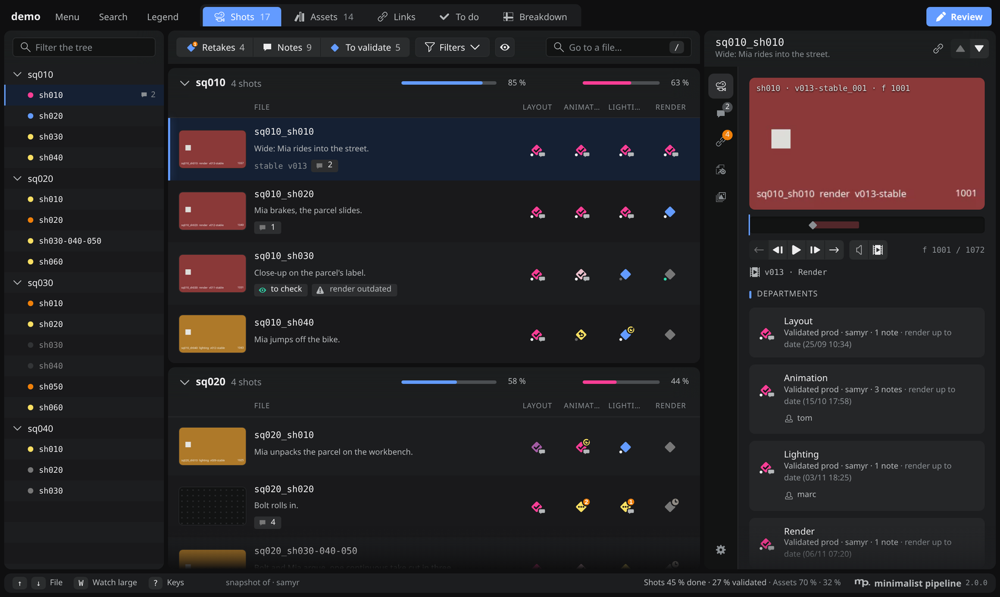
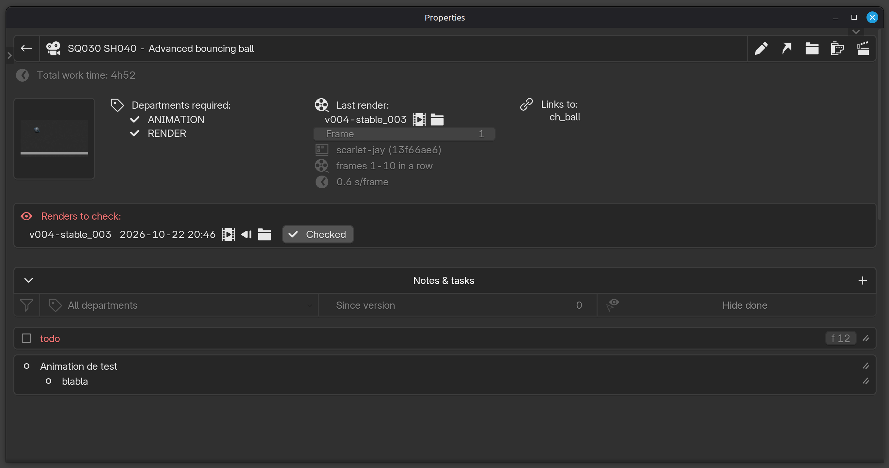

# Suivi & revues

*[← Index de la documentation](README.md) · [English version](tracking-and-reviews.md)*

---

Chaque asset/shot a un dossier `.pipeline/` à côté de ses fichiers `.blend` :

- **`tracking.json`** : départements requis + une description libre de ce qu'est l'asset/shot (définie à la création — interactivement ou via CSV en masse, voir [Structure de projet, nommage, création en masse](project-and-naming_fr.md)) + liste d'entrées (`note` / `todo` / `rtk`), chacune avec auteur, date, son ou ses départements, état fait/pas fait. Le titre *Notes & tasks* (panneau File, détail d'un fichier) affiche ce qui reste, replié ou non : les RTK ouverts en rouge, les todos ouverts en gris -- les notes ne sont pas comptées. *Hide done*, premier de ses filtres, fait réapparaître ceux qui sont faits : les retakes à vérifier sur un rendu. Le panneau latéral et le Project monitoring gardent chacun leurs filtres et leur repli. Un clic droit sur les icônes d'une entrée (sa case ou son rond, la poignée à sa droite) propose Reply, Edit, Mark done / Reopen et Delete.
- **`{version}.wipmeta`** : une par version de travail — mode de création, départements travaillés cette session, libs liées. Détails complets dans [Versions : wip et stable](versions_fr.md).
- **`{version}.stablemeta`** : une par version `-stable` — départements validés à ce moment-là. C'est le point de référence pour calculer "qu'est-ce qui a été retouché depuis le dernier stable" affiché partout dans l'UI. Un département peut aussi être validé directement, sans republier de version `-stable` — boutons à côté de chaque département dans le panneau Tracking/le dashboard, pour les départements (comme "render") qui ne sont pas liés à une modification du fichier. Ça mute le `departments_validated` du dernier stablemeta en place ; nécessite qu'au moins une version `-stable` existe déjà.

**Import de review prod** (panneau Projet ou menu Pipeline > *Import review*) : relit la review faite sur la page d'un snapshot (le `.json` qu'elle télécharge, voir *Review dans la page* plus bas). Chaque ligne de la case d'un département devient un retake séparé — plusieurs retakes sur le même plan vont sur plusieurs lignes, chacune avec sa case à cocher. Auteur et date sont ceux donnés à son téléchargement (`prod` et le jour de l'import s'ils sont vides) ; chaque note est ancrée sur le rendu que le reviewer a regardé -- le *Last render* que montrait le snapshot, par shot pour un bloc (`[sh120]` prend celui de sh120) -- et sur la version du `.blend` dont ce rendu est issu (`v007-stable_001` → `..._v007-stable.blend`), pas sur le dernier fichier : une étiquette *▶ v007-stable_001* sur la note (snapshot) et *Based on: ... (render v007-stable_001)* dans son infobulle disent lequel. La review porte ce rendu (un champ `render_watched` dans son `.json`) ; un shot jamais rendu garde la version du fichier. Seule une review d'un snapshot de cette version de l'add-on est lue : celle d'un snapshot plus ancien est refusée -- exporter le snapshot à nouveau et faire la review dessus. Réimporter le même fichier, ou un fichier renvoyé avec des notes en plus, ne crée jamais de doublon : les lignes déjà importées sont ignorées. Les descriptions modifiées dans la page (*✎ Edit the description*) sont appliquées aussi, après un dialogue qui liste chaque changement (avant / après) : toutes, ou aucune — pour en écarter une, la changer dans la page et retélécharger la review. Seule une description modifiée par la prod compte : une description changée dans le projet depuis l'export n'est jamais remise à l'ancienne, et une description vide ne change rien. Une popup liste ce qui est entré et ce qui n'a pas pu (ex : un fichier renommé ou branché depuis). Les entrées importées l'indiquent dans leur infobulle. Chaque review importée est gardée telle qu'elle a été envoyée, dans `snapshots/reviews/<rôle>/<AAAA-MM>/` (`team`, ou `no-role` ; le mois de sa date de review) : un même fichier n'est jamais copié deux fois, un autre du même nom reçoit un numéro.

**Snapshot de prod** (panneau Projet ou menu Pipeline > *Snapshot*) : écrit un seul fichier HTML -- `<projet>_snapshot_<AAAA-MM-JJ_HH-MM>.html`, dans le dossier `snapshots/<AAAA-MM>/` du projet par défaut (un par mois ; les snapshots d'avant la 1.2 restent à sa racine) -- avec l'état de chaque asset/shot par département et toutes les notes, pour les personnes hors studio (pas besoin de Blender ni d'accès au partage : il s'ouvre hors ligne dans n'importe quel navigateur, sur ordinateur ou téléphone, et s'envoie par mail). Le scan tourne en arrière-plan ; Blender reste utilisable pendant ce temps. Une fois écrit, il s'ouvre dans le navigateur (*Open when done*, à côté de *Thumbnails* dans le sélecteur de fichier ; décocher pour juste l'enregistrer).

**Page en live** (panneau Projet ou menu Pipeline > *Open in browser*) : la même page, servie par ce Blender au navigateur de cette machine et tenue à jour -- une note écrite, un enregistrement, un rendu terminé s'y voient en quelques secondes, sans exporter de nouveau. Une pastille à côté de l'heure dit *connected*, *Blender busy* (une tâche longue : elle attend) ou *disconnected* (Blender fermé, ou *Stop the live page* : elle se reconnecte seule dès que Blender la sert de nouveau, sans recharger). Les vidéos se lisent depuis le `renders/` du projet, à travers Blender. **Elle review en votre nom, aussitôt** : toujours en review, sous le nom d'utilisateur et le rôle de Blender (Préférences ; sans rôle : celui de l'équipe), et ce que vous faites -- ✓, un retake ou une note ajoutés, une réponse, *Mark fixed*, l'attribution, les réglages du fichier, une description une fois sa case quittée, *+ shot* -- est envoyé à Blender un instant après et appliqué comme l'import d'une review (les mêmes vérifications ; envoyé deux fois, rien ne change). L'en-tête dit *sending…*, puis *live* ; vos étiquettes YOU partent quand la page le montre fait. Pas appliqué (Blender longtemps occupé, fermé) : renvoyé tout seul. Le panneau d'un fichier y a plus : le bouton Blender à côté de son nom l'ouvre dans Blender (en demandant d'abord si le fichier de Blender a des changements non sauvegardés : sauvegarder, ne pas sauvegarder, annuler) ; *To check*, ses rendus pas encore regardés -- ▶ dans le lecteur, *Checked* en retire un (*Push to editing when checked*, coché, envoie sa vidéo aux rushes) ; *Linked files*, ce qu'il lie (une stable plus récente signalée) et ce qui le lie, un clic en ouvre un ; et sous le lecteur, chaque version de ses rendus avec une vidéo, à regarder à la place du principal. Sur cette machine seulement (`127.0.0.1`, un jeton dans son adresse) ; le snapshot reste pour ceux qui sont hors du studio.

- **En haut**, une ligne qui reste visible quand la page défile : le projet et le jour du snapshot -- ouvert plus tard, une pastille « n days old » rappelle que le projet a pu avancer depuis --, le Done et le Validated de chaque section (une double barre, `84 % · 3 %` ; avec un planning, son rythme dans une pastille colorée par palier, comme dans un tableur de suivi : 105 % et plus en avance, 100 à 105 % dans les temps, 90 à 100 % léger retard, moins de 90 % en retard -- les jours ouvrés d'avance ou de retard dans son infobulle), *Go to a file…* (/), *?* et *Review* (violet). La page est sombre, dans l'esprit de Blender, ou claire (menu ⋯ : System, Light, Dark) ; une couleur pour un sens : vert fait, orange en cours ou retravaillé, violet validé, rouge un retake, bleu la lecture et les plages d'images, ta review en neutre.
- **La liste** : un onglet par section (Shots, Assets, et Libraries s'il y en a) puis *Breakdown*, les fichiers par séquence / préfixe, chaque groupe une carte avec son Done et son Validated -- replié quand aucun de ses fichiers n'a de département à suivre. Un fichier montre sa vignette (à sa taille au survol à la souris, en plein écran au clic ou au toucher), son nom, puis ses versions (`wip v004 · stable v003`, la wip seulement si plus récente que la stable), le nombre de shots d'un bloc et ses notes ouvertes ; dessous, des étiquettes : un retake sans département (*RTK · WHOLE FILE*), *render to check*, *render outdated*, et la farm (en file en pointillés, en rendu, en échec en rouge) ; un fichier écarté (*On hold*, *Cancelled*) est estompé. Puis un losange keyframe par département : pas commencé (contour), en cours (à moitié plein), retravaillé depuis (ouvert, une flèche), fait (vert), validé (violet avec un ✓ : clair par un rôle, foncé par le rôle principal) ; en attente d'une étape précédente (une horloge dedans) ou à reprendre depuis qu'une a changé (un œil dedans), dans la couleur de son état ; non requis, rien. Au survol ou au focus, le losange s'étire en capsule avec ses mots (`WIP · v005`, `DONE · stable v003`, `✓ PROD · Valerie`, et *Waiting* ou *To redo* avec leur raison). Un retake ouvert y colle un post-it -- rouge d'un rôle de validation, bordé de rouge de l'équipe, leur nombre dedans (`2 RTK`) --, ta review un *YOU* au-dessus. À droite, le Done et le Validated du fichier.
- **Filtres** : un département (les boutons ne regardent alors que lui), puis chaque bouton avec son icône, son nom et son nombre -- *Your review* (✎, tant qu'il y en a une : les fichiers qu'elle a touchés), *Retakes* (un RTK ouvert -- sur ce département ou sur aucun), *Open notes*, *Render outdated*, *To validate* (un département fait que sa stable n'a pas validé), *In the farm* (tant qu'un fichier y est : en rendu, en file ou en échec), *Not finished*. *Go to a file…* dans l'en-tête (/ de n'importe où) resserre la liste et liste les fichiers trouvés de toutes les sections -- Entrée ou un clic en ouvre un. Un filtre qui ne trouve rien dans cette section mais ailleurs le dit. *?* donne la légende, les touches et le calcul du Done.
- **Le panneau d'un fichier** (un clic sur sa ligne) : à côté de la liste sur un ordinateur -- la liste se décale et reste active, un clic sur une autre ligne affiche celle-ci ; son bord gauche se tire pour l'élargir ou le rétrécir -- au-delà de sa largeur maximale, il prend toute la page (un iPad en portrait), tiré depuis son bord gauche il revient à côté de la liste (gardé par le navigateur, un double clic pour la largeur par défaut) ; une liste étroite passe en compact : des lignes de 58 px, une petite vignette, le nom et une ligne, le losange de chaque département dans une colonne de 30 px nommée par ses initiales (L, A, Li, R) --, tout l'écran sur un téléphone (glissé vers le bas pour fermer, *Previous* / *Next* en bas) et sur une tablette. Au doigt, un premier toucher sur un losange montre ses mots, un second ouvre le fichier. En haut, **le lecteur** : la vidéo du fichier (ses shots l'un après l'autre), sa timeline portant les notes à leurs images -- le losange rouge d'un retake, la barre bleue d'une plage (`f12-30`), les tiennes cerclées ; un clic y va --, ◂ ▶ ▸ (`,` `.` une image en arrière / en avant, Espace pour lire), l'image comme numérotée dans le .blend (`f12 / f96 · 30 fps`) et **⤢ Watch large** : la vidéo sur toute la fenêtre, les départements avec ✓ / ✕ et les notes à leurs images dans une colonne à côté, la timeline et ⏮ ◂ ▶ ▸ ⏭ dessous, les fichiers de la séquence en bas (un clic en lit un ; après la dernière vidéo d'un fichier, celle du suivant) -- Échap pour revenir au panneau. Le ▶ d'une séquence dans la liste ouvre Watch large dessus. Pas de vidéo à lire : pourquoi, et *Choose the videos folder…*, à sa place. Puis sa description et ses départements, chacun avec son losange, son état et ce qui y est ouvert (`done · 1 retake · 1 thread`), sa validation, ✓ / ✕ pendant une review, et **ses fils dessous** -- chaque note à un seul endroit, sous son premier département (aucun : sous *Whole file*) : l'initiale de son auteur, qui, en tant que quoi, quand, son type (RTK rouge, TODO orange, NOTE neutre), ses images (un clic y va), ses réponses en retrait ; les fermées repliées (*1 closed todo · show*). En bas, son dernier rendu par shot (la version rendue, ⚠ si plus ancienne que la stable, *to check*, l'état de la farm, ▶ le lit au-dessus) et son fichier Blender. *Previous* / *Next* ou ← / → parcourent la liste filtrée (sur un téléphone ‹ › dans son en-tête, ou un glissement latéral), Échap ou la languette sur son bord gauche le ferme (au bord de la fenêtre ensuite, la languette le rouvre) ; le bouton lien copie un lien qui ouvre ce fichier (`…_snapshot_….html#sq060_sh070`).
- **Done** : chaque département requis compte pour une part égale : pas commencé 0 %, en cours 33 %, fini mais retravaillé depuis 67 %, fini avec un RTK ouvert -- sur lui ou sur aucun -- 67 %, fini 100 % (les trois valeurs du milieu se règlent par projet : Project settings > *Snapshot done*). Un fichier fait la moyenne de ses départements, un groupe celle de ses fichiers. L'onglet *Breakdown* montre, à la place de la liste, le planning (le jour, l'avancement attendu) et donne le Done de chaque section par séquence / préfixe et par département -- l'avancement attendu en trait sur chaque barre -- et une grille séquence (ou préfixe) × département, chaque case teintée selon son %.
- **Vidéos** : la page lit la vidéo de chaque rendu. *Videos*, dans le sélecteur de fichier de l'export, choisit d'où -- retenu d'un export à l'autre, comme les séquences cochées : *Don't copy* (par défaut) ne copie rien : sur une machine qui atteint le projet, la page les lit dans `renders/` directement, en relatif (le navigateur charge une vidéo au ▶, il ne parcourt jamais un dossier) ; *Folder* les copie dans `snapshots/videos/`, commun aux snapshots de tous les mois (la page le trouve en `../videos` ; un snapshot enregistré ailleurs, dans un `videos/` à côté de lui) -- seulement les vidéos nouvelles ou modifiées depuis le dernier export : emporter tout le dossier `snapshots/` --, *Zip* dans un zip à côté du snapshot, à son nom (`..._snapshot_<date>.zip`) : les deux pour emporter le snapshot ailleurs, un dossier à envoyer tel quel, un zip à envoyer d'un bloc. Une copie absente (un snapshot *Folder* ouvert au studio sans son dossier), la page se rabat sur `renders/`. Les séquences sont listées, aucune cochée la première fois : la vidéo de chaque dernier rendu que montre la page, pour chaque shot des séquences cochées, est copiée (*Folder*, *Zip*) sous son chemin dans `renders/` (`sq100/sh030/v002-stable_001/sq100_sh030_v002-stable_001.mp4`) -- la même arborescence, donc un même nom marche depuis la copie ou depuis `renders/`. *Assets & libraries*, sous les séquences, ajoute de la même façon celle de chaque asset/library (`assets/ch/ch_bob/v003_002/...`). Seul le rendu principal de chaque shot part (celui du département le plus haut, voir [farm](farm_fr.md)) ; *Every department* emporte aussi le dernier rendu de chaque département, lu sur la page sous le principal -- sans elle, ceux-là se lisent depuis `renders/` là où le projet est accessible. **Trop large ou illisible** : une vidéo de plus de 8192 px de large (un rendu panoramique -- au-delà, les navigateurs sur PC comme sur iPad la refusent) ou dans un codec que les navigateurs ne lisent pas (ProRes, DNxHR...) a une copie légère à côté, dans le dossier `ld/` de son rendu (H.265, 8192 px de large au plus), faite par la compilation de la farm : c'est elle que lit la page et qu'emporte le snapshot, la pleine gardée pour le montage. Un rendu compilé avant reçoit sa copie légère de l'export snapshot, une fois, pour les séquences cochées (il faut ffmpeg ; le log dit lesquelles). Copié après le HTML, en arrière-plan aussi ; une séquence sans rendu est ignorée (un avertissement dit laquelle), comme les assets/libraries sans vidéo. Le ▶ bleu de l'en-tête du panneau d'un fichier lit son rendu -- pour un bloc dont les shots ont été rendus séparément, la vidéo de chaque shot l'une après l'autre dans l'ordre du bloc (⏮ ⏭ ou ← → pour sauter) --, un petit ▶ après le nom de chaque séquence pour celles de tous ses fichiers à la suite, et *▶ Play* sur chaque ligne de *Last render* : une ligne par vidéo, un shot rendu séparément a la sienne. En review, *Last render* se replie : un ▶ par shot reste sous l'image. Des contrôles fins sous l'image (▶/❚❚, position, temps, plein écran ; Espace lit/met en pause), et la frame affichée -- `f1042`, numérotée comme dans le .blend (la première frame du rendu, d'après son historique de farm ou le nom de ses images, plus son rang dans la vidéo au fps du projet) : un bloc rendu d'un seul tenant compte sur sa propre timeline, comme Blender et les retakes `[f12-40]` ; ◂ ▸ (ou , et .) reculent / avancent d'une frame, en pause. Un rendu dont la première frame est inconnue compte depuis le début de sa vidéo (`#1`). Déplacées, renommées, ou sur une autre machine : *Choose the videos folder…* (le bouton dossier à côté de *?* tant qu'aucun n'est choisi, le menu ⋯ de la page, ou sous un rendu sans rien à lire) choisit le dossier qui les contient, quel que soit son nom -- le dossier `renders/` du projet marche aussi : dans Chrome ou Edge la page n'ouvre que les vidéos dont elle a besoin, par leur chemin, sans jamais parcourir le dossier (Firefox et Safari lisent d'abord chaque fichier du dossier choisi : y choisir `videos/`, pas `renders/`, plein d'images) ; sur téléphone, les vidéos elles-mêmes.
- Son menu ⋯ choisit aussi le thème de la page : *System* (celui de l'appareil), *Light* ou *Dark*, retenu par le navigateur.
- La review se fait directement dans la page et revient sous forme d'un `.json` (*Review dans la page*, plus bas).




Le Monitoring projet (panneau Project ou menu Pipeline), une fenêtre à part : la liste de tous les fichiers avec leur état par département, et le détail d'un fichier (notes/todos, avec un clic pour valider un `rtk`, et son temps de travail total loggé — voir [Choix de conception](design_fr.md), "La durée de travail est loggée, jamais affichée par personne", pour ce que ce total est et n'est pas). Décrits dans [Interface](interface_fr.md#fenêtres-de-vue-densemble).

Un bloc multishot peut taguer une note/todo avec le shot du bloc concerné — voir [Blocs de shots (multishot)](multishot_fr.md).

**Rendus à vérifier** : quand un job farm se termine (frames vérifiées, vidéo compilée), son rendu attend une vérification. Le Project monitoring l'affiche dans sa colonne "Farm" sous forme de bouton (clic pour la lire), à côté de l'icône du popup Farm pour chaque job du fichier encore dans la farm (soumis, en file d'attente, en attente entre deux étapes, en cours, en échec) — une par shot, côte à côte pour un bloc ; le survol d'une icône donne son shot, sa version et son étape (rendering 45/120, compiling...). Le bouton coche qui suit marque les rendus à vérifier comme vérifiés ; une icône de filtre (caméra) n'affiche que les fichiers qui ont une icône dans cette colonne. Une légende de ces icônes est en bas du tableau, à côté du nombre de fichiers (derrière un bouton *Legend* quand la place manque). Le détail du fichier les liste dans leur propre box (date, vidéo, le rendu précédent -- pour lire la version d'avant du shot et comparer --, dossier, "Checked"), avec en dessous une box "In the farm" pour ses jobs encore dans la farm (shot, version, étape), à côté du dernier rendu de chaque shot, vérifié ou non. Marquer un rendu vérifié archive aussi son job farm, et affiche tous les départements du fichier, cochés selon leur validation actuelle ("render" coché en plus) : en décocher un que le rendu montre pas au point le dévalide (il faut une version stable, comme pour toute validation de département à la main). Un par shot et par département (celui du preset du rendu, voir [Farm](farm_fr.md)) : un rendu plus récent d'un shot remplace l'ancien du même département, pas celui d'un autre ; son département apparaît dans son nom (`sh040 animation v005`), et *Checked* coche ce département d'abord au lieu de "render".



---

## Étapes : Waiting et À reprendre

**Étapes** (Edit project, dans le champ des départements lui-même) : `layout > animation > fx, lighting > render` -- `>` l'étape suivante, une virgule pour des départements en parallèle. Seulement des virgules (`layout, animation, lighting, render`, comme avant) : pas d'étapes, rien ne change. Rien n'est jamais bloqué : c'est de l'information.

- **Waiting** : une étape précédente a un RTK ouvert, ou n'est pas commencée -- *Waiting: layout RTK*, *Waiting: layout not started*. Affiché à la place de l'état du département dans Project monitoring ; son état propre reste dans l'infobulle.
- **To redo** (à reprendre) : un département déjà commencé dont une étape précédente a changé après sa dernière mise à jour -- un RTK de cette étape fermé, ou un stable fait avec elle retravaillée -- *To redo: layout changed on 12/11*. Sa dernière mise à jour : un enregistrement dans une session où il était coché comme travaillé, ou **Still done**.
- **Où** : les cellules de Project monitoring (une légende dans son pied de page dès que le projet a des étapes), les départements de File details, les boutons *Working on* du panneau latéral. Sur la page du snapshot, une horloge (Waiting) ou une flèche orange (To redo) à la place du losange, l'état en petit losange sur son coin ; la raison sous le nom du département dans le panneau du fichier.
- **Still done** (File details, ou le ✓ à côté d'un bouton du panneau latéral, sur un département à reprendre, ouvert à tous) : le travail fait tient toujours après le changement -- noté avec qui et quand, et un pourquoi facultatif ; ce n'est pas une validation.

## On hold et Cancelled

**Écarter un fichier** sans l'archiver (File details, le bouton pause) : *On hold* (en pause, en attente d'une décision) ou *Cancelled* (coupé au montage, abandonné), avec un pourquoi. Il reste dans les listes de Blender, grisé avec sa marque (sur la page du snapshot : masqué, une ligne en bas de sa séquence le montre), et sort des parts faites (les chiffres du snapshot, le rythme du planning), des filtres Retakes et To validate, et des étapes (ni Waiting ni To redo). Le même bouton le remet *Active*. La marque d'un bloc vaut pour tous ses shots.

## Équipe et attribution

**L'équipe** (Edit project → *Team*, les noms séparés par une virgule) : chacun choisit son nom d'utilisateur dedans (Préférences ou la fenêtre d'accueil, le bouton de l'équipe à côté du champ du nom ; un nom absent de l'équipe est signalé), et les départements d'un fichier sont attribués à ses membres.

- **Attribuer** (File details, le bouton de l'équipe à côté d'un département, ouvert à tous) : cocher pour qui c'est -- le layout de sh010 à Léa, son animation à Tom. Facultatif, une affaire de filtre : rien n'est compté à partir de là (pas de charge par personne, voir [Choix de conception](design_fr.md)). Stocké dans `tracking.json` : `"assignees": {"animation": ["tom"]}`.
- **Moi** (les filtres de Project monitoring, l'icône personne -- celle de l'équipe quand il est éteint) : seulement les fichiers avec un département qui t'est attribué.
- **Sur la page du snapshot** : à qui chaque département est attribué, sous son nom ; *Me* parmi les filtres (ton nom dans la review). En review, les noms de chaque département sont un bouton : son menu, l'équipe à cocher -- envoyé comme action `assign`, appliqué à l'import comme le ferait File details.

## Fini, puis validé : les rôles de validation

Un département est **fini** (*done*) quand son travail est terminé (la
coche à côté de lui -- appelée « validé » avant la 1.1.2, mêmes données).
La **validation** vient par-dessus : l'accord d'un rôle -- le superviseur,
la prod -- sur la version qu'il a vue.

- **Les rôles** se règlent par projet (Edit project > *Validation roles*,
  par ex. `sup:1,prod:2,real:2`) : un niveau plus haut couvre les plus bas
  (validé par la prod : bon pour le sup aussi), le même niveau est
  équivalent (prod ou real). Sans réglage, `sup:1,prod:2`.
- **Votre rôle** : Préférences > *Validation role*. Vide : membre de
  l'équipe.
- **Valider** : dans le détail d'un fichier, une étoile à côté de chaque
  département fini donne ou retire la validation de votre rôle (son
  infobulle liste chaque rôle : validé, couvert par un plus haut, ou non).
  Elle est gardée sur le dernier stable, et un nouveau stable la garde
  tant que ce département n'a pas été retravaillé depuis (1.1.9 :
  « validated on v012, not worked since ») ; retravaillé, le nouveau
  stable repart sans -- le rôle ne l'a pas vu -- et affiche la dernière
  donnée (« prod : v012, à revoir »). La donner ou la retirer écrit une note sous votre rôle, pour
  la trace -- dans *Notes & tasks*, celles qui se suivent forment une
  seule boîte, une ligne par rôle et stable (« ★ prod: fixanim, render-ld
  · v003-stable », chaque note dans son infobulle).
- **Notes sous un rôle** : une note, todo ou RTK écrite par quelqu'un qui a
  un rôle le porte (sa case ou son point en violet dans Blender), comme les notes importées d'une
  review. Un RTK d'un rôle est rouge dans le snapshot, celui de l'équipe rouge clair ; dans Blender, la case d'un rôle est violette, celle de l'équipe celle de Blender.
  La fenêtre *New entry* montre votre rôle dans une case *As sup*, cochée
  par défaut : décochez-la pour écrire au nom de l'équipe (une note
  technique, par exemple).
- **Une review au nom de l'équipe** : *team* dans le Role d'une review
  (celui de la page snapshot -- sauf si un rôle de
  validation porte ce nom) : ses retakes et notes sont ceux de l'équipe
  -- sans rôle, orange, sans le tag « prod review » (importés d'une
  review d'équipe) -- et elle ne valide rien : les ✓ de la page sont
  désactivés, un ✓ ou un `ok` écrit avant est laissé de côté.
- **Project monitoring** : un département en RTK (rouge) ouvre, au clic,
  une petite popup avec ses retakes ouverts -- et ceux sur aucun
  département --, fermée dès que la souris sort. Un retake sur aucun
  département : le bouton à côté du nom du fichier (rouge) les montre. Un département fini affiche « Done · prod » une
  fois validé (l'étoile en plein pour le rôle le plus haut, la grille
  sinon grisée) ; un filtre (l'étoile) liste les fichiers dont un département
  fini reste à valider -- pour votre rôle, ou par n'importe quel rôle si
  vous n'en avez pas.
- **Snapshot** : « ✓ prod » sous la marque d'un département (chaque
  rôle dans son infobulle), barré pour une validation donnée sur un
  stable antérieur et retravaillé depuis (le panneau du fichier dit lequel : « ✓ sup on v012,
  to review again »). Un chiffre *Validated* s'affiche à part du Done --
  par section, groupe et fichier, en violet : la part des départements
  requis validés par le rôle le plus haut (ou un de son niveau) au stable
  affiché. Le Done reste la fabrication : 100 % fini sans rien de validé
  donne 100 % / 0 %.
- **Review dans la page** : *✎ Review* (violet, dans l'en-tête) ouvre
  d'abord une fenêtre : *Continue your review* quand le navigateur en
  garde une ; votre nom, la date de review et votre rôle (des boutons,
  une ligne disant ce que fait chacun : l'équipe écrit retakes et notes,
  sans validation) ; ce qu'on veut *parcourir* -- *To validate*, *Open
  retakes and notes*, *Everything, in order*, *What the filters show*
  (les filtres réglés pour, son premier fichier ouvert) ; *Load a review
  file…*. Pendant la review, l'en-tête montre qui, en tant que quoi et
  combien de fichiers (un clic : la même fenêtre, pour les changer) et
  *Send…* ; le menu ⋯ *Clear this review…* et *Leave the review*. Dans
  le panneau d'un fichier, un département *To redo* a *Still done* (son
  travail tient toujours), et *File settings*, replié en bas, change ses
  départements requis et l'écarte (*Active*, *On hold*, *Cancelled*, avec
  un pourquoi) -- envoyés avec la review, ouverts à tous les rôles ; chaque séquence
  (ou préfixe) a *+ shot* (ou *+ asset*) : son numéro ou son nom, ses
  images, sa description et ses départements requis, vérifiés selon le
  nommage du projet, affiché prévu dans son groupe jusqu'à ce que
  l'import le crée ; et les chiffres suivent pendant qu'on écrit -- par
  section, groupe et fichier, après un crayon : ce que la review en
  ferait ; un ✓ à côté de chaque département (le
  valider pour votre rôle -- seulement s'il est fini) et un ✕. Chaque
  département tient sur une ligne : sa marque, son nom, ce que dit votre
  review (✓ you, ✕ you), son état et ce qui est ouvert dessus (« not
  started · 2 RTK · 1 note · 1 closed »), à qui il est attribué (un rond
  en pointillés s'il n'y a personne : son menu vous met en premier, puis
  l'équipe, puis *Nobody*), ✓ et ✕. **✕ ouvre une case sous l'en-tête du
  département** : *Retake* ou *Note* (ou `note:` tapé au début), un par
  ligne, `[f12-40]` pour des frames ; sur un bloc, *On All / sh010 /
  sh020…* -- la même chose que le `[sh020]` en début de ligne, l'un change
  l'autre --, *+ f12* place la frame affichée après lui (encore une fois
  sur une autre frame : la plage entre les deux, `[f12-30]`). *Add retake*
  (Ctrl+Entrée, ⌘↵ sur Mac) ajoute les lignes et laisse la case ouverte
  pour la suivante ; sans rien écrire, le département est renvoyé sans
  texte (sa validation retirée) ; *Cancel* ou Échap la ferme. Ce que vous
  avez ajouté s'affiche au-dessus des fils du département, une ligne
  chacun avec ✕ YOU / NOTE · YOU et une × pour le retirer. Une note garde
  votre ✓ ; un retake le remplace. *Whole file* vient en premier : son ✕
  écrit un retake sur aucun département (X), son ✓ valide tous les
  départements finis (V). *✎ Edit the description* au-dessus. **Les
  notes** : une ligne par fil -- type (RTK, TODO, NOTE), frames (un clic y
  va), shot, texte, qui et quand --, un clic l'ouvre (ses réponses,
  *Reply*, *Mark fixed*) ; au survol, les deux en icônes. Un fil est
  ouvert par défaut s'il a une réponse de moins de 7 jours ou une des
  vôtres ; ensuite comme vous l'avez laissé. Les notes d'un même auteur
  le même jour partagent un en-tête. La barre au-dessus : *Open* (les
  fermés repliés sous « N closed », à la fin de leur département), *All*,
  *Mine* (les vôtres, ceux auxquels vous avez répondu ou que vous avez
  corrigés) ; *Newest* ou *By frame* -- gardés par le navigateur. *Reply*
  ouvre une case sous le dernier message du fil : *Retake* (« encore à
  reprendre » : son département renvoyé comme par ✕, importé en RTK sur
  lui) ou *Note* (une remarque) ; envoyée, elle s'affiche ↩ YOU, avec une
  × pour la retirer. *Mark fixed* (un todo ouvert : *Mark done*) la barre
  avec ✓ FIXED · YOU : faite à l'import, au nom de son auteur (une déjà
  faite depuis, ou disparue, est laissée telle quelle ; réimporter ne
  change rien) ; un nouveau clic l'annule. La RTK à laquelle on répond
  reste ouverte. *File settings*, replié à la fin : les départements
  requis et la mise de côté. Les chiffres que votre review change
  s'affichent après un crayon (with you 33 % · 5 %), leur bulle -- au
  survol ou d'un tap -- dit ce qu'ils sont aujourd'hui. La liste montre ce
  que vous avez fait sous chaque département (✓ you, ✕ you), et sous le
  nom du fichier les attributions changées ; *Last
  render* et *Blender file* s'effacent du panneau pendant la review.
  Touches : ← → (fichiers), Échap (fermer), V (all done), X (case du
  fichier entier), R (répondre au fil sélectionné) ; dans une case,
  Ctrl+Entrée ajoute, Échap annule.
  Pour la relire : *Your review*, parmi les filtres (ou *Show the changes* dans *Send your review*), ne montre que les fichiers que la review a touchés.
  *Send…* ouvre *Send your review* : votre
  nom, votre rôle (obligatoire dès qu'elle contient un retake ou une
  validation) et la date de review ; puis fichier par fichier ce qu'elle
  contient, avec les symboles de la liste (✓ un département validé, ✕ un
  retake et son texte, une description, des corrections, des réponses) ;
  le nom du `.json` -- la page n'envoie rien elle-même : téléchargez-le et
  envoyez-le au studio (mail, SwissTransfer). *Clear this review…*, *Keep
  reviewing*, *Download* : **Import review** prend le fichier --
  plusieurs d'un coup aussi (un par reviewer : le fichier porte son
  heure, son rôle et son auteur). Sur tablette ou téléphone, le bouton
  devient *Save or send…*, la feuille de partage du système :
  *Enregistrer dans Fichiers* choisit le dossier (un téléchargement
  atterrit là où le navigateur -- ou l'app qui affiche la page -- range
  les siens), ou AirDrop, Mail.... La page garde ce que vous
  écrivez dans votre navigateur au fil de l'eau (un rechargement le
  retrouve, dans le même navigateur -- pas en navigation privée ni sur une
  autre machine) ; le menu ⋯ de la barre propose *Load a review…*
  (rouvre une review téléchargée), *Clear this review* et *Leave the
  review*. L'import demande d'abord, en rappelant le rôle et la liste
  des validations, puis refuse toute validation d'un département
  retravaillé depuis le stable vu par la review (un stable plus récent
  sans y avoir touché la garde).

Rien à migrer : `departments_validated` garde son nom, les validations
sont une nouvelle clé `approvals` du stablemeta, le rôle d'une note une
nouvelle clé `role` -- absente, celle de l'équipe.

## Structure de données : `tracking.json`

**`assets/ch/ch_bob/.pipeline/tracking.json`** — un par asset/shot, créé avec le fichier :

```json
{
  "file_name": "ch_bob",
  "created_at": "2026-03-25T16:00:00",
  "departments_required": ["modeling", "rigging", "texturing"],
  "description": "Personnage principal, le renard.",
  "entries": [
    {
      "id": "a3f1c",
      "type": "todo",
      "text": "Ajouter les shape keys du visage",
      "author": "samy",
      "date": "2026-03-21T09:00:00",
      "departments": ["rigging"],
      "done": false
    }
  ]
}
```

`type` vaut `note` (`done: null`, jamais cochable), `todo` ou `rtk` (retour à corriger — `done: true/false`, avec `done_by`/`done_at` une fois validé).

**New entry** : une entrée par ligne, quel que soit le type (RTK par défaut) -- chaque ligne ses propres départements, frames et, dans un bloc, shot. Les départements s'affichent toujours dans l'ordre du projet (Edit project), partout où ils sont listés.


**Plusieurs départements** : une entrée peut concerner plusieurs départements à la fois -- les cocher dans le menu département des dialogues New entry / Edit. C'est une seule entrée avec un seul état fait, affichée sous le filtre de chacun de ses départements ; une RTK ouverte met chacun de ses départements en rouge (Project monitoring, snapshot) ; une RTK sur aucun département (retake général) met le nom du fichier en rouge à la place dans le Project monitoring ; dans le snapshot elle entoure de rouge la pastille "n RTK" à côté du nom du fichier et compte dans le Done du fichier comme une RTK sur un seul département fait (le Done de chaque département n'y bouge pas). Stocké en `"departments": ["animation", "lighting"]` (un seul département : une liste d'un).

Un rendu farm terminé ajoute une clé `to_check`, jusqu'à ce qu'il soit marqué vérifié : `{"<shot>#<département>": {"render", "video", "at", "job_id", "shot", "department"}}` — le shot vaut `""` pour un asset ou un shot seul, une clé par shot et par département ; un rendu sans département (et un marqué avant la 1.2) a pour clé son shot seul.

---

**Voir aussi** : [Versions : wip et stable](versions_fr.md) pour `.wipmeta`/`.stablemeta` · [Interface](interface_fr.md) pour le panneau Tracking et les fenêtres de monitoring.
